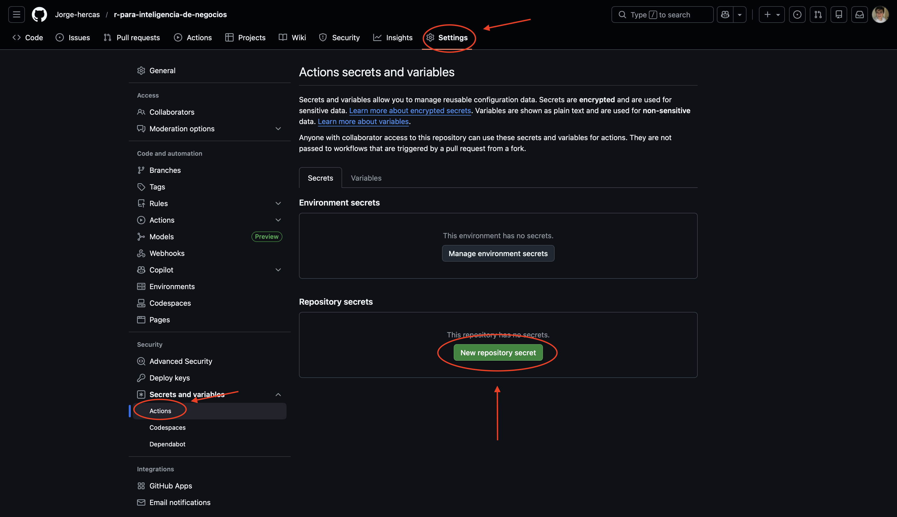
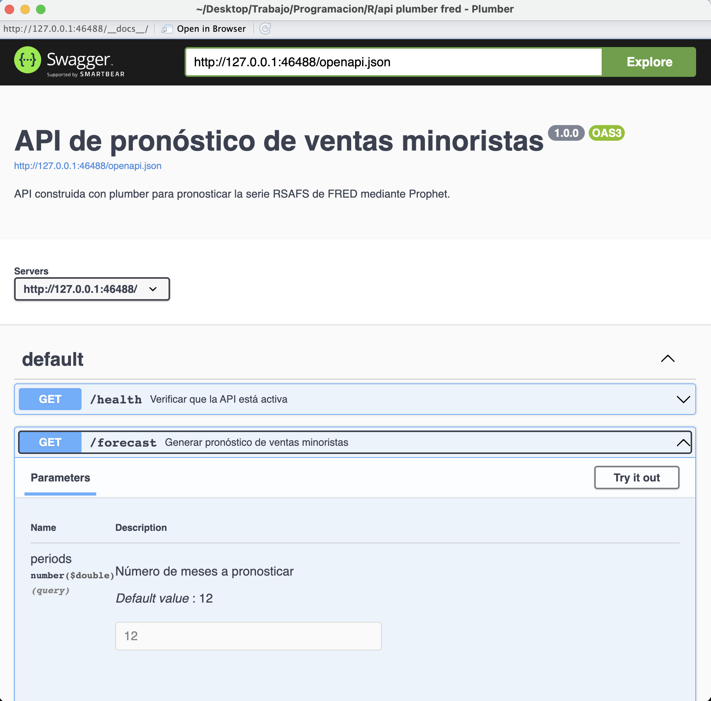
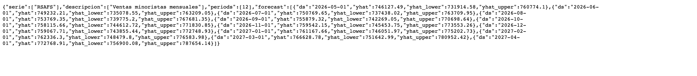
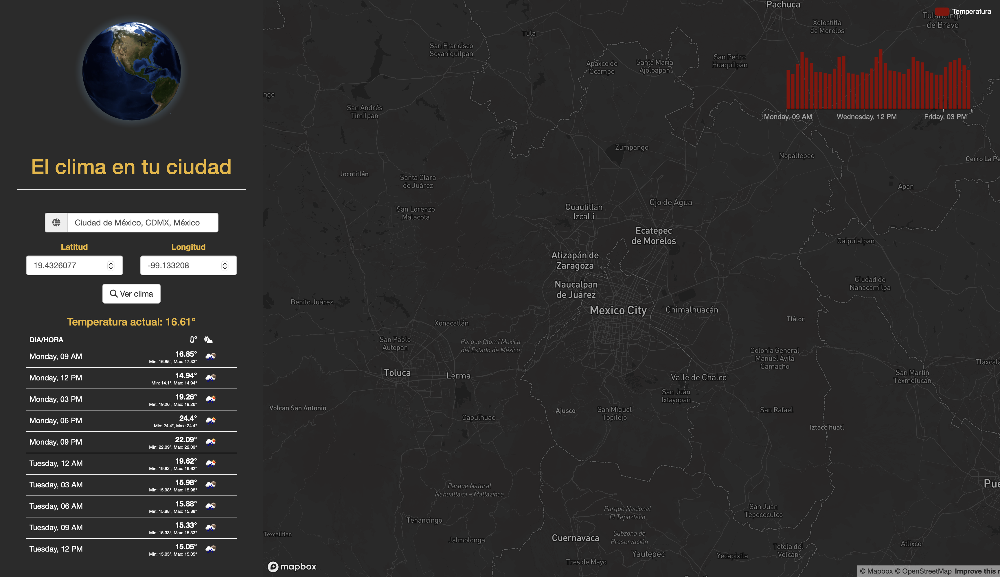
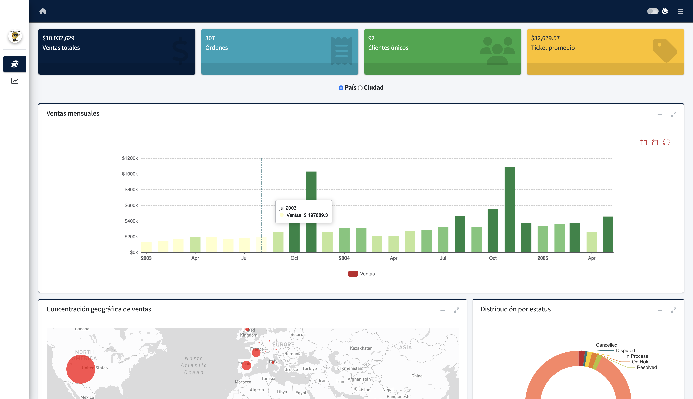
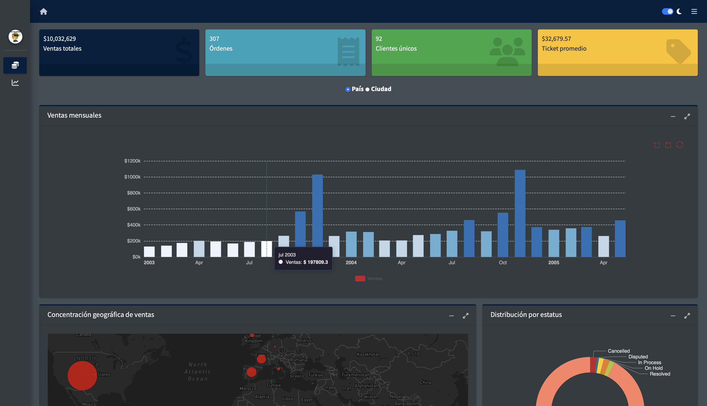
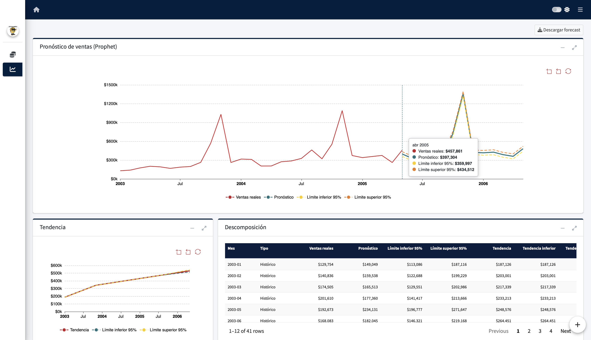
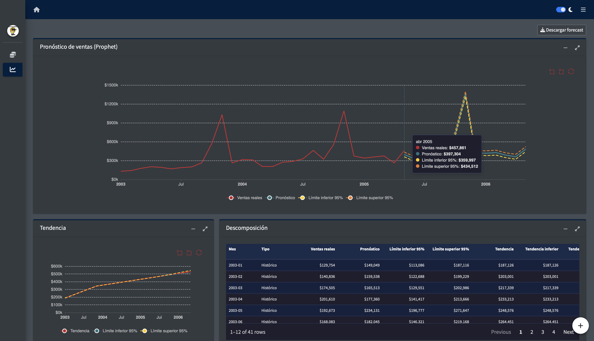

# Planteamiento de la investigación

Durante mucho tiempo, la formación profesional de los economistas se ha concentrado principalmente en el estudio de la teoría económica, las matemáticas, la estadística y la econometría. Estas áreas constituyen una base fundamental para comprender el comportamiento de los mercados, las empresas, los hogares y las instituciones; sin embargo, la forma en la que actualmente se genera, almacena y utiliza la información ha cambiado de manera considerable. Los datos con los que se trabaja dentro de una organización ya no se encuentran necesariamente contenidos en una hoja de cálculo o en un archivo que pueda analizarse de manera aislada, sino que pueden provenir de bases de datos, servicios web, aplicaciones empresariales, sistemas de planificación de recursos, plataformas alojadas en la nube y otros entornos que se actualizan de forma recurrente.
Este cambio ha provocado que el trabajo relacionado con el análisis económico requiera habilidades que van más allá de la aplicación de modelos estadísticos o econométricos. Antes de estimar un modelo, construir un indicador o generar un pronóstico, es necesario localizar la información, extraerla, validar su estructura, identificar errores, transformar variables y, finalmente, preparar un conjunto de datos que pueda utilizarse correctamente. De hecho, en un ambiente laboral, una parte importante del tiempo dedicado a un proyecto analítico no se concentra en la estimación final, sino en todos los procesos previos que permiten obtener datos confiables. Supongamos, por ejemplo, que una empresa desea conocer el comportamiento futuro de sus ventas. En primera instancia, el problema podría parecer relativamente sencillo: obtener los registros históricos, estructurar una serie de tiempo y estimar un modelo de pronóstico. Sin embargo, los datos podrían encontrarse distribuidos en distintas tablas, contener registros duplicados, presentar fechas en formatos diferentes, utilizar monedas distintas o incluir productos que han cambiado de nombre a lo largo del tiempo. Además, la información podría actualizarse diariamente y el resultado tendría que ser consultado por personas que no necesariamente cuentan con conocimientos de programación. En tal caso, la estimación del modelo representa solamente una parte del problema. También sería necesario construir un proceso que extraiga los nuevos registros, aplique las transformaciones requeridas, actualice el modelo, almacene las estimaciones y presente los resultados mediante un reporte, dashboard o aplicación interactiva. Es precisamente en este punto donde el análisis de datos comienza a relacionarse con la ingeniería de datos y donde las herramientas de programación adquieren especial importancia para el economista.No obstante, en algunos programas de formación económica, la programación continúa presentándose únicamente como un recurso complementario para ejecutar modelos estadísticos. Bajo este enfoque, el estudiante aprende a cargar una base previamente preparada, escribir algunas instrucciones y obtener los resultados de una regresión. Aunque esta práctica resulta útil para comprender determinados métodos, no siempre representa las condiciones que encontrará dentro de un entorno profesional, donde los datos rara vez están completamente limpios, organizados y listos para utilizarse.
Esta situación puede generar una separación entre los conocimientos teóricos adquiridos por el economista y las competencias técnicas que necesita para resolver problemas basados en datos. Un profesional puede comprender correctamente los supuestos de un modelo, interpretar sus coeficientes y evaluar su relevancia económica, pero, al mismo tiempo, enfrentar dificultades para conectarse a una base de datos, consultar información mediante SQL, automatizar la actualización de un conjunto de registros o poner sus resultados a disposición de otros usuarios. Lo anterior no significa que el economista deba convertirse necesariamente en un ingeniero de software o asumir todas las funciones de un ingeniero de datos. La intención tampoco es reemplazar la teoría económica por conocimientos de programación. Más bien, se plantea la necesidad de complementar la formación cuantitativa tradicional con herramientas que permitan trabajar con el ciclo de vida completo de los datos. De esta forma, el economista no solamente sería capaz de analizar información, sino también de comprender de dónde proviene, cómo fue transformada, qué problemas de calidad presenta y de qué manera puede utilizarse de forma recurrente. Dentro de este contexto, el lenguaje R representa una alternativa particularmente útil. Aunque suele definirse como un lenguaje orientado a la computación estadística y la creación de gráficos, sus posibilidades no se limitan a estas dos áreas. R permite consultar bases de datos, consumir API, leer información estructurada y no estructurada, realizar procesos de limpieza, desarrollar modelos estadísticos, construir visualizaciones, automatizar tareas y crear aplicaciones web mediante Shiny. También puede integrarse con SQL, HTML, CSS, JavaScript, servicios en la nube y herramientas para el despliegue de modelos.
Esta amplitud hace posible utilizar un solo entorno para cubrir una parte considerable del flujo de trabajo relacionado con los datos. Por ejemplo, un economista podría extraer indicadores económicos mediante una API, almacenarlos en una base de datos, transformar la información, estimar un modelo de series de tiempo, generar un pronóstico y publicar los resultados mediante una aplicación interactiva. Aunque cada una de estas actividades pertenece a una etapa distinta, todas pueden conectarse a través de una misma lógica de programación.

Ahora bien, conocer la sintaxis de R no garantiza por sí solo que una persona sea capaz de resolver problemas reales. Aprender a declarar una variable, crear una función o filtrar una tabla representa únicamente el punto de partida. El verdadero reto consiste en relacionar estas instrucciones con una necesidad concreta, estructurar un proceso y producir un resultado que pueda interpretarse y utilizarse. En otras palabras, el valor de la programación no se encuentra exclusivamente en el código, sino en la capacidad de convertir un problema en una secuencia ordenada de operaciones. Por esta razón, la presente investigación no busca elaborar únicamente una descripción del lenguaje R ni un manual general sobre sus funciones. Su propósito es analizar de qué manera las herramientas de programación pueden fortalecer el trabajo del economista en proyectos de análisis e ingeniería de datos. Para ello, se propone desarrollar una serie de ejercicios aplicados que representen diferentes etapas del ciclo de la información: extracción, almacenamiento, limpieza, transformación, análisis, modelado, automatización y presentación de resultados.

Entre los procesos que pueden considerarse se encuentra la extracción de datos desde archivos, bases relacionales y API; la construcción de un pipeline semiautomatizado; el tratamiento de valores faltantes y registros duplicados; la estimación de modelos estadísticos y predictivos; la generación de pronósticos; y la elaboración de dashboards o aplicaciones web. Estos ejercicios permitirán evaluar a R no solamente como una herramienta estadística, sino como un entorno capaz de integrar distintas tareas que forman parte del trabajo profesional con datos.

La elección de proyectos aplicados responde a una razón sencilla: los conocimientos de programación resultan más claros cuando se utilizan para resolver un problema. Explicar de manera aislada cómo funciona una consulta, un ciclo o una función puede ayudar a comprender la sintaxis, pero no necesariamente permite identificar su utilidad. En cambio, cuando estas herramientas se integran en un flujo completo, es posible observar la relación existente entre cada etapa y entender por qué una decisión tomada durante la extracción o limpieza de los datos puede afectar posteriormente los resultados de un modelo.
También es importante considerar que la ingeniería de datos constituye un campo sumamente amplio. Esta investigación no pretende abarcar todas sus herramientas, arquitecturas o plataformas, ni afirmar que R sustituye a las tecnologías especializadas utilizadas para procesar grandes volúmenes de información. El interés se concentra en aquellos principios y tareas que pueden ser incorporados al trabajo de un economista: conexión con distintas fuentes, construcción de procesos reproducibles, transformación de datos, automatización de actividades y almacenamiento ordenado de resultados.
Bajo esta delimitación, el concepto de ingeniería de datos se utilizará desde una perspectiva aplicada. Es decir, se analizarán los procesos necesarios para trasladar la información desde su fuente original hasta un estado en el que pueda ser estudiada y consumida por otras personas o sistemas. Esto permitirá mostrar que el análisis no comienza en el momento de estimar un modelo, sino desde que se decide qué información se necesita, cómo se obtendrá y qué controles se aplicarán para garantizar su calidad.

El problema central de esta tesina puede resumirse, por lo tanto, en la existencia de una brecha entre las capacidades tradicionales de análisis cuantitativo del economista y las habilidades de programación requeridas para trabajar con información dentro de los entornos actuales. Mientras que la formación económica proporciona elementos valiosos para interpretar fenómenos, construir hipótesis y evaluar resultados, las organizaciones requieren además profesionales capaces de transformar esas ideas en procesos reproducibles y soluciones que puedan mantenerse y utilizarse de manera recurrente.
A partir de este problema surge la necesidad de identificar qué herramientas de programación resultan relevantes para el economista y cómo pueden integrarse mediante R en un flujo práctico de análisis e ingeniería de datos. No se trata únicamente de determinar si R puede realizar determinadas operaciones, pues técnicamente el lenguaje ofrece una gran variedad de posibilidades, sino de establecer cómo dichas posibilidades pueden organizarse para resolver problemas vinculados con la actividad económica y empresarial.

La pregunta principal de la investigación será la siguiente:

*¿De qué manera el lenguaje R puede integrar herramientas de programación, análisis e ingeniería de datos para fortalecer la práctica profesional del economista?*

A partir de esta pregunta general se plantean las siguientes preguntas específicas:

- ¿Qué competencias de programación y manejo de datos resultan relevantes para el economista dentro de los entornos profesionales actuales?

- ¿Cómo puede utilizarse R para extraer, limpiar, transformar y almacenar información proveniente de diferentes fuentes?

- ¿De qué forma pueden integrarse los métodos estadísticos y económicos con procesos de automatización y preparación de datos?

- ¿Qué ventajas y limitaciones presenta R para desarrollar pipelines, modelos analíticos y aplicaciones orientadas a la toma de decisiones?

- ¿Cómo pueden presentarse los resultados de un análisis para que sean interpretados y utilizados por personas sin conocimientos de programación?

Estas preguntas permiten mantener un hilo conductor entre los diferentes proyectos que se desarrollarán en la tesina. Cada ejercicio no se presentará como un ejemplo completamente independiente, sino como evidencia de una etapa dentro de un proceso más amplio. La intención será demostrar que el economista puede utilizar la programación para pasar de los datos originales a una solución analítica funcional.

## Objetivo general

Analizar la aplicación del lenguaje R como una herramienta integradora para el desarrollo de procesos de análisis e ingeniería de datos, mediante la implementación de ejercicios prácticos relacionados con la extracción, preparación, modelado, automatización y presentación de información relevante para la práctica profesional del economista.

## Objetivos específicos

- Identificar las principales necesidades de programación y manejo de datos que enfrenta el economista al desarrollar proyectos analíticos en entornos profesionales.

- Describir las capacidades del lenguaje R para trabajar con archivos, bases de datos, API y otras fuentes de información.
Aplicar técnicas de limpieza y transformación que permitan corregir problemas comunes de calidad, estructura y consistencia de los datos.

- Construir procesos reproducibles para la extracción, actualización y almacenamiento de información.
Integrar métodos estadísticos, econométricos y predictivos en flujos de trabajo orientados a la solución de problemas económicos o empresariales.

- Desarrollar mecanismos para automatizar parcial o totalmente la ejecución de los procesos analíticos.

- Presentar los resultados mediante visualizaciones, reportes o aplicaciones interactivas que faciliten su interpretación.
Examinar las ventajas y limitaciones de R como herramienta para complementar la formación y el trabajo profesional del economista.

## Justificación

La relevancia de esta investigación radica, en primer lugar, en la creciente disponibilidad de información. Actualmente, instituciones públicas, empresas y organizaciones generan datos de manera continua. Sin embargo, contar con grandes cantidades de información no garantiza que esta pueda ser aprovechada. Para producir conocimiento es necesario establecer procedimientos que permitan obtener los datos correctos, evaluar su calidad, transformarlos y relacionarlos con una pregunta específica.
El economista posee una formación particularmente útil para este propósito, ya que cuenta con herramientas para analizar incentivos, interpretar relaciones entre variables, evaluar escenarios y estudiar el comportamiento de distintos agentes. No obstante, cuando estas capacidades se combinan con conocimientos de programación, su alcance puede ampliarse considerablemente. Un análisis que anteriormente se realizaba de manera manual puede convertirse en un proceso automatizado; una estimación individual puede transformarse en un servicio que se actualiza con nuevos datos; y un conjunto de resultados estáticos puede presentarse mediante una aplicación que permita a cada usuario explorar la información de acuerdo con sus necesidades.

Desde una perspectiva académica, esta tesina permitirá relacionar conocimientos de economía, estadística y econometría con principios propios del análisis y la ingeniería de datos. Esta relación es importante porque evita estudiar la programación como una disciplina aislada. R no se utilizará únicamente para repetir operaciones que podrían realizarse en una hoja de cálculo, sino para estructurar procesos que sean reproducibles, escalables y verificables.
La reproducibilidad resulta especialmente relevante. Cuando un procedimiento depende de modificaciones manuales, copiar y pegar información o ejecutar una larga serie de pasos sin documentación, aumenta la posibilidad de cometer errores. En cambio, cuando las transformaciones se encuentran expresadas mediante código, cada paso puede revisarse, repetirse y ajustarse. Esto no elimina por completo los errores, pero permite identificar con mayor claridad dónde se originaron y qué información fue afectada. La automatización representa otra ventaja importante. Supongamos que se necesita actualizar mensualmente un pronóstico económico. Si en cada periodo una persona debe descargar los datos, modificar el archivo, estimar nuevamente el modelo y copiar los resultados a un reporte, el procedimiento consume tiempo y depende excesivamente de la intervención manual. Mediante R, el proceso puede organizarse en funciones que extraigan los nuevos registros, validen su estructura, actualicen el modelo y almacenen las estimaciones. Posteriormente, los resultados pueden mostrarse en un dashboard o ser consumidos por otro sistema.

Del mismo modo, la utilización de SQL permite acercar el análisis económico a las condiciones reales en las que se almacena la información. Aunque las hojas de cálculo continúan siendo herramientas valiosas, presentan limitaciones cuando el volumen de datos aumenta, existen múltiples usuarios o la información se actualiza con mucha frecuencia. Comprender cómo consultar tablas, establecer relaciones y seleccionar únicamente los registros necesarios constituye una habilidad que facilita el trabajo con bases empresariales y reduce la dependencia de archivos preparados por terceros.
Por otra parte, R ofrece ventajas relacionadas con la presentación de los resultados. Una solución analítica tiene poco valor si solamente puede ser interpretada por la persona que escribió el código. Los gráficos, reportes y aplicaciones interactivas permiten comunicar los hallazgos y ponerlos a disposición de otros usuarios. Shiny, por ejemplo, hace posible crear interfaces en las que una persona puede seleccionar periodos, regiones, productos u otras variables sin modificar directamente el programa. Esto resulta importante porque, dentro de una organización, quienes toman decisiones no siempre son quienes desarrollan los modelos. El analista debe ser capaz de traducir procedimientos técnicos en resultados comprensibles. En consecuencia, el flujo de trabajo no termina al obtener una estimación estadísticamente adecuada, sino cuando esta puede utilizarse para responder una pregunta y apoyar una decisión. 

También existe una justificación profesional. Las actividades realizadas por economistas se han diversificado y actualmente incluyen áreas como inteligencia de negocios, ciencia de datos, análisis de riesgos, pronósticos, evaluación de políticas, mercadotecnia, finanzas, logística y planeación. En todas ellas se requiere trabajar con información, aunque con diferentes niveles de complejidad. El conocimiento de herramientas de programación permite que el economista participe en una mayor parte del proceso y se comunique mejor con especialistas de otras disciplinas. Sin embargo, esta investigación tampoco pretende presentar a R como una solución universal. En proyectos de gran escala pueden requerirse herramientas especializadas, infraestructura distribuida y lenguajes adicionales. La elección dependerá del volumen de datos, la frecuencia de actualización, los requerimientos de seguridad y el entorno tecnológico de cada organización. Precisamente por esta razón, uno de los propósitos de la tesina será identificar tanto las capacidades como las limitaciones del lenguaje. La aportación del trabajo será principalmente práctica y metodológica. A través de los proyectos seleccionados se propondrá una ruta que permita al economista comprender el ciclo completo de los datos. Esta ruta comenzará con la identificación y extracción de la información, continuará con su limpieza y transformación, incorporará métodos de análisis y modelado, y finalizará con la automatización y comunicación de los resultados.

En síntesis, la investigación se justifica porque aborda una necesidad presente en la práctica profesional: complementar la capacidad analítica del economista con herramientas que le permitan construir soluciones basadas en datos. El verdadero valor de R no estará solamente en la cantidad de paquetes disponibles o en la posibilidad de ejecutar modelos complejos, sino en su capacidad para reunir diferentes etapas dentro de un proceso ordenado y reproducible.

## Delimitación de la investigación

La investigación se concentrará en la aplicación de R a proyectos de análisis e ingeniería de datos relacionados con el trabajo del economista. Se utilizará SQL como herramienta complementaria para consultar y almacenar información, además de librerías de R destinadas a la manipulación de datos, el consumo de API, la estimación de modelos, la automatización de procesos y la creación de visualizaciones o aplicaciones interactivas.

El alcance será aplicado y demostrativo. No se buscará comparar exhaustivamente todos los lenguajes de programación ni todas las plataformas disponibles. Tampoco se pretende desarrollar una arquitectura empresarial de gran escala. Los proyectos servirán para representar problemas suficientemente cercanos a un entorno real, pero utilizando conjuntos de datos públicos, simulados o de libre acceso que permitan reproducir los resultados.

De manera general, el trabajo comprenderá las siguientes etapas:

1. Obtención de datos desde diferentes fuentes.
2. Limpieza, validación y transformación de la información.
3. Almacenamiento y consulta mediante estructuras reproducibles.
4. Aplicación de métodos estadísticos, econométricos o predictivos.
5. Automatización parcial de los procesos desarrollados.
6. Visualización y presentación de resultados.
7. Evaluación de las ventajas y limitaciones encontradas.

Las cuales serán desarrolladas a partir de proyectos prácticos de inicio a fin, lo que demostrará su potencial en un entorno real. Finalmente, se espera demostrar que la programación puede funcionar como un vínculo entre la formación teórica del economista y las necesidades actuales de las organizaciones. Más que sustituir los conocimientos económicos, herramientas como R y SQL permiten aplicarlos dentro de procesos más amplios, dinámicos y cercanos a la realidad profesional. De esta manera, el economista no se limita a recibir una base de datos y estimar un modelo, sino que adquiere la capacidad de comprender, construir y comunicar una solución a lo largo de todo el ciclo de la información.

# Marco teórico: programación orientada a los datos

## El economista frente al análisis de datos

Tradicionalmente, la formación de un economista se encuentra estrechamente relacionada con el análisis de información. A través de la estadística, la econometría y la teoría económica, este profesional adquiere herramientas para formular hipótesis, identificar relaciones entre variables y estudiar el comportamiento de empresas, consumidores, mercados e instituciones. Sin embargo, la forma en la que actualmente se genera y almacena la información ha cambiado de manera considerable.

En un entorno profesional, los datos no siempre se encuentran en una hoja de cálculo completamente limpia y preparada para su análisis. Estos pueden provenir de bases de datos, API, sistemas empresariales y archivos con distintas estructuras. Además, es común encontrar valores faltantes, registros duplicados, formatos inconsistentes o información distribuida en diferentes fuentes. Por esta razón, antes de estimar un modelo o construir un indicador, será necesario extraer, validar, limpiar y transformar los datos. Supongamos, por ejemplo, que una empresa desea pronosticar sus ventas. Aunque el objetivo final sea estimar una serie de tiempo, primero deberán localizarse los registros, identificar las operaciones canceladas, corregir fechas, unificar monedas y establecer un mecanismo para incorporar nuevos datos. En este caso, el modelo estadístico representa solamente una parte del proceso. La programación permite organizar estas actividades dentro de un flujo reproducible. Mediante código es posible documentar las transformaciones, automatizar tareas repetitivas y reducir la dependencia de procedimientos manuales. Esto no significa que la programación sustituya el razonamiento económico, sino que proporciona los medios necesarios para aplicar dicho razonamiento sobre información proveniente de entornos reales.
En este sentido, R constituye una herramienta útil para complementar la formación del economista. Además de sus capacidades estadísticas, permite consultar bases de datos, consumir API, limpiar información, desarrollar modelos predictivos, automatizar procesos y construir aplicaciones interactivas. De esta manera, puede utilizarse en diferentes etapas del ciclo de vida de los datos [@wickham2017r].

No obstante, conocer la sintaxis de un lenguaje no garantiza la solución de un problema. El valor de la programación se encuentra en la capacidad de convertir una necesidad concreta en una secuencia ordenada de operaciones. De poco serviría construir un modelo complejo si sus resultados no responden una pregunta relevante o no pueden ser interpretados por las personas responsables de tomar decisiones. Por lo tanto, el economista frente al análisis de datos requiere integrar tres tipos de conocimientos: razonamiento económico para formular e interpretar problemas; herramientas estadísticas para evaluar relaciones y construir estimaciones; y habilidades de programación para obtener, procesar y presentar información. Estas áreas no deben entenderse de manera aislada, ya que la utilidad del análisis depende de su correcta integración.

Los proyectos desarrollados en esta tesina representarán distintas etapas de este proceso. Primero se construirá un pipeline semiautomatizado para obtener y almacenar información; posteriormente, se pondrá en producción un modelo de series de tiempo; y, finalmente, se utilizará Shiny para presentar los resultados mediante aplicaciones interactivas. Así, se mostrará que el trabajo del economista no comienza únicamente al estimar un modelo, sino desde la obtención de los datos y termina cuando los resultados pueden ser utilizados para apoyar una decisión.

## El ciclo de vida de los datos

El ciclo de vida de los datos comprende las diferentes etapas por las que atraviesa la información desde el momento en que es generada u obtenida, hasta que se utiliza para producir un análisis, responder una pregunta o apoyar la toma de decisiones. Aunque este proceso puede cambiar dependiendo del proyecto, generalmente incluye la extracción, almacenamiento, limpieza, transformación, análisis y presentación de los resultados.

En primera instancia, será necesario identificar de dónde provienen los datos. Estos pueden encontrarse en archivos locales, bases de datos, API, plataformas empresariales o servicios alojados en la nube. La elección del método de extracción dependerá del tipo de fuente, su estructura y la frecuencia con la que se actualiza. No será lo mismo analizar un archivo estático que trabajar con información que cambia diariamente. Una vez obtenidos los datos, el siguiente paso será almacenarlos y verificar su calidad. En esta etapa pueden aparecer valores faltantes, registros duplicados, fechas incorrectas o diferencias entre las categorías utilizadas por cada fuente. Antes de realizar cualquier análisis, estos problemas deberán identificarse y corregirse, ya que la calidad de los resultados dependerá directamente de la información utilizada.

Posteriormente, los datos serán transformados de acuerdo con las necesidades del proyecto. Esto puede incluir seleccionar variables, unir tablas, crear indicadores, modificar formatos o agrupar observaciones. Después de estas transformaciones, la información podrá utilizarse para generar visualizaciones, realizar análisis estadísticos o estimar modelos predictivos.
Sin embargo, el proceso no termina al obtener un resultado. Este también deberá almacenarse, comunicarse y ponerse a disposición de otros usuarios. Para ello pueden utilizarse reportes, dashboards, aplicaciones web o API. Además, cuando la información se actualiza de manera recurrente, será necesario automatizar parte del flujo para incorporar nuevos registros y generar resultados actualizados.

Aunque suele representarse como una secuencia lineal, el ciclo de vida de los datos es un proceso dinámico. Un error identificado durante el análisis puede obligarnos a regresar a la etapa de limpieza, mientras que una nueva necesidad del usuario podría requerir variables adicionales. Por esta razón, cada etapa deberá mantenerse documentada y organizada.
En los proyectos desarrollados en esta tesina, el ciclo comenzará con la extracción y almacenamiento de información, continuará con su transformación y modelado, y finalizará con la presentación de los resultados mediante aplicaciones interactivas. De esta forma, R será utilizado como una herramienta para conectar las diferentes etapas y construir procesos reproducibles orientados al análisis económico y empresarial.

## Diferencia y relación entre análisis e ingeniería de datos

El análisis y la ingeniería de datos son dos disciplinas que participan en distintas etapas del ciclo de vida de la información. Aunque ambas trabajan con datos y pueden utilizar herramientas similares, sus objetivos no son exactamente los mismos. Mientras que la ingeniería de datos se concentra principalmente en obtener, integrar, transformar y almacenar información, el análisis de datos busca utilizarla para responder preguntas, identificar patrones y apoyar la toma de decisiones. Esta diferencia puede parecer sencilla; sin embargo, en la práctica, la separación entre ambas áreas no siempre resulta tan clara. En proyectos pequeños, una misma persona podría conectarse a una fuente, extraer los registros, corregir los errores, desarrollar un modelo y presentar los resultados. Por el contrario, dentro de una organización con grandes volúmenes de información, estas actividades pueden distribuirse entre diferentes equipos de ingeniería, análisis, ciencia de datos e inteligencia de negocios.

Independientemente de cómo se dividan las responsabilidades, ambas disciplinas mantienen una relación estrecha. Un análisis dependerá de que la información se encuentre disponible y correctamente preparada; mientras que un proceso de ingeniería tendrá sentido en la medida en que proporcione datos útiles para resolver una necesidad. Por esta razón, será importante que el economista comprenda no solamente cómo analizar una base terminada, sino también los procesos que permitieron obtenerla.

### Análisis de datos

El análisis de datos comprende el conjunto de procedimientos utilizados para examinar, resumir, interpretar y modelar información. Su principal objetivo consiste en transformar los datos disponibles en resultados que permitan comprender un fenómeno, evaluar una hipótesis o tomar una decisión, donde dependiendo del objetivo planteado, el análisis puede dividirse en diferentes categorías. El análisis descriptivo busca conocer qué ocurrió mediante indicadores, tablas y visualizaciones. El análisis diagnóstico intenta identificar los factores relacionados con un determinado resultado. El análisis predictivo utiliza información histórica para estimar comportamientos futuros. Finalmente, el análisis prescriptivo busca evaluar alternativas y recomendar una posible decisión [@tukey1977eda].

Supongamos, por ejemplo, que una empresa observa una disminución en sus ingresos. En primera instancia, un análisis descriptivo permitiría identificar el periodo, las regiones y las líneas de producto en las que ocurrió esta reducción. Posteriormente, podrían estudiarse factores como los precios, la cantidad vendida, la disponibilidad de inventario o el comportamiento de determinados clientes. Finalmente, se podría construir un modelo para pronosticar las ventas de los siguientes meses y evaluar diferentes escenarios. Este proceso no consiste únicamente en ejecutar un método estadístico, ya que antes de seleccionar una técnica, será necesario formular correctamente la pregunta, identificar las variables disponibles y comprender el contexto de la información. Además, una vez obtenidos los resultados, deberán interpretarse considerando sus supuestos y limitaciones. En este sentido, la formación del economista representa una ventaja importante. Los conocimientos de teoría económica, estadística y econometría permiten analizar relaciones entre variables, formular hipótesis y distinguir entre una asociación estadística y una posible relación causal. Sin embargo, estas capacidades deberán complementarse con herramientas que permitan trabajar con la información bajo condiciones reales (las cuales, prácticamente nunca, tienen las condiciones ideales).

Entre las actividades más comunes dentro del análisis de datos se encuentran:

- El cálculo de estadísticas descriptivas e indicadores.
- La exploración de relaciones entre variables.
- La identificación de tendencias y valores atípicos.
- La construcción de visualizaciones.
- La comparación de grupos o periodos.
- La estimación y validación de modelos.
- La generación de pronósticos.
- La comunicación e interpretación de resultados.

Personalmente, después de haber trabajado varios años en análisis de datos, puedo confirmar que las actividades más comumnes (ignorando la limpieza de datos, que suele representar el 60% del tiempo gastado de desarrollo) suelen ir relacionadas a la visualización de datos.

Ahora bien, el producto final del análisis puede tomar distintas formas. En algunos casos será un reporte; en otros, un conjunto de indicadores, una visualización, un modelo predictivo o una aplicación interactiva [@R-shiny]. Sin importar el formato utilizado, el resultado deberá responder la pregunta planteada y ser comprensible para las personas que lo utilizarán. Sin embargo, para llegar a esta etapa se requiere que los datos se encuentren disponibles, organizados y con un nivel adecuado de calidad. Es aquí donde comienza la relación directa con la ingeniería de datos.

### Ingeniería de datos

La ingeniería de datos se concentra en los procesos necesarios para obtener, transportar, transformar y almacenar información. Su objetivo principal consiste en construir flujos que permitan que los datos se encuentren disponibles para su análisis o consumo por parte de otros sistemas. En un escenario sencillo, este proceso podría limitarse a importar un archivo y realizar algunas modificaciones. No obstante, dentro de una organización, la información puede provenir de diferentes fuentes y actualizarse con distintas frecuencias. Los datos podrían encontrarse en bases relacionales, archivos, API, plataformas empresariales o servicios alojados en la nube. Cada una de estas fuentes tendrá su propia estructura y sus propios mecanismos de acceso.

Supongamos que se desea construir un conjunto histórico de información climática. La fuente puede proporcionar datos mediante una API que se actualiza varias veces al día. Para conservar estos registros será necesario enviar una solicitud, validar la respuesta, seleccionar las variables relevantes, transformar algunos valores y almacenarlos en una base de datos. Además, el proceso deberá evitar la creación de duplicados y registrar cualquier error que ocurra durante la extracción. En este caso, la ingeniería de datos no analiza todavía el comportamiento del clima ni genera un pronóstico. Su función consiste en asegurar que la información sea obtenida y almacenada de manera ordenada para que pueda utilizarse posteriormente [@reis2022fundamentals].

Entre las actividades relacionadas con la ingeniería de datos se encuentran:

- La identificación de las fuentes de información.
- La extracción de datos desde archivos, bases de datos o API.
- La integración de registros provenientes de diferentes sistemas.
- La transformación y estandarización de formatos.
- El almacenamiento de la información.
- La construcción de pipelines.
- La automatización de procesos.
- El control de errores y la generación de notificaciones.
- La validación de la calidad y consistencia de los datos.
- La actualización periódica de los registros.

Esta área, a pesar de ser mucho más técnica que la relacionada al análisis de datos, personalmente me parece bastante más interesante, ya que requiere de un tipo de conocimientos técnicos y tecnologías bastante más retadoras en la práctica  (típicamente, entornos de AWS, Azure, etc, así como bases de datos en la nube, desarrollos a producción, etc).

Uno de los conceptos más importantes dentro de esta área es el pipeline de datos. Un pipeline puede entenderse como una secuencia ordenada de actividades mediante las cuales la información se traslada desde su fuente original hasta un destino. Durante este recorrido, los datos pueden ser limpiados, transformados, validados y preparados para su consumo.

Un pipeline no tiene que ser completamente automático para resultar útil. En algunos casos será suficiente con construir un proceso semiautomatizado que ejecute la mayoría de las actividades y requiera intervención únicamente cuando se presente algún error. Lo verdaderamente importante será que las reglas del proceso se encuentren claramente definidas y puedan repetirse de manera consistente. También será necesario considerar que un proceso automatizado no siempre funcionará correctamente. Una API puede dejar de responder, la estructura de un archivo puede cambiar o una conexión con la base de datos puede interrumpirse. Por esta razón, la ingeniería de datos también debe incorporar mecanismos para detectar y manejar estos problemas. Aquí será importante distinguir entre transportar información y garantizar su utilidad. Un pipeline podría ejecutarse correctamente y almacenar miles de registros, pero esto no significa necesariamente que los datos sean adecuados. Será necesario comprobar que las variables tengan los formatos esperados, que no existan duplicados indebidos y que los valores se encuentren dentro de rangos razonables.

### Relación entre ambas disciplinas

La ingeniería y el análisis de datos forman parte de un mismo proceso. La primera prepara y proporciona la información; la segunda la utiliza para generar resultados. Por lo tanto, la calidad de un análisis dependerá considerablemente de las decisiones tomadas durante la extracción, transformación y almacenamiento de los datos. 

Supongamos que se desea construir un modelo para pronosticar ventas mensuales. Si durante el proceso de extracción se incluyen pedidos cancelados como ventas efectivas, el modelo utilizará información incorrecta. De manera similar, si existen registros duplicados, el importe mensual podría encontrarse sobreestimado. Aunque el modelo estadístico esté correctamente especificado, sus resultados serán poco confiables porque el problema se originó en una etapa anterior. La relación también funciona en sentido contrario. Las necesidades del análisis determinan qué información debe obtenerse y cómo deberá estructurarse. Si se quiere estudiar el comportamiento mensual de las ventas por país y línea de producto, el pipeline tendrá que conservar las fechas, ubicaciones, categorías e importes correspondientes. Extraer una gran cantidad de columnas que no serán utilizadas solamente incrementaría el consumo de recursos sin aportar información relevante. Por esta razón, la relación entre ambas áreas no debe entenderse únicamente como una entrega de datos de un equipo a otro. Lo ideal será que exista comunicación entre quienes construyen los procesos y quienes realizan el análisis. El conocimiento de la pregunta de negocio permite diseñar mejores flujos de información, mientras que comprender la estructura de los datos ayuda a establecer análisis más realistas.

Ahora, seguramente recordarás que mencioné en el punto previo que una gran cantidad del trabajo de análisis de datos se enfoca en la limpieza, a pesar de que esta tarea es, *propiamente*, de la rama de la ingeniería de datos. Esto es verdad, sin embargo, en la práctica no es raro ver que no exista una clara división entre estas áreas, por lo que los analistas suelen realizar actividades de este estilo en una gran mayoría de los proyectos asignados (aunque esto solo es una nota adicional).

## El lenguaje R como herramienta integradora

R es un lenguaje de programación especialmente conocido por sus aplicaciones en estadística, análisis y visualización de datos. Sin embargo, sus posibilidades no se limitan únicamente a la estimación de modelos o la creación de gráficos. Gracias a su amplia variedad de librerías y a su capacidad para conectarse con otras tecnologías, R puede utilizarse en diferentes etapas del ciclo de vida de los datos. Esta característica permite considerarlo como una herramienta integradora. Dentro de un mismo entorno será posible extraer información desde distintas fuentes, transformar los registros, aplicar métodos estadísticos, automatizar procesos y presentar los resultados. De esta forma, el usuario no tendrá que cambiar constantemente de herramienta para realizar cada actividad, aunque en algunos proyectos será necesario complementar R con bases de datos, servicios en la nube u otros lenguajes [@chan2018data].

Aunque frecuentemente se presenta a R como un lenguaje orientado a la computación estadística, cuenta con las características necesarias para construir programas y organizar procesos completos. Mediante R será posible crear objetos, funciones, estructuras de control y procedimientos que puedan ejecutarse de manera repetitiva. Esta capacidad resulta importante al trabajar con datos, ya que permite convertir una serie de actividades manuales en instrucciones reproducibles. Supongamos, por ejemplo, que mensualmente se recibe un archivo con información de ventas. En lugar de abrir el documento, eliminar columnas, modificar fechas y calcular indicadores de forma manual, puede construirse un programa que ejecute automáticamente estas transformaciones. Además, R es un lenguaje de código abierto, por lo que puede utilizarse sin adquirir una licencia. También dispone de una comunidad que desarrolla librerías para atender diferentes necesidades. Algunas se encuentran enfocadas en manipulación y visualización, mientras que otras permiten conectarse a bases de datos, consumir API, construir modelos o crear aplicaciones web.

Ahora bien, la disponibilidad de estas herramientas no significa que sea necesario utilizar R para todas las actividades de un proyecto. La elección dependerá de la cantidad de información, la infraestructura disponible y las necesidades de la organización. Sin embargo, para proyectos analíticos de pequeña o mediana escala, R puede cubrir una parte considerable del proceso.

### Integración con distintas fuentes de datos

Uno de los primeros pasos de cualquier análisis consiste en obtener la información. R permite trabajar con archivos como CSV, Excel, TXT, JSON y RDS, además de conectarse con hojas de cálculo alojadas en línea y otras fuentes externas.
También puede establecer conexiones con gestores de bases de datos como MySQL, SQL Server, PostgreSQL o Snowflake. Mediante paquetes como `DBI`, el usuario puede enviar consultas SQL desde una sesión de R, recuperar únicamente los registros necesarios y utilizar los resultados dentro del análisis. Esta integración evita que toda la información tenga que descargarse manualmente. Supongamos que una empresa almacena millones de registros de ventas en una base de datos. En lugar de exportar la tabla completa, será posible realizar una consulta que seleccione únicamente las columnas, periodos y productos requeridos. Posteriormente, los datos obtenidos podrán transformarse y analizarse desde R. De la misma manera, R permite consumir información proporcionada mediante API. Estas interfaces facilitan el intercambio de datos entre aplicaciones y generalmente devuelven respuestas en formatos como JSON. Una vez obtenida la respuesta, R puede convertirla en una estructura tabular, seleccionar las variables relevantes y almacenar los resultados. Esta capacidad será utilizada en los proyectos de la tesina, tanto para obtener información climática como para actualizar la serie empleada en el modelo predictivo.


### Transformación y análisis de información

Después de obtener los datos, será necesario prepararlos para su análisis. R ofrece diferentes herramientas para seleccionar columnas, filtrar observaciones, crear variables, unir tablas, realizar agrupaciones y modificar formatos.
El conjunto de paquetes conocido como tidyverse proporciona una sintaxis relativamente clara para desarrollar estas operaciones. Por ejemplo, `dplyr` permite transformar tablas; `tidyr` facilita la reorganización de la información; y `lubridate` ayuda a trabajar con fechas y horas. Estas herramientas permiten expresar una secuencia de transformaciones de forma ordenada. Cada instrucción representa una operación específica, lo que facilita revisar el proceso y ejecutarlo nuevamente cuando aparezcan nuevos registros. Esto resulta especialmente útil al construir pipelines, ya que las reglas de limpieza no tendrán que aplicarse manualmente en cada actualización. 

(Existen algunas otras librerías para transformaciones mucho más específicas, como `purrr`, `forcats`, etc, pero por ahora no las incuiremos en este análisis, ya que no son necesarias para los proyectos a realizar).

Una vez preparada la información, R dispone de una amplia variedad de métodos estadísticos y predictivos. Estos pueden utilizarse para realizar análisis exploratorios, comparar grupos, estimar regresiones, segmentar observaciones o generar pronósticos. Al encontrarse dentro del mismo entorno, los resultados de un modelo pueden incorporarse directamente a las etapas posteriores.

### Automatización y puesta en producción

R, como en cualquier lenguaje de programación orientada a objetos, también puede utilizarse para ejecutar procesos de manera automática o semiautomática. Un programa puede organizarse mediante funciones que realicen tareas específicas, como consultar una fuente, validar la información, actualizar una tabla o generar un pronóstico. Estas funciones pueden programarse para ejecutarse periódicamente mediante herramientas externas o servicios alojados en la nube. Además, es posible incorporar mecanismos de manejo de errores para registrar fallas (`tryCatch()`), detener una carga o enviar una notificación. 

Típicamente, los métodos más comunes de automatización con R son mediante el programador de tareas **CRON** de Linux/Unix, utilizando notebooks en databricks o Microsoft Fabric (aunque este último es de costo) o mediante Github Actions, definiendo los procesos en un archivo `YAML`. 

En el caso de los modelos predictivos, R permite ir más allá de la estimación realizada dentro de una sesión local. Mediante herramientas como la librería `plumber`, una función puede convertirse en una API que reciba solicitudes y devuelva resultados. De esta manera, otros programas no necesitarán ejecutar directamente el código del modelo, sino que podrán consultarlo mediante un endpoint. Asimismo, el proceso puede empaquetarse dentro de un contenedor de Docker. Esto permite incluir el código, las librerías y las configuraciones necesarias para ejecutar la solución en diferentes entornos. Así, se reduce la posibilidad de que el programa funcione en una computadora, pero presente errores en otra debido a diferencias entre versiones o dependencias.

### Presentación de resultados

El ciclo de los datos no termina con la estimación de un modelo. Los resultados deberán comunicarse de forma clara y ponerse a disposición de las personas que los utilizarán. R permite crear gráficos, tablas, reportes y aplicaciones interactivas.
Mediante `ggplot2` (librería de la que no soy muy fanático) pueden construirse visualizaciones estáticas [@wickham2024ggplot2], mientras que otras librerías, como `echarts4r` [@R-echarts4r] (mucho mejor alternativa que `plotly`) permiten utilizar gráficos basados en JavaScript. Estas alternativas proporcionan interactividad y permiten que el usuario consulte valores, seleccione categorías o explore diferentes periodos. 

Por otra parte, Shiny permite transformar análisis realizados en R en aplicaciones web. Una aplicación puede incluir filtros, indicadores, tablas, mapas, gráficos y opciones para descargar información. El usuario final no necesita modificar el código, ya que interactúa con los resultados mediante una interfaz.

Supongamos que se desarrolla un análisis de ventas por país y línea de producto. Mediante Shiny, una persona podría seleccionar las categorías de interés y obtener indicadores actualizados. La aplicación ejecutaría internamente las transformaciones requeridas y mostraría solamente los resultados correspondientes a la selección.

### Ventajas y limitaciones de R

Entre las principales ventajas de R se encuentra su especialización en el análisis de datos, la disponibilidad de librerías y su integración con diferentes fuentes y tecnologías. Además, su naturaleza de código abierto facilita el acceso y permite desarrollar soluciones sin depender necesariamente de licencias comerciales. R también favorece la reproducibilidad. Las operaciones aplicadas pueden conservarse mediante scripts o documentos, haciendo posible repetir el análisis y revisar cada transformación. De igual forma, permite pasar de un análisis exploratorio a una aplicación o proceso productivo sin abandonar completamente el entorno de trabajo. Sin embargo, R también presenta algunas limitaciones, por ejemplo, su desempeño puede disminuir al trabajar localmente con volúmenes de información superiores a la memoria disponible. Además, ciertas implementaciones empresariales pueden requerir herramientas especializadas de orquestación, procesamiento distribuido, seguridad y monitoreo.

Considerando lo anterior, R no debe considerarse como un sustituto universal de todas las tecnologías relacionadas con datos. Su valor se encuentra en su capacidad para integrarse con ellas y cubrir una parte considerable del proceso analítico. En algunos casos será la herramienta principal; en otros, funcionará como un componente dentro de una arquitectura más amplia (además del hecho de que actualizar una librería en R no suele arruinar un entorno de trabajo por incompatibilidad de versiones, como si suele pasar en Python, lo cual a mi parecer es una ventaja increíble).

En los proyectos de esta tesina, R servirá como el elemento que conecta las diferentes etapas del ciclo de vida de los datos. Se utilizará para obtener información, realizar transformaciones, desarrollar un pipeline, estimar un modelo de series de tiempo, ponerlo en producción y presentar los resultados mediante aplicaciones interactivas. De esta manera, se evaluará su utilidad no solamente como herramienta estadística, sino como un lenguaje capaz de integrar procesos de análisis e ingeniería de datos.

## Pipelines de datos

Un pipeline de datos puede entenderse como una secuencia organizada de procesos mediante los cuales la información se traslada desde una o varias fuentes hasta un destino en el que pueda almacenarse, analizarse o utilizarse por otros sistemas. Durante este recorrido, los datos pueden ser extraídos, validados, transformados y estructurados de acuerdo con las necesidades del proyecto. Aunque el término puede parecer complejo, su lógica es relativamente sencilla, por ejemplo, supongamos que diariamente necesitamos consultar información climática mediante una API, modificar algunas variables y almacenar los resultados en una base de datos. Si estas actividades se realizan de manera aislada y manual, todavía no existe un flujo claramente definido [@paraskevas2025data]. En cambio, cuando se organizan como una secuencia que puede ejecutarse de forma recurrente, comienza a construirse un pipeline.

La principal finalidad de estos procesos será garantizar que los datos se encuentren disponibles, actualizados y preparados para su consumo. De esta manera, el analista no tendrá que repetir manualmente las mismas actividades cada vez que aparezcan nuevos registros.

### Componentes de un pipeline

El primer componente de un pipeline será la fuente de información. Los datos pueden provenir de archivos, bases relacionales, API, servicios en la nube o sistemas empresariales. Un mismo pipeline también puede integrar información procedente de varias fuentes, aunque esto requerirá establecer reglas para relacionarla correctamente.

Posteriormente, será necesario definir el método de extracción. En el caso de una base de datos, los registros podrían obtenerse mediante una consulta SQL; mientras que para una API será necesario enviar una solicitud a un endpoint y procesar la respuesta recibida. La extracción deberá limitarse, en la medida de lo posible, a la información necesaria, evitando transportar datos que no serán utilizados.

Después de la extracción se aplicarán las transformaciones. Estas pueden incluir la modificación de nombres y tipos de columnas, el tratamiento de valores faltantes, la eliminación de duplicados, la creación de variables o la combinación de diferentes tablas. La finalidad será convertir los datos originales en una estructura consistente.

Finalmente, la información será almacenada en un destino. Este puede ser un archivo, una base de datos, un almacén de datos o cualquier sistema desde el cual los registros puedan ser consultados posteriormente. Además de estos componentes principales, un pipeline deberá incorporar validaciones, manejo de errores, notificaciones y registros de las ejecuciones realizadas.
De manera general, el flujo puede resumirse así:


$$
\begin{array}{c}
\text{Fuente} \\[2pt]
\downarrow \\[2pt]
\text{Extracción} \\[2pt]
\downarrow \\[2pt]
\text{Validación} \\[2pt]
\downarrow \\[2pt]
\text{Transformación} \\[2pt]
\downarrow \\[2pt]
\text{Almacenamiento} \\[2pt]
\downarrow \\[2pt]
\text{Consumo}
\end{array}
$$

Sin embargo, no todos los pipelines deberán seguir exactamente el mismo orden. La estructura dependerá de las características de la fuente, el volumen de información y las necesidades del proyecto. Personalmente, esto me recuerda a una anécdota en la que tuve que hacer un pipeline para una migración de una tabla con trescientas millones de filas. Ese fue un caso particular, ya que el reporte final que se alimentaba de esa tabla requería muchas transformaciones de datos, sin embargo, el origen era un sistema *legacy* sumamente lento, por lo que era imposible hacer esas transformaciones directamente de la fuente sin quebrar el pipeline, razón por la que se optó por transformar los datos meramente en el destino (alojándolos en crudo en una capa *bronce*, de un esquema *medalion*), siendo este un típico caso de un proceso ELT.

### Procesos ETL y ELT

Dos de los enfoques más utilizados para construir pipelines son ETL y ELT. Aunque ambos buscan trasladar información desde una fuente hacia un destino, la diferencia principal se encuentra en el momento en el que se realizan las transformaciones.
ETL corresponde a las etapas de extracción, transformación y carga. En este enfoque, los datos se obtienen desde la fuente, se limpian o modifican y, posteriormente, se almacenan en el destino. Este proceso resulta útil cuando la información debe cumplir una estructura específica antes de ser incorporada a la base final.

Por otro lado, ELT corresponde a extracción, carga y transformación. En este caso, los datos originales se almacenan primero y las transformaciones se realizan posteriormente dentro del sistema de destino. Este enfoque es común en plataformas con suficiente capacidad para procesar grandes cantidades de información.

La elección entre ambos dependerá de la arquitectura utilizada. En proyectos relativamente pequeños, R puede realizar las transformaciones antes de cargar los resultados, siguiendo principalmente una lógica ETL. No obstante, también puede extraer información y almacenarla inicialmente en su formato original para transformarla después. En la práctica, algunos pipelines combinan características de ambos enfoques. Por esta razón, lo importante no será únicamente clasificar el proceso, sino documentar claramente dónde y cuándo se modifica la información [@reis2022fundamentals].

### Automatización de los procesos

Una de las principales ventajas de construir un pipeline será la posibilidad de automatizar su ejecución. Si los datos se actualizan diariamente, semanalmente o mensualmente, no resultaría eficiente que una persona tuviera que repetir manualmente cada uno de los pasos.

Mediante la automatización, el pipeline puede ejecutarse en horarios previamente establecidos o cuando se presente un determinado evento. Por ejemplo, un proceso podría consultar una API cada mañana, recuperar los nuevos registros, almacenarlos y generar una notificación al terminar. No obstante, la automatización no tiene que ser completa desde el inicio. Un pipeline semiautomatizado puede ejecutar la mayor parte del proceso y requerir intervención solamente para revisar resultados o solucionar errores. Esta alternativa resulta especialmente útil durante las primeras etapas de desarrollo, cuando todavía será necesario validar que las reglas funcionen correctamente.

Para programar la ejecución pueden utilizarse diferentes herramientas. En un equipo local, por ejemplo, un script de R podría ejecutarse mediante *cron* o mediante el Programador de tareas de Windows. En ambientes empresariales también pueden utilizarse servicios en la nube, plataformas de orquestación o flujos de integración continua. Lo importante será evitar que la ejecución dependa exclusivamente de que una persona abra el programa y ejecute manualmente cada instrucción.

### Cargas completas e incrementales

Al diseñar un pipeline también será necesario decidir qué datos se cargarán en cada ejecución. Una carga completa reemplaza o vuelve a procesar toda la información disponible. Este enfoque puede ser adecuado cuando el conjunto de datos es pequeño o cuando los registros históricos cambian con frecuencia. Sin embargo, conforme aumenta el volumen de información, repetir una carga completa puede consumir recursos innecesarios. En estos casos puede utilizarse una carga incremental, la cual procesa únicamente los registros nuevos o aquellos que fueron modificados desde la última ejecución, por ejemplo, supongamos que una API proporciona información climática cada hora. Si la base ya contiene varios meses de registros, no sería necesario consultar y almacenar nuevamente todo el historial. El pipeline podría identificar la última fecha cargada y solicitar solamente los datos posteriores. No obstante, una carga incremental deberá considerar la posibilidad de que algunos registros anteriores sean corregidos en la fuente. Dependiendo del caso, podría ser necesario actualizar las filas existentes mediante una operación como `MERGE` o volver a procesar un periodo reciente.

### Calidad y validación de los datos

Un pipeline no deberá limitarse a transportar información. También tendrá que verificar que los datos cumplan ciertas condiciones antes de ser almacenados o utilizados.

Entre las validaciones más comunes se encuentran:

- Comprobar que las columnas esperadas estén presentes.
- Verificar los tipos de datos.
- Identificar valores faltantes.
- Detectar registros duplicados.
- Revisar rangos o valores permitidos.
- Confirmar que las fechas tengan un formato correcto.
- Comprobar que las relaciones entre tablas sean válidas.
- Comparar el número de registros extraídos y almacenados.

Aunque claro, estas solo son las validaciones más básicas que podemos hacer. En la práctica, es común hacer uso de métodos más específicos para, por ejemplo, encontrar duplicados difusos, como lo es la *distancia de Levenstein* [@hdz2023levenshtein].

Supongamos que una API normalmente devuelve las variables de temperatura, humedad y velocidad del viento. Si en una ejecución cambia el nombre de alguna columna, el pipeline podría continuar y almacenar información incompleta. Una validación previa permitiría identificar el cambio y detener el proceso antes de afectar los datos existentes.

La validación será especialmente importante cuando los resultados alimenten modelos o dashboards. Un error no detectado durante la carga podría propagarse hasta las etapas posteriores y producir conclusiones equivocadas.

### Manejo de errores y monitoreo

Incluso cuando un pipeline se encuentra correctamente construido, pueden presentarse errores. Una fuente puede no estar disponible, las credenciales pueden vencer, la conexión con la base de datos puede interrumpirse o la estructura de la respuesta puede cambiar. Por esta razón, será necesario establecer qué deberá ocurrir cuando una etapa no pueda completarse. En algunos casos, el proceso podrá intentar nuevamente la operación; en otros, será preferible detener la ejecución y conservar la información anterior.

R permite manejar estas situaciones mediante herramientas como tryCatch(), con la cual es posible capturar errores y ejecutar una acción alternativa. Por ejemplo, el pipeline podría registrar el mensaje, cerrar la conexión y enviar una notificación por correo. También será recomendable conservar una bitácora con información como:

- Fecha y hora de ejecución.
- Cantidad de registros extraídos.
- Cantidad de registros almacenados.
- Duración del proceso.
- Resultado de la ejecución.
- Errores o advertencias encontrados.

Estos registros facilitarán el monitoreo y permitirán identificar cuándo ocurrió una falla. Sin ellos, podría parecer que el pipeline se ejecutó correctamente, aunque en realidad no haya incorporado nueva información (problema más común de lo que parece).

### Pipelines reproducibles mediante R

R permite organizar las diferentes etapas de un pipeline mediante funciones. Cada función puede encargarse de una tarea específica, como extraer datos, validar la respuesta, transformar variables o cargar los resultados. Esta separación facilita la lectura del código y permite modificar una etapa sin alterar todo el proceso. Además, las funciones pueden recibir parámetros. Por ejemplo, un mismo proceso podría consultar distintas ciudades, periodos o indicadores sin tener que duplicar el código. Esto hace que la solución sea más flexible y escalable.

Para que un pipeline sea reproducible, también será necesario documentar las librerías utilizadas, las conexiones requeridas y las reglas aplicadas. Las credenciales no deberán escribirse directamente en el código (regla básica de programación), sino almacenarse mediante variables de entorno u otros mecanismos seguros.

En esta tesina se desarrollará un pipeline semiautomatizado para extraer información climática desde una API, transformar los registros y almacenarlos en una base de datos. El proceso también considerará la validación de las respuestas, el manejo de errores y la automatización de las ejecuciones. Con este ejercicio se mostrará cómo R puede utilizarse no solamente para analizar una base ya construida, sino también para participar en su obtención y actualización.

Ahora bien, muchas personas suelen estar acostumbradas a automatizar procesos usando `Airflow` en Python, y ya que una de las misiones de esta tesina será demostrar que R puede ser tan provechoso para el análisis y la ingeniería de datos como Python, me di a la tarea de recrear esta librería únicamente con lenguaje R, disponible en [este repositorio de GitHub, bajo el nombre `rflow`](https://github.com/Jorge-hercas/rflow). Su funcionamiento es muy sencillo, ya que simplemente debemos definir un DAG para cada proceso, por ejemplo:


```{r}
#| eval: false

##### Instalar desde GitHub
devtools::install_github("Jorge-hercas/rflow")

library(rflow)

pipeline <- with_dag(
  DAG$new(
    dag_id = "pipeline_ventas",
    schedule_interval = "@daily"
  ),
  {
    extraer <- r_task("extraer", function(){
      data.frame(
        producto = c("A", "B", "C"),
        ventas = c(100, 150, 200)
      )
    })

    transformar <- r_task("transformar", function(context){
      datos <- context$ti$extraer
      datos$ventas_con_iva <- datos$ventas * 1.16
      datos
    })

    cargar <- r_task("cargar", function(context){
      datos <- context$ti$transformar
      write.csv(
        datos,
        "ventas_procesadas.csv",
        row.names = FALSE
      )
      message("Datos almacenados correctamente")
    })

    extraer %>>% transformar %>>% cargar
  }
)

#####  Ejecutar el pipeline
resultado <- run_dag(pipeline)
```

Siendo un pipeline que sigue la secuencia:

$$
\text{Extraer} \rightarrow \text{Transformar} \rightarrow \text{Cargar} 
$$

Y cada tarea devuelve un resultado que queda disponible para las tareas posteriores mediante:

```{r, eval=FALSE}
context$ti$nombre_de_la_tarea
```

Claro que esto no es más que una ejemplificación de un pipeline real, el cuál suele ser mucho más complejo, pero nos puede dar una buena idea sobre la estructura que suelen llevar.


## Análisis predictivo y series de tiempo

El análisis predictivo comprende el conjunto de métodos utilizados para estimar resultados futuros a partir de información histórica. A diferencia del análisis descriptivo, cuyo propósito principal consiste en explicar qué ocurrió, el análisis predictivo intenta utilizar los patrones observados para anticipar el posible comportamiento de una variable. Esto no significa que un modelo pueda conocer el futuro con absoluta certeza. Los pronósticos se construyen bajo determinados supuestos y siempre estarán acompañados de cierto nivel de incertidumbre. Su utilidad dependerá de la calidad de los datos, de la estabilidad del fenómeno estudiado y de la capacidad del modelo para representar las relaciones presentes en la información [@kuhn2013applied].

En economía y negocios, estos métodos pueden utilizarse para estimar ventas, precios, demanda, inflación, consumo, inventarios o número de clientes. Por ejemplo, una empresa podría emplear sus ventas históricas para calcular la demanda esperada durante los siguientes meses. A partir de estos resultados sería posible planear compras, establecer niveles de inventario o distribuir recursos entre diferentes regiones. Sin embargo, un modelo predictivo no debería evaluarse únicamente por su complejidad. Un método relativamente sencillo puede generar mejores resultados que uno más avanzado cuando representa adecuadamente la estructura de los datos. Por esta razón, será necesario comprender las características de la variable, seleccionar el modelo apropiado y validar su desempeño con información que no haya sido utilizada durante la estimación.

### Series de tiempo

Una serie de tiempo puede definirse como una sucesión de variables aleatorias ordenadas cronológicamente:

$$
\{Y_t\}_{t=1}^{T}
$$

Donde cada observación $Y_t$ representa el valor de una variable en un momento específico $t$. A diferencia de otros conjuntos de datos, en los que el orden de las observaciones puede no ser importante, en una serie temporal la secuencia constituye una parte fundamental del análisis [@box2015time].

Variables como las ventas, la inflación, los tipos de cambio, el consumo eléctrico o la temperatura presentan un orden natural. Además, sus observaciones suelen mantener cierta dependencia con los periodos anteriores. Matemáticamente, esta relación puede representarse mediante la presencia de autocovarianza:

$$
\operatorname{Cov}(Y_t,Y_{t-k})\neq 0
$$

Para algún rezago $k\geq 1$. Esto significa que los valores pasados pueden contener información relevante para explicar o pronosticar los valores futuros.

Supongamos, por ejemplo, que las ventas de una empresa han mantenido un crecimiento constante durante los últimos meses. Será razonable considerar que las ventas del siguiente periodo se encuentran relacionadas con esta trayectoria. De manera similar, si cada diciembre se registra un incremento, será posible identificar un patrón estacional que ayude a construir el pronóstico.

El objetivo del análisis de series temporales será identificar y modelar estas dependencias. De manera general, el pronóstico de una observación futura puede expresarse como:

$$
\widehat{Y}_{t+h}
$$

Donde $h$ representa el horizonte de pronóstico. Si $h=1$, se estimará el siguiente periodo; mientras que valores mayores permitirán generar pronósticos para horizontes más amplios.

### Componentes de una serie temporal

Antes de seleccionar un modelo será necesario comprender los componentes de la serie. Generalmente pueden identificarse la tendencia, la estacionalidad, los ciclos y el componente aleatorio.

La tendencia representa el comportamiento de largo plazo. Esta indica si la variable mantiene un crecimiento, una disminución o un nivel relativamente estable conforme transcurre el tiempo. En su forma más sencilla, puede representarse como:

$$
Y_t=T_t+\varepsilon_t
$$

Donde $T_t$ representa la tendencia y $\varepsilon_t$ el componente aleatorio. La tendencia puede seguir un comportamiento lineal, exponencial, logístico o presentar modificaciones en distintos periodos.

La estacionalidad corresponde a patrones que se repiten en intervalos regulares. Por ejemplo, las ventas pueden aumentar durante diciembre, el consumo de electricidad puede presentar variaciones a lo largo del día y la demanda de ciertos productos puede modificarse según la estación del año. Al incorporar este componente, la serie puede expresarse como:

$$
Y_t=T_t+S_t+\varepsilon_t
$$

Donde $S_t$ representa el componente estacional.

La estacionalidad puede ser aditiva cuando la magnitud de las variaciones se mantiene relativamente constante, o multiplicativa cuando aumenta o disminuye proporcionalmente al nivel de la serie. En el primer caso, una diferencia de temporada puede conservar aproximadamente el mismo tamaño; en el segundo, la diferencia será mayor conforme aumente el valor general de la variable.

Por otro lado, los ciclos representan movimientos que ocurren durante periodos amplios, pero que no siguen necesariamente una frecuencia fija. Los ciclos económicos de expansión y contracción constituyen un ejemplo de este comportamiento. Finalmente, el componente aleatorio incluye las variaciones que no pueden explicarse mediante los elementos anteriores.

En un modelo aditivo, la descomposición general puede representarse como:

$$
Y_t=T_t+S_t+C_t+\varepsilon_t
$$

Donde $C_t$ corresponde al componente cíclico. La identificación de estos elementos permitirá elegir un modelo adecuado y comprender qué patrones explican el comportamiento de la serie [@hamilton1994time].

### Estacionariedad

Uno de los conceptos centrales dentro del análisis temporal es la estacionariedad. Una serie será estacionaria cuando sus propiedades estadísticas permanezcan relativamente constantes a lo largo del tiempo. En su versión débil, esta condición requiere:

$$
E(Y_t)=\mu
$$

$$
\operatorname{Var}(Y_t)=\sigma^2
$$

$$
\operatorname{Cov}(Y_t,Y_{t-k})=\gamma_k
$$

Esto significa que la media y la varianza deberán mantenerse constantes, mientras que la autocovarianza dependerá únicamente del rezago $k$ y no del momento en el que se calculó.

La estacionariedad resulta importante porque varios modelos clásicos suponen que las relaciones entre observaciones se mantienen estables. Si la media aumenta constantemente o la varianza cambia con el tiempo, los parámetros calculados con datos anteriores podrían no representar correctamente los periodos posteriores.

Una de las herramientas utilizadas para evaluar esta condición es la prueba Dickey-Fuller aumentada o ADF [@dickey1979distribution]. Su punto de partida puede representarse mediante un modelo autorregresivo:

$$
Y_t=\rho Y_{t-1}+\varepsilon_t
$$

Si $\rho=1$, la serie presenta una raíz unitaria y, por tanto, no será estacionaria. La prueba ADF suele expresarse en términos de diferencias:

$$
\Delta Y_t=
\alpha+\beta t+\gamma Y_{t-1}
+\sum_{i=1}^{p}\delta_i\Delta Y_{t-i}
+\varepsilon_t
$$

Donde:

- $\Delta Y_t=Y_t-Y_{t-1}$ representa la primera diferencia.
- $\alpha$ corresponde al intercepto.
- $\beta t$ representa una posible tendencia temporal.
- $\gamma$ es el parámetro relacionado con la raíz unitaria.
- Los términos $\Delta Y_{t-i}$ permiten controlar la autocorrelación residual.
- $\varepsilon_t$ representa el error aleatorio.

La hipótesis nula establece que la serie posee una raíz unitaria y no es estacionaria. La hipótesis alternativa indica que la serie sí presenta estacionariedad. Si el valor $p$ es menor que el nivel de significancia seleccionado, será posible rechazar la hipótesis nula.

Cuando una serie no es estacionaria, puede transformarse mediante diferenciación. La primera diferencia será:

$$
Y_t'=Y_t-Y_{t-1}
$$

Mientras que la segunda diferencia se obtiene aplicando nuevamente el procedimiento:

$$
Y_t''=Y_t'-Y_{t-1}'
$$

En muchos casos, una o dos diferenciaciones resultan suficientes para estabilizar la media de la serie. Sin embargo, diferenciar en exceso puede eliminar información relevante, por lo que esta transformación deberá aplicarse únicamente cuando sea necesaria.

### Modelos autorregresivos

Uno de los enfoques más sencillos para trabajar con series temporales es el modelo autorregresivo [@box2015time]. Su lógica consiste en explicar el valor actual mediante observaciones pasadas de la misma variable.

Un modelo autorregresivo de orden $p$, representado como $AR(p)$, se define mediante:

$$
Y_t=c+\phi_1Y_{t-1}+\phi_2Y_{t-2}
+\cdots+\phi_pY_{t-p}+\varepsilon_t
$$

Donde $c$ es una constante, $\phi_1,\ldots,\phi_p$ son los parámetros autorregresivos y $\varepsilon_t$ representa el término de error.

Para un modelo $AR(1)$, la expresión se simplifica a:

$$
Y_t=c+\phi_1Y_{t-1}+\varepsilon_t
$$

En este caso, el valor actual dependerá únicamente de la observación anterior. Si $\phi_1$ se encuentra cerca de uno, existirá una fuerte persistencia temporal; mientras que un valor cercano a cero indicará una dependencia reducida.

Este modelo requiere que la serie sea estacionaria. Para un $AR(1)$, la condición clásica será:

$$
|\phi_1|<1
$$

Cuando el coeficiente se aproxima a uno, las perturbaciones pueden mantenerse durante periodos prolongados y la serie puede presentar un comportamiento no estacionario.

### Modelos ARIMA

El modelo ARIMA integra tres componentes: autorregresión, diferenciación y medias móviles [@brockwell2016introduction]. Su notación general es:

$$
ARIMA(p,d,q)
$$

Donde:

- $p$ indica el número de términos autorregresivos.
- $d$ representa el número de diferenciaciones.
- $q$ indica la cantidad de términos de medias móviles.

Matemáticamente, el modelo puede expresarse mediante el operador rezago $B$:

$$
\phi(B)(1-B)^dY_t=c+\theta(B)\varepsilon_t
$$

Donde $(1-B)^d$ representa la diferenciación de orden $d$, $\phi(B)$ corresponde al componente autorregresivo y $\theta(B)$ representa el componente de medias móviles.

Un modelo $ARIMA(1,1,1)$ puede escribirse como:

$$
Y_t-Y_{t-1}
=
c+\phi_1(Y_{t-1}-Y_{t-2})
+\varepsilon_t+\theta_1\varepsilon_{t-1}
$$

En este caso se aplica una diferenciación, se utiliza un rezago autorregresivo y se incorpora un error anterior.

El componente de medias móviles no utiliza directamente observaciones pasadas, sino los errores cometidos por el modelo. Un modelo $MA(1)$ se define como:

$$
Y_t=c+\varepsilon_t+\theta_1\varepsilon_{t-1}
$$

Esto implica que una perturbación ocurrida en un periodo puede continuar influyendo en observaciones posteriores.

La selección de $p$, $d$ y $q$ puede apoyarse en pruebas de estacionariedad, funciones de autocorrelación, funciones de autocorrelación parcial y criterios de información como AIC o BIC. Posteriormente, será necesario analizar los residuos para comprobar que no conserven una estructura temporal importante.

### Suavizamiento exponencial y modelos ETS

Los modelos de suavizamiento exponencial parten de la idea de que las observaciones más recientes suelen aportar más información sobre el futuro [@hyndman2008forecasting]. Por esta razón, asignan pesos que disminuyen progresivamente conforme los datos se alejan en el tiempo.

El suavizamiento exponencial simple puede expresarse como:

$$
\widehat{Y}_{t+1}
=
\alpha Y_t+(1-\alpha)\widehat{Y}_t
$$

Donde $0<\alpha<1$. Valores cercanos a uno asignan mayor importancia a la observación reciente, mientras que valores cercanos a cero generan una trayectoria más estable.

Los modelos ETS consideran tres componentes:

- Error.
- Tendencia.
- Estacionalidad.

Cada componente puede ser aditivo, multiplicativo o no estar presente. Por ejemplo, $ETS(A,N,N)$ representa un modelo con error aditivo, sin tendencia y sin estacionalidad; mientras que $ETS(A,A,A)$ incorpora error, tendencia y estacionalidad de forma aditiva [@hyndman2008forecasting].

Cuando la serie presenta tendencia, puede utilizarse el método de Holt. Sus ecuaciones principales son:

$$
l_t=\alpha Y_t+(1-\alpha)(l_{t-1}+b_{t-1})
$$

$$
b_t=\beta(l_t-l_{t-1})+(1-\beta)b_{t-1}
$$

$$
\widehat{Y}_{t+h}=l_t+hb_t
$$

Donde $l_t$ representa el nivel, $b_t$ la tendencia y $h$ el horizonte de pronóstico.

Si también existe estacionalidad, el método de Holt-Winters incorpora un tercer componente. En su versión aditiva:

$$
l_t=
\alpha(Y_t-s_{t-m})
+(1-\alpha)(l_{t-1}+b_{t-1})
$$

$$
b_t=
\beta(l_t-l_{t-1})
+(1-\beta)b_{t-1}
$$

$$
s_t=
\gamma(Y_t-l_t)
+(1-\gamma)s_{t-m}
$$

$$
\widehat{Y}_{t+h}
=
l_t+hb_t+s_{t-m+h}
$$

Donde $s_t$ representa la estacionalidad y $m$ la longitud del ciclo estacional.

### Modelos SARIMA

Un modelo ARIMA convencional puede presentar dificultades cuando la serie contiene patrones estacionales. Para incorporar estas relaciones se utiliza el modelo SARIMA:

$$
SARIMA(p,d,q)(P,D,Q)_m
$$

Los parámetros $(p,d,q)$ representan la estructura no estacional, mientras que $(P,D,Q)$ corresponden a los componentes estacionales y $m$ indica la periodicidad [@box2015time].

Su formulación general es:

$$
\Phi(B^m)\phi(B)(1-B)^d(1-B^m)^DY_t
=
\Theta(B^m)\theta(B)\varepsilon_t
$$

La principal diferencia respecto a ARIMA será la incorporación de dependencias entre observaciones separadas por un ciclo completo. En una serie mensual con comportamiento anual, por ejemplo, $m=12$.

La diferenciación no estacional compara observaciones consecutivas:

$$
Y_t'=Y_t-Y_{t-1}
$$

Mientras que la diferenciación estacional compara observaciones separadas por un periodo completo:

$$
Y_t'=Y_t-Y_{t-m}
$$

Para datos mensuales con estacionalidad anual:

$$
Y_t'=Y_t-Y_{t-12}
$$

Así, cada observación se compara con el mismo mes del año anterior y se reduce el efecto de los patrones periódicos.

### Modelo Prophet

Prophet es un modelo diseñado para trabajar con series que pueden presentar tendencias, estacionalidades múltiples, cambios estructurales y efectos relacionados con acontecimientos especiales [@prophetDocs]. Su formulación general es:

$$
y(t)=g(t)+s(t)+h(t)+\varepsilon_t
$$

Donde:

- $g(t)$ representa la tendencia.
- $s(t)$ corresponde a la estacionalidad.
- $h(t)$ incorpora efectos de acontecimientos especiales.
- $\varepsilon_t$ representa el error.

Una característica importante de Prophet es la incorporación de puntos de cambio o *changepoints*. Estos permiten que la pendiente de la tendencia se modifique en diferentes momentos. Una tendencia lineal segmentada puede expresarse como:

$$
g(t)=
\left(k+a(t)^{T}\delta\right)t
+
\left(m+a(t)^{T}\gamma\right)
$$

Donde $k$ es la tasa de crecimiento inicial, $m$ el intercepto, $\delta$ representa los cambios en la pendiente y $a(t)$ indica qué puntos de cambio se encuentran activos.

La estacionalidad se aproxima mediante series de Fourier:

$$
s(t)=
\sum_{n=1}^{N}
\left[
a_n\cos\left(\frac{2\pi nt}{P}\right)
+
b_n\sin\left(\frac{2\pi nt}{P}\right)
\right]
$$

Donde $P$ representa el periodo estacional y $N$ la cantidad de términos utilizados. La combinación de senos y cosenos permite aproximar patrones periódicos con formas más complejas.

En esta tesina, Prophet será utilizado para construir el modelo que posteriormente se pondrá en producción. Su elección se relaciona con la capacidad de incorporar tendencias, estacionalidades y cambios estructurales manteniendo una interpretación relativamente sencilla.

### Evaluación de los pronósticos

El ajuste de un modelo sobre datos históricos no será suficiente para demostrar su capacidad predictiva. Será necesario separar la información en un conjunto de entrenamiento y otro de prueba. El primero se utilizará para estimar los parámetros, mientras que el segundo permitirá comparar los pronósticos con valores que el modelo no observó durante su ajuste.

Entre las métricas comunes se encuentra el error absoluto medio:

$$
MAE=\frac{1}{n}\sum_{t=1}^{n}|Y_t-\widehat{Y}_t|
$$

También puede utilizarse la raíz del error cuadrático medio:

$$
RMSE=
\sqrt{
\frac{1}{n}
\sum_{t=1}^{n}
(Y_t-\widehat{Y}_t)^2
}
$$

El RMSE penaliza con mayor fuerza los errores grandes debido a que las diferencias se elevan al cuadrado. Otra alternativa será el error porcentual absoluto medio:

$$
MAPE=
\frac{100}{n}
\sum_{t=1}^{n}
\left|
\frac{Y_t-\widehat{Y}_t}{Y_t}
\right|
$$

Sin embargo, esta última métrica puede presentar problemas cuando los valores observados son iguales o cercanos a cero.

Además de evaluar las métricas, deberán revisarse los residuos:

$$
e_t=Y_t-\widehat{Y}_t
$$

Idealmente, estos deberán comportarse como ruido blanco, con media cercana a cero, varianza estable y ausencia de autocorrelación significativa. Si los residuos conservan algún patrón, esto indicará que el modelo no logró capturar toda la estructura temporal [@hyndman2006another].

Finalmente, la selección no deberá depender exclusivamente de la métrica más baja. También será necesario considerar la estabilidad del modelo, su facilidad de actualización, el horizonte del pronóstico y la forma en la que se utilizarán los resultados. En esta investigación, el objetivo no será únicamente estimar una serie de tiempo, sino estructurarla como un proceso capaz de recibir datos actualizados, generar nuevas predicciones y ponerlas a disposición de otros usuarios.


## Puesta en producción de modelos

La estimación de un modelo representa solamente una parte de un proyecto predictivo. Durante una práctica académica puede ser suficiente con cargar los datos, aplicar algunas transformaciones, ajustar el modelo y mostrar sus resultados. Sin embargo, dentro de un entorno profesional será necesario que el proceso pueda recibir nueva información, generar predicciones actualizadas y ponerlas a disposición de otros usuarios o sistemas.

La puesta en producción consiste en transformar un modelo experimental en una solución que pueda ejecutarse de manera reproducible y recurrente. Esto implica organizar no solamente el método estadístico, sino también las etapas relacionadas con la extracción de los datos, su validación, la generación de predicciones, el almacenamiento de resultados y el monitoreo del proceso. Supongamos, por ejemplo, que una empresa utiliza un modelo para pronosticar sus ventas mensuales. Si en cada periodo un analista debe descargar manualmente los registros, modificar el código y copiar los resultados en un reporte, el modelo todavía depende considerablemente de la intervención humana. En cambio, una solución productiva debería ser capaz de incorporar la información más reciente, ejecutar las transformaciones establecidas y generar un nuevo pronóstico siguiendo siempre las mismas reglas.

De manera general, el flujo puede representarse así:

$$
\begin{aligned}
\text{Datos nuevos}
&\longrightarrow \text{Limpieza y transformación}\\
&\longrightarrow \text{Actualización del modelo}\\
&\longrightarrow \text{Generación de predicciones}\\
&\longrightarrow \text{Almacenamiento de resultados}\\
&\longrightarrow \text{Visualización o consumo}
\end{aligned}
$$

No todos los modelos requerirán la misma arquitectura. La elección dependerá del tipo de información, la frecuencia de actualización, el número de usuarios y la forma en la que se consumirán los resultados. Un pronóstico mensual utilizado por un grupo pequeño puede implementarse mediante un script programado, mientras que un modelo consultado por varias aplicaciones podría requerir una API, un contenedor y servicios alojados en la nube [@plumberDocs].

### Del modelo experimental al modelo productivo

Durante la etapa experimental, el objetivo principal consiste en identificar un método adecuado y evaluar su desempeño. En esta fase será común explorar diferentes variables, comparar modelos, modificar parámetros y visualizar los resultados. Estas actividades son necesarias para comprender el problema, pero el código generado no siempre tendrá una estructura apropiada para ejecutarse de manera recurrente.

Un modelo productivo deberá separar claramente las etapas del proceso. Por ejemplo, una función puede encargarse de obtener los datos; otra, de prepararlos; una más, de ajustar el modelo; y una última, de generar las predicciones. Esta división facilita el mantenimiento y permite identificar con mayor rapidez el punto en el que ocurre un error.

La diferencia entre ambos enfoques puede resumirse de la siguiente manera:

| Modelo experimental | Modelo en producción |
|---|---|
| Se ejecuta principalmente de forma manual | Se ejecuta de manera automática o semiautomática |
| Puede utilizar datos estáticos | Incorpora información actualizada |
| Su objetivo es evaluar métodos | Su objetivo es entregar resultados utilizables |
| El código puede encontrarse en un solo archivo | El proceso se divide en funciones o componentes |
| Generalmente lo utiliza el analista | Puede ser consumido por otros usuarios o sistemas |
| Los errores se corrigen durante la ejecución | Los errores deben detectarse y registrarse |

Poner un modelo en producción no modifica necesariamente sus fundamentos matemáticos. Un modelo Prophet, ARIMA o una regresión conservarán la misma lógica estadística; lo que cambia será la forma en la que se organiza su ejecución. Dicho de otra manera, el modelo se convierte en un componente dentro de un sistema más amplio.

Antes de llegar a producción deberá validarse que el modelo posea un desempeño aceptable. Para ello será necesario revisar sus métricas, analizar los residuos y comprobar su comportamiento sobre datos que no se utilizaron durante el entrenamiento. Publicar un modelo sin evaluarlo podría automatizar resultados incorrectos y propagar sus errores a otras aplicaciones.

### Encapsulación y reproducibilidad

Uno de los primeros pasos para preparar un modelo será encapsular su lógica mediante funciones. Una función permite reunir varias instrucciones dentro de un procedimiento que puede ejecutarse nuevamente utilizando diferentes parámetros. Supongamos que el modelo requiere consultar una serie económica, preparar sus variables y generar un pronóstico. En lugar de repetir cada instrucción manualmente, estas actividades pueden dividirse en funciones como:

- Obtener los datos desde la fuente.
- Validar la respuesta recibida.
- Preparar la estructura requerida por el modelo.
- Ajustar o cargar el modelo.
- Generar las predicciones.
- Guardar o devolver los resultados.

Esta organización evita duplicar código y permite modificar una etapa sin alterar necesariamente las demás. También facilita la realización de pruebas, ya que cada función puede evaluarse de manera independiente.

La reproducibilidad también requiere controlar las dependencias. El funcionamiento del modelo puede depender de determinadas versiones de R, de sus librerías y de otros componentes del sistema. Si estas condiciones no se encuentran documentadas, el programa podría funcionar en la computadora del desarrollador y presentar errores al trasladarse a otro entorno. Además, las credenciales y llaves de acceso no deberán escribirse directamente dentro del código. En su lugar, pueden utilizarse variables de entorno, archivos de configuración protegidos o servicios diseñados para administrar secretos. Así, el programa podrá acceder a las fuentes necesarias sin exponer información sensible en el repositorio [@dockerDocs].

### Formas de poner un modelo en producción

Existen diferentes alternativas para poner un modelo en producción. Una de las más sencillas consiste en programar la ejecución de un script. Este enfoque resulta apropiado cuando el modelo debe actualizarse en intervalos definidos y sus resultados pueden almacenarse en un archivo o una base de datos. Por ejemplo, un script podría ejecutarse al inicio de cada mes, consultar los datos más recientes, ajustar el modelo y escribir el pronóstico en una tabla. Posteriormente, un dashboard podría consultar dicha tabla sin necesidad de ejecutar nuevamente todo el proceso.

Otra alternativa será incorporar el modelo dentro de una aplicación Shiny. En este caso, el usuario podrá establecer parámetros mediante una interfaz y generar resultados de manera interactiva. Esta opción será útil cuando el modelo forme parte de una herramienta analítica utilizada directamente por una persona. También es posible exponer el modelo mediante una API. Esta opción permite separar la lógica predictiva de las aplicaciones que consumirán sus resultados. Finalmente, en arquitecturas más amplias, el modelo podría integrarse dentro de un pipeline, un servicio en la nube o un flujo de integración y despliegue continuo.

La elección dependerá principalmente de las siguientes preguntas:

- ¿Con qué frecuencia se necesitan las predicciones?
- ¿Los datos se actualizan automáticamente?
- ¿Quién consumirá los resultados?
- ¿Cuántas solicitudes deberá atender el modelo?
- ¿La respuesta debe generarse inmediatamente o puede calcularse previamente?
- ¿Existen requisitos de seguridad o privacidad?
- ¿Dónde se almacenarán las predicciones?

No será necesario construir una arquitectura compleja cuando el problema pueda resolverse mediante un proceso programado. La solución deberá ser proporcional a las necesidades del proyecto.

### Exposición del modelo mediante una API

Una API permite que una aplicación solicite información o ejecute una operación mediante un conjunto de reglas previamente establecidas. Al exponer un modelo de esta manera, otros sistemas podrán solicitar predicciones sin conocer su código interno ni contar con una sesión de R. Por ejemplo, una solicitud podría indicar el número de meses que se desean pronosticar:

```text
GET /forecast?periods=12
```

El servicio recibirá el parámetro, ejecutará la función correspondiente y devolverá una respuesta estructurada, generalmente en formato JSON. Esta respuesta podría contener las fechas, los valores estimados y los límites inferior y superior del intervalo de predicción.

En R, la librería `plumber` [@plumberDocs] permite convertir funciones en endpoints. De esta manera, la lógica del modelo puede mantenerse en un archivo separado, mientras que otro archivo define las rutas mediante las cuales será consultada.

Una API de predicción puede incluir diferentes endpoints, por ejemplo:

- `/health`, para comprobar que el servicio se encuentra activo.
- `/forecast`, para solicitar un pronóstico.
- `/model-info`, para consultar información general del modelo.
- `/metrics`, para recuperar indicadores de desempeño.

El endpoint de salud resulta especialmente útil en un entorno productivo, ya que permite que la plataforma verifique si el servicio continúa funcionando. Sin embargo, recibir una respuesta positiva no garantiza necesariamente que todo el flujo sea correcto. También será necesario comprobar la conexión con las fuentes, la disponibilidad de las librerías y la capacidad del modelo para generar resultados válidos.

Los parámetros recibidos deberán validarse antes de ejecutar el modelo. Si el usuario solicita un horizonte negativo, introduce texto donde se espera un número o supera un límite razonable, la API deberá devolver un mensaje de error comprensible. Esta validación evita ejecuciones innecesarias y reduce el riesgo de resultados inesperados.

### Contenedores y Docker

Una API que funciona correctamente en una computadora local todavía puede presentar dificultades al trasladarse a otro entorno. Esto ocurre porque el nuevo sistema podría utilizar una versión diferente de R, no contar con las librerías necesarias o carecer de algunas dependencias del sistema operativo.

Los contenedores permiten empaquetar la aplicación junto con los elementos requeridos para ejecutarla [@dockerDocs]. Una imagen de Docker puede incluir:

- La versión de R.
- Las librerías utilizadas.
- Los archivos del modelo.
- El código de la API.
- Las dependencias del sistema.
- Las instrucciones para iniciar el servicio.

De esta forma, en lugar de configurar manualmente cada servidor, se construye una imagen reproducible que puede ejecutarse en diferentes entornos compatibles con contenedores.

El archivo `Dockerfile` contiene las instrucciones utilizadas para construir la imagen. Generalmente define una imagen base, instala las dependencias, copia los archivos del proyecto y establece el comando que iniciará la API. Posteriormente, la imagen puede ejecutarse localmente o desplegarse en servicios de AWS, Azure, Google Cloud u otras plataformas. Ahora bien, es importante distinguir entre una imagen y un contenedor. La imagen funciona como una plantilla que incluye el programa y sus dependencias, mientras que el contenedor corresponde a una instancia en ejecución de dicha imagen. A partir de una misma imagen pueden iniciarse varios contenedores para atender una mayor cantidad de solicitudes.

El uso de Docker no garantiza por sí mismo que el modelo se encuentre completamente listo para producción. Todavía será necesario establecer variables de entorno, configurar la red, proteger los endpoints y definir mecanismos de monitoreo. No obstante, el contenedor proporciona una base consistente para trasladar la solución entre diferentes ambientes.

### Automatización y despliegue

Una vez empaquetado el modelo, será necesario definir cómo se publicará y actualizará. El despliegue consiste en trasladar una versión de la aplicación a un entorno en el que pueda ser utilizada por sus consumidores.

En un proceso manual, una persona podría construir la imagen y publicarla cada vez que exista un cambio. Sin embargo, esta actividad también puede automatizarse mediante un flujo de integración y despliegue continuo, conocido como CI/CD. La integración continua permite ejecutar pruebas cada vez que el código es modificado. Si estas pruebas se completan correctamente, el proceso puede construir una nueva imagen y enviarla al entorno correspondiente. El despliegue continuo agrega la posibilidad de publicar automáticamente la versión validada.

Un flujo básico puede incluir:

1. Validación del código.
2. Ejecución de pruebas.
3. Construcción de la imagen.
4. Publicación de la imagen.
5. Despliegue en el entorno seleccionado.
6. Verificación del servicio.

El control de versiones será importante para identificar qué modificación se encuentra activa y regresar a una versión anterior si aparece algún problema. En modelos predictivos, también será recomendable registrar la versión de los datos, los parámetros y las librerías utilizadas.

### Seguridad

Al publicar un modelo mediante una API, el servicio se convierte en un punto de acceso que deberá protegerse. Aunque el ejercicio desarrollado en esta tesina utilizará información pública, en un contexto empresarial los datos podrían contener información confidencial.

Entre las medidas básicas se encuentran la autenticación, la autorización, el cifrado de las comunicaciones y la protección de credenciales. La autenticación permite identificar a quien realiza la solicitud, mientras que la autorización establece qué operaciones puede ejecutar. También será conveniente limitar la cantidad de solicitudes que un usuario puede realizar durante un periodo determinado. Sin esta restricción, una gran cantidad de consultas podría consumir los recursos disponibles o impedir que otros usuarios accedan al servicio.

Los mensajes de error tampoco deberán revelar información sensible, como rutas internas, credenciales o detalles completos de la infraestructura. El usuario necesita conocer la causa general del problema, mientras que los detalles técnicos pueden conservarse en los registros internos.

### Monitoreo y mantenimiento

La puesta en producción no constituye la última etapa del modelo. Una vez publicado, será necesario comprobar que el servicio se encuentre disponible y que sus predicciones mantengan un desempeño adecuado.

El monitoreo técnico puede considerar:

- Tiempo de respuesta.
- Número de solicitudes.
- Porcentaje de errores.
- Uso de memoria y procesamiento.
- Disponibilidad del servicio.
- Fallas en las conexiones con fuentes externas.

También será necesario monitorear el comportamiento estadístico. Los datos pueden cambiar con el tiempo y dejar de parecerse a la información utilizada durante el entrenamiento. Este fenómeno puede reducir gradualmente la precisión del modelo. Por ejemplo, un modelo de ventas construido antes de un cambio importante en los hábitos de consumo podría perder capacidad predictiva. Aunque la API continúe respondiendo correctamente, sus resultados podrían dejar de ser útiles. Por esta razón, el monitoreo deberá incluir métricas como MAE, RMSE o MAPE cuando los valores reales estén disponibles.

El proceso también deberá definir cuándo se actualizará el modelo. Algunas alternativas consisten en reentrenarlo en periodos establecidos, hacerlo cuando se acumule cierta cantidad de información o iniciar el proceso cuando las métricas superen un nivel de error. La mejor opción dependerá de la estabilidad del fenómeno y del costo de ejecutar nuevamente el entrenamiento. Además, será importante conservar registros de las predicciones generadas. Estos permitirán comparar posteriormente los valores estimados con los observados y determinar si el modelo continúa cumpliendo su objetivo.

### Aplicación en la tesina

En esta investigación se pondrá en producción un modelo Prophet utilizado para pronosticar una serie mensual de ventas minoristas. La información será obtenida desde la API de la Reserva Federal de St. Louis, conocida como FRED, y el modelo será organizado mediante funciones encargadas de extraer los datos, preparar la serie y generar el pronóstico.

Posteriormente, estas funciones serán expuestas mediante una API construida con `plumber`. El usuario o sistema consumidor podrá establecer el número de meses que desea pronosticar y recibirá como respuesta los valores estimados junto con sus intervalos correspondientes.

Finalmente, la API será empaquetada mediante Docker. La imagen incluirá la versión de R, las librerías requeridas y los archivos necesarios para ejecutar el servicio. Esto permitirá demostrar cómo un modelo inicialmente desarrollado dentro de una sesión local puede transformarse en una solución reproducible y preparada para desplegarse en un servicio compatible con contenedores.

El propósito del ejercicio no será construir una infraestructura empresarial completa, sino mostrar los elementos fundamentales de la puesta en producción: organización del código, actualización de datos, exposición mediante una API, manejo de parámetros y empaquetamiento de dependencias. De esta manera, el modelo dejará de ser únicamente un resultado estadístico y se convertirá en un servicio que puede ser utilizado por otros procesos.


## Visualización y comunicación de resultados

El análisis de datos no termina al obtener una tabla, estimar un modelo o calcular un conjunto de indicadores. Los resultados también deberán organizarse y comunicarse de forma que puedan ser comprendidos por las personas responsables de utilizarlos. En la mayoría de los casos, estas personas no participaron en el desarrollo del análisis y pueden no contar con conocimientos de programación, estadística o ingeniería de datos. De hecho, uno mismo como analista puede comprender el significado de las variables, los coeficientes y las transformaciones realizadas, ya que conoce el proceso completo. Sin embargo, no sería razonable entregar los resultados en su forma original y esperar que cualquier usuario llegue a las mismas conclusiones. Será necesario seleccionar la información relevante, proporcionar contexto y utilizar representaciones que faciliten su interpretación.

La visualización de datos consiste en representar información mediante elementos gráficos, como barras, líneas, puntos, mapas o indicadores. Su finalidad no será únicamente hacer que los resultados se vean atractivos, sino ayudar a identificar comparaciones, tendencias, distribuciones y relaciones que podrían resultar difíciles de observar directamente en una tabla. Supongamos, por ejemplo, que una empresa almacena miles de registros de ventas. Una tabla permitirá consultar cada operación, pero no mostrará rápidamente si los ingresos aumentaron, qué producto tuvo el mejor desempeño o en qué región se registró una caída. En cambio, un conjunto adecuado de gráficos e indicadores puede resumir esta información y dirigir la atención hacia los resultados más importantes.

### De los datos a la información

Los datos por sí solos no siempre proporcionan una explicación. Para que puedan convertirse en información deberán organizarse dentro de un contexto y relacionarse con una pregunta concreta. Un valor de ventas, por ejemplo, tendrá poca utilidad si no se conoce el periodo, la moneda, el producto o la región a la que corresponde.

La comunicación de resultados comienza desde la selección de lo que será mostrado. Incluir todas las variables y cálculos disponibles puede generar una vista saturada y dificultar la identificación de los hallazgos principales. Por esta razón, será necesario distinguir entre la información necesaria para responder una pregunta y aquella que solamente representa un detalle adicional.

Antes de construir una visualización convendrá responder lo siguiente:

- ¿Cuál es la pregunta que se desea responder?
- ¿Quién utilizará la información?
- ¿Qué nivel de detalle necesita esa persona?
- ¿Qué variables son realmente relevantes?
- ¿La información se consultará una sola vez o se actualizará periódicamente?
- ¿El usuario necesita explorar los datos o únicamente conocer un resultado?

Las respuestas determinarán el tipo de producto que deberá construirse. Un análisis académico puede requerir gráficos acompañados de explicaciones detalladas; un director podría necesitar solamente algunos indicadores; mientras que un analista podría requerir una aplicación interactiva que permita examinar diferentes escenarios.

### Selección de la visualización

Cada tipo de gráfico responde mejor a determinadas preguntas. La selección deberá realizarse con base en la naturaleza de los datos y en la relación que se desea mostrar, no únicamente por la apariencia del gráfico.

Los gráficos de barras son apropiados para comparar categorías, como ventas por producto, región o tipo de cliente. Los gráficos de líneas resultan útiles para representar la evolución de una variable a lo largo del tiempo. Los histogramas muestran la distribución de los valores, mientras que los diagramas de dispersión permiten estudiar la relación entre dos variables cuantitativas.

Los mapas pueden utilizarse cuando la localización constituye una parte importante del análisis. No obstante, no toda información que contenga una ciudad, un estado o un país necesita representarse geográficamente. Si el objetivo principal consiste en comparar valores exactos entre regiones, un gráfico de barras podría ser más claro que un mapa.

De manera general, la selección puede orientarse mediante las siguientes relaciones:

| Objetivo | Visualización recomendada |
|---|---|
| Comparar categorías | Gráfico de barras |
| Mostrar una tendencia temporal | Gráfico de líneas |
| Analizar una distribución | Histograma o gráfico de densidad |
| Estudiar la relación entre variables | Diagrama de dispersión |
| Mostrar una composición | Barras apiladas o gráfico de áreas |
| Representar información espacial | Mapa |
| Mostrar valores resumidos | Indicadores o tarjetas |
| Consultar observaciones detalladas | Tabla |

Esta clasificación no representa una regla absoluta. En algunos casos será necesario combinar varios elementos, aunque cada uno deberá cumplir una función específica dentro de la comunicación [@ggplot2Docs].

### Claridad y diseño visual

Una visualización deberá facilitar la lectura de la información. El exceso de colores, etiquetas, líneas o efectos puede distraer al usuario y reducir la claridad del resultado. Por esta razón, el diseño deberá mantener una estructura sencilla y resaltar únicamente los elementos relevantes.

El título deberá explicar qué información se muestra. También será importante utilizar nombres comprensibles en los ejes, unidades de medida y periodos. Un gráfico con variables denominadas `sales_total` o `pred_yhat` puede resultar claro para quien desarrolló el código, pero no necesariamente para el usuario final. Estas etiquetas pueden sustituirse por expresiones como “Ventas totales” o “Valor pronosticado”.

El uso del color deberá mantener consistencia. Si una categoría aparece en varios gráficos, convendrá conservar el mismo color para evitar confusiones. También será recomendable reservar los colores intensos para destacar resultados relevantes y utilizar tonos más neutrales en los elementos secundarios.

Además, deberán considerarse las posibles dificultades de percepción. Algunas combinaciones de colores pueden ser complicadas para personas con deficiencias en la visión cromática. Por ello, la diferencia entre categorías no debería depender exclusivamente del color; también pueden utilizarse etiquetas, formas o tipos de línea.

La escala constituye otro elemento importante. Alterar el límite de un eje puede exagerar o minimizar una diferencia. En gráficos de barras generalmente será conveniente comenzar el eje en cero, ya que la longitud representa directamente la magnitud. En series temporales puede justificarse un rango distinto, pero deberá mantenerse una representación transparente.

Finalmente, una visualización no deberá contener más precisión de la necesaria. Mostrar una cifra monetaria con varios decimales puede generar ruido cuando la decisión se toma en miles o millones. El nivel de detalle deberá corresponder con el propósito del análisis.

### Tablas e indicadores

Los gráficos no sustituyen completamente a las tablas. Mientras que una visualización facilita la identificación de patrones, una tabla permite consultar valores específicos y revisar observaciones individuales. Por esta razón, ambos recursos pueden complementarse.

Las tablas deberán organizarse de acuerdo con las necesidades del usuario. Puede ser útil aplicar formatos numéricos, ordenar los registros, incluir filtros o resaltar determinadas condiciones. Sin embargo, una tabla con cientos de filas no debería presentarse como el elemento principal de un dashboard, ya que será difícil obtener una interpretación general.

Los indicadores o KPI resumen una medida considerada importante para el seguimiento de un objetivo. Algunos ejemplos son las ventas totales, el crecimiento respecto al periodo anterior, el número de clientes o el error promedio de un modelo.

Un indicador deberá incluir contexto. Mostrar únicamente que las ventas fueron de diez millones no permite determinar si el resultado es favorable. Será necesario compararlo con una meta, con el periodo anterior o con algún valor de referencia. De esta manera, el usuario podrá interpretar si el comportamiento representa una mejora, una reducción o una situación estable.

### Dashboards y reportes

Un dashboard es una interfaz que reúne indicadores, gráficos, tablas y otros elementos relacionados con un objetivo de análisis. Su propósito principal consiste en proporcionar una visión general y facilitar el seguimiento de la información.

Por otro lado, un reporte suele presentar un análisis más específico y detallado. Mientras que el dashboard permite consultar el estado actual de diferentes métricas, el reporte puede desarrollar una explicación, mostrar evidencia y documentar las conclusiones obtenidas.

La diferencia no siempre será completamente rígida. Un dashboard puede incluir explicaciones y un reporte puede contener elementos interactivos. Sin embargo, será útil distinguir su finalidad: el primero se orienta principalmente al monitoreo y la exploración, mientras que el segundo se concentra en comunicar un análisis determinado.

Un dashboard deberá mantener una jerarquía visual. Los indicadores más importantes pueden colocarse en la parte superior, seguidos por gráficos que expliquen su comportamiento y, finalmente, tablas con mayor detalle. Esta distribución ayuda al usuario a pasar de una visión general hacia información más específica.

Incluir demasiados elementos en una sola vista puede producir el efecto contrario al esperado. Si todos los gráficos intentan llamar la atención, ninguno tendrá una prioridad clara. Será preferible dividir la información en pestañas o secciones cuando existan diferentes objetivos de análisis.

### Interactividad

La interactividad permite que el usuario modifique algunos parámetros y explore la información de acuerdo con sus necesidades. Por ejemplo, puede seleccionar un país, una línea de producto, un periodo o el estado de una orden y obtener resultados actualizados.

Esta capacidad será especialmente útil cuando una sola vista estática no pueda representar todas las combinaciones disponibles. En lugar de construir un gráfico para cada país, puede crearse una visualización que cambie según la selección realizada. No obstante, agregar interactividad no mejora automáticamente la comunicación. Cada filtro deberá tener un propósito y producir un cambio comprensible. Una aplicación con demasiadas opciones puede confundir al usuario o generar combinaciones que no tengan sentido.

También será necesario proporcionar valores iniciales razonables. Cuando la aplicación se abra, deberá mostrar información útil sin requerir que el usuario configure todos los parámetros. Del mismo modo, los filtros relacionados deberán mantener consistencia; por ejemplo, si se selecciona un país, las opciones de ciudad podrían limitarse a las ubicaciones disponibles dentro de ese país.

Las visualizaciones interactivas también pueden incluir información adicional al colocar el cursor sobre un elemento, permitir acercamientos o seleccionar observaciones. Estas funciones resultan útiles para explorar detalles sin saturar la vista principal.

### Comunicación de modelos predictivos

Los resultados de un modelo requieren cuidados adicionales. Mostrar únicamente el valor pronosticado puede transmitir una certeza mayor a la que realmente existe. Por esta razón, será recomendable incluir intervalos que representen el rango dentro del cual podría encontrarse el valor futuro.

En una serie temporal puede mostrarse la información histórica mediante una línea y distinguir el periodo pronosticado mediante otro color o tipo de trazo. También puede agregarse una banda correspondiente a los límites inferior y superior. De esta forma, el usuario podrá diferenciar claramente entre observaciones reales y estimaciones. Las métricas de desempeño deberán explicarse en términos comprensibles. Indicar que un modelo tiene un MAPE de 3 % será más útil si se aclara que, en promedio, sus predicciones se han alejado aproximadamente ese porcentaje de los valores observados. También será importante comunicar las limitaciones. Un pronóstico puede cambiar cuando aparecen nuevos datos, ocurren acontecimientos no observados anteriormente o se modifica la relación entre las variables. La visualización deberá apoyar la interpretación del modelo, pero no convertir sus resultados en afirmaciones absolutas.

### Comunicación para diferentes usuarios

La misma información puede necesitar distintas formas de presentación dependiendo del público. Un analista podría requerir métricas detalladas, residuos y parámetros del modelo; mientras que un ejecutivo probablemente necesite conocer la tendencia general, los riesgos y las posibles implicaciones para la toma de decisiones.

Por esta razón, será necesario adaptar el nivel técnico. Simplificar la explicación no implica ocultar información, sino presentar primero los elementos relevantes y permitir que los detalles adicionales puedan consultarse cuando sean necesarios.

Una comunicación adecuada deberá responder al menos tres preguntas:

1. ¿Qué ocurrió o qué se espera que ocurra?
2. ¿Por qué este resultado es importante?
3. ¿Qué decisión o acción podría considerarse?

La visualización mostrará la evidencia, pero deberá acompañarse de títulos, notas o explicaciones que orienten su interpretación. El objetivo no será imponer una conclusión, sino facilitar que el usuario comprenda el resultado dentro de su contexto.

### Visualización mediante R

R dispone de diferentes herramientas para construir visualizaciones y comunicar resultados. La librería `ggplot2` permite elaborar gráficos estáticos mediante una estructura basada en capas. A partir de esta lógica pueden definirse los datos, las variables visuales, las geometrías, las escalas y el tema general.

También existen librerías que integran gráficos desarrollados en JavaScript, lo que permite agregar interactividad. Entre ellas se encuentra `echarts4r`, utilizada para construir visualizaciones que pueden incorporarse directamente en aplicaciones Shiny.

Las tablas pueden presentarse mediante herramientas como `reactable`, que permiten ordenar, filtrar y consultar los registros. Por otra parte, los documentos creados con Quarto pueden combinar texto, código, tablas y gráficos dentro de un mismo reporte reproducible.

La ventaja principal no radica únicamente en la variedad de gráficos disponibles, sino en la posibilidad de conectar la visualización con el proceso de análisis. Cuando los datos se actualizan, el código puede volver a ejecutar las transformaciones y generar nuevamente los resultados, evitando modificaciones manuales en cada gráfico.

### Aplicación en la tesina

En esta investigación, la visualización y comunicación de resultados representarán la última etapa del ciclo de vida de los datos. Después de obtener, transformar y analizar la información, los resultados serán presentados mediante aplicaciones desarrolladas con Shiny.

El proyecto climático permitirá consultar información obtenida y almacenada mediante el pipeline desarrollado previamente. Por otro lado, el dashboard de ventas incorporará filtros por línea de producto, país y estado de la orden, además de indicadores, gráficos interactivos, tablas y opciones de descarga.

Estas aplicaciones permitirán que una persona sin conocimientos de R interactúe con los resultados mediante una interfaz. El usuario no tendrá que ejecutar consultas o modificar funciones, ya que la aplicación realizará internamente las operaciones necesarias.

El propósito no será mostrar la mayor cantidad posible de gráficos, sino organizar la información de acuerdo con preguntas concretas. De esta manera, las aplicaciones funcionarán como el vínculo entre los procesos técnicos desarrollados en la tesina y las personas responsables de utilizar sus resultados.


## Dashboards y aplicaciones Shiny

Después de obtener, transformar y analizar los datos, será necesario presentar los resultados mediante una herramienta que pueda ser utilizada por otras personas. En algunos casos será suficiente con generar un reporte estático; sin embargo, cuando los usuarios necesiten consultar diferentes periodos, categorías o escenarios, puede resultar más conveniente construir una aplicación interactiva.

Shiny es una librería de R que permite desarrollar aplicaciones web sin abandonar el entorno utilizado para el análisis [@R-shiny]. Esto significa que las funciones, modelos, gráficos y transformaciones construidos previamente pueden integrarse dentro de una interfaz a la que el usuario accede mediante un navegador. Aunque Shiny es frecuentemente utilizado para crear dashboards, sus posibilidades no se limitan a este tipo de herramientas. También puede emplearse para automatizar actividades, generar reportes, cargar y procesar archivos, consultar modelos estadísticos o proporcionar formularios mediante los cuales una persona envía información y obtiene un resultado. La principal ventaja será que el usuario no tendrá que ejecutar código directamente. En lugar de modificar objetos o escribir instrucciones, podrá seleccionar opciones mediante controles visuales y observar cómo cambian los resultados. De esta manera, el análisis desarrollado en R puede convertirse en una herramienta accesible para personas que no poseen conocimientos de programación.

### Diferencia entre un dashboard y una aplicación web

Un dashboard es una interfaz diseñada para reunir indicadores, gráficos, tablas y otros componentes relacionados con un objetivo de análisis. Generalmente busca proporcionar una visión resumida del comportamiento de un negocio, proceso o fenómeno. Por ejemplo, un dashboard de ventas podría mostrar los ingresos acumulados, los productos con mayor participación, la evolución mensual y la distribución de operaciones por país. Los filtros permitirían modificar la vista de acuerdo con las necesidades del usuario.

Respectivamente, una aplicación web posee un alcance más amplio. Además de presentar información, puede recibir archivos, ejecutar cálculos, generar documentos, modificar registros o conectarse con otros servicios. En otras palabras, todo dashboard construido con Shiny será una aplicación web, pero no toda aplicación Shiny tendrá que funcionar como dashboard.

Esta diferencia será importante porque permite comprender que Shiny no constituye solamente una alternativa a herramientas de visualización. Su propósito será convertir procesos desarrollados en R en programas que puedan utilizarse mediante una interfaz.

| Dashboard | Aplicación web |
|---|---|
| Resume y monitorea información | Ejecuta uno o varios procesos |
| Se concentra en indicadores y visualizaciones | Puede recibir datos y devolver distintos resultados |
| Facilita la exploración mediante filtros | Puede incluir formularios, archivos, modelos o automatizaciones |
| Generalmente consulta información existente | Puede transformar, generar o almacenar información |

La elección dependerá de la necesidad que se pretende resolver. Si el objetivo consiste en monitorear ventas, un dashboard podría ser suficiente. Si además se requiere que el usuario cargue un archivo, ejecute un modelo y descargue un reporte, será más adecuado hablar de una aplicación web.

### Arquitectura de una aplicación Shiny

Una aplicación Shiny se construye mediante tres componentes generales: la información global, la interfaz de usuario y el servidor. 

La sección global contiene los objetos que serán compartidos por la aplicación. Aquí pueden cargarse las librerías, establecerse opciones generales, leerse archivos o crearse conexiones con fuentes de información. No obstante, deberá evitarse colocar en esta sección operaciones que necesiten ejecutarse de manera distinta para cada usuario.

La interfaz de usuario, conocida como `UI`, define los elementos que aparecerán en la pantalla. Entre ellos se encuentran títulos, textos, botones, filtros, gráficos, tablas y espacios destinados a mostrar resultados. Esta parte representa el componente visible de la aplicación y también suele denominarse *frontend*.

El servidor contiene la lógica interna o *backend*. En esta sección se reciben los valores seleccionados por el usuario, se ejecutan las transformaciones y se generan los resultados que serán enviados a la interfaz.

La relación entre estos elementos puede representarse de la siguiente manera:

$$
\text{Entrada del usuario}
\longrightarrow
\text{Operaciones en el servidor}
\longrightarrow
\text{Resultado en la interfaz}
$$

En una aplicación sencilla, los tres componentes pueden encontrarse dentro de un mismo archivo. Sin embargo, conforme aumenta la complejidad será conveniente separar funciones, datos, estilos y módulos en diferentes archivos. Esta organización facilita el mantenimiento y permite que varias personas trabajen sobre el proyecto.

### Entradas y salidas

La interacción en Shiny se basa en entradas y salidas. Las entradas o *inputs* corresponden a los valores proporcionados por el usuario. Estos pueden obtenerse mediante listas, botones, controles numéricos, campos de texto, calendarios o archivos.

Algunos ejemplos de entradas son:

- País seleccionado.
- Línea de producto.
- Periodo de análisis.
- Estado de una orden.
- Horizonte de pronóstico.
- Archivo cargado por el usuario.

Las salidas o *outputs* corresponden a los resultados generados por la aplicación. Estos pueden tomar la forma de un texto, una cifra, un gráfico, una tabla, un mapa, una notificación o un archivo descargable.

Cada entrada deberá tener una función claramente definida. Agregar controles que no produzcan cambios relevantes solamente incrementará la complejidad de la aplicación. También será recomendable proporcionar valores iniciales que permitan visualizar resultados desde el momento en el que la interfaz se abre. De manera similar, las salidas deberán utilizar formatos adecuados. Un valor resumido puede mostrarse mediante una tarjeta; una tendencia, mediante un gráfico de líneas; y los registros individuales, mediante una tabla. La selección dependerá de la naturaleza de la información y de la pregunta que se desea responder.

### Reactividad

La reactividad constituye uno de los principios centrales de Shiny. Una expresión reactiva se actualiza cuando cambia alguno de los valores de los que depende. Esto permite que los resultados respondan automáticamente a las selecciones realizadas por el usuario. Supongamos que una aplicación contiene un filtro de país y un gráfico de ventas. Cuando el usuario selecciona una nueva opción, Shiny identifica que el gráfico depende de ese filtro, ejecuta nuevamente las operaciones necesarias y actualiza únicamente el resultado afectado. Esta lógica evita que toda la aplicación tenga que reconstruirse en cada interacción. Sin embargo, será necesario diseñar cuidadosamente las dependencias para impedir cálculos innecesarios. Si una consulta compleja se ejecuta ante cualquier cambio, la aplicación podría responder lentamente y consumir más recursos [@R-shinyWidgets].  

Los objetos reactivos permiten calcular un resultado una vez y reutilizarlo en diferentes salidas. Por ejemplo, una tabla filtrada puede servir para generar al mismo tiempo un indicador, un gráfico y una descarga. De esta forma, la transformación no tendrá que repetirse para cada componente. También existen eventos reactivos que permiten controlar cuándo deberá ejecutarse una operación. En lugar de actualizar el resultado cada vez que cambia un campo, puede utilizarse un botón para iniciar el cálculo una vez que el usuario haya terminado de configurar los parámetros.

Esta alternativa resulta útil cuando se ejecutan modelos, consultas o procesos que requieren varios segundos. Así, se evita iniciar repetidamente una operación antes de que el usuario complete su selección.

### Visualizaciones y tablas interactivas

Shiny puede integrar prácticamente cualquier gráfico construido en R. La librería `ggplot2` permite crear visualizaciones estáticas, mientras que paquetes basados en JavaScript proporcionan elementos interactivos. Por ejemplo, `echarts4r` permite construir gráficos en los que el usuario puede consultar valores, activar o desactivar series, acercarse a un periodo y seleccionar elementos. Esta interactividad facilita la exploración sin agregar todas las etiquetas directamente en la vista. Las tablas también pueden incorporar funciones adicionales. Mediante `reactable`, por ejemplo, será posible ordenar columnas, realizar búsquedas, cambiar de página, aplicar formatos condicionales y mostrar información agrupada. Sin embargo, la interactividad deberá mantenerse relacionada con el objetivo del análisis. Agregar animaciones, colores o efectos sin una función concreta puede distraer al usuario. La aplicación deberá priorizar la claridad y utilizar cada componente para responder una pregunta.

### Carga y descarga de archivos

Una aplicación Shiny puede permitir que el usuario cargue archivos para procesarlos. Esto hace posible construir herramientas en las que una persona proporciona una base y recibe indicadores, gráficos o un documento generado automáticamente. Antes de utilizar un archivo cargado será necesario validar su estructura. La aplicación deberá comprobar que las columnas requeridas estén presentes, que el formato sea compatible y que la cantidad de información no exceda los límites establecidos. Si aparece algún problema, deberá mostrarse un mensaje claro.

También pueden proporcionarse opciones de descarga. Por ejemplo, el usuario podría exportar la tabla filtrada en formato Excel, descargar un gráfico o generar un reporte con los parámetros seleccionados. Esta función permite que la aplicación no se limite a mostrar resultados, sino que también sirva como punto de distribución de la información. Sin embargo, las descargas deberán respetar los filtros, permisos y reglas aplicadas dentro de la aplicación.

### Diseño y experiencia del usuario

Una aplicación funcional no siempre será fácil de utilizar. Además de construir correctamente los cálculos, será necesario organizar la interfaz de manera que el usuario comprenda qué puede hacer y dónde encontrará los resultados.

Los elementos más importantes deberán ocupar una posición visible. En un dashboard será común colocar los indicadores principales en la parte superior, seguidos por gráficos y, posteriormente, tablas con mayor detalle. Los filtros pueden agruparse en una barra lateral o en una sección claramente identificada. Los nombres de las variables deberán adaptarse al lenguaje de los usuarios. Aunque el código utilice objetos como `productline`, `order_status` o `yhat`, la interfaz puede mostrar “Línea de producto”, “Estado de la orden” y “Valor pronosticado”.

También será necesario utilizar mensajes de carga. Si una operación requiere tiempo, el usuario deberá saber que el proceso continúa ejecutándose. De lo contrario, podría pensar que la aplicación dejó de funcionar y repetir la acción. Los mensajes de error deberán explicar el problema y, cuando sea posible, indicar cómo corregirlo. Mostrar únicamente el mensaje técnico producido por R puede resultar confuso para una persona que no conoce el funcionamiento interno.

La apariencia puede modificarse mediante temas, HTML y CSS. Esto permite utilizar colores, tipografías, logotipos y distribuciones relacionadas con la identidad visual de una organización. Sin embargo, la personalización no deberá reducir la legibilidad ni dificultar la navegación.

### Estructura y modularidad

Conforme una aplicación crece, mantener todo el código dentro de un único archivo puede volver complicado su desarrollo. Shiny permite utilizar módulos para dividir la interfaz y el servidor en componentes reutilizables. Un módulo puede encargarse, por ejemplo, de mostrar un conjunto de filtros y generar una tabla. Otro podría contener el pronóstico de ventas y sus controles. Cada módulo mantendrá su propia lógica y podrá incorporarse en diferentes partes de la aplicación.

Entre las ventajas de la modularidad se encuentran:

- Reducción de código repetido.
- Separación de responsabilidades.
- Mayor facilidad para realizar pruebas.
- Mantenimiento de componentes independientes.
- Reutilización en otras aplicaciones.
- Menor riesgo de repetir identificadores.

Además de los módulos, será conveniente separar las funciones generales, estilos, recursos y conexiones. Una posible estructura puede incluir archivos para la interfaz, el servidor, las funciones auxiliares y una carpeta `www` para imágenes, hojas de estilo o código JavaScript. La estructura deberá mantenerse proporcional al tamaño del proyecto. Una aplicación pequeña puede conservarse en un solo archivo, mientras que una solución más amplia se beneficiará de una organización modular.

### Seguridad y desempeño

Cuando una aplicación utiliza información empresarial, será necesario controlar quién puede acceder a ella. La seguridad puede incluir autenticación, autorización y conexiones cifradas. La autenticación identifica al usuario, mientras que la autorización determina qué información o funciones puede utilizar. También deberá evitarse incluir credenciales directamente en el código. Las contraseñas, llaves de API y cadenas de conexión pueden almacenarse mediante variables de entorno o servicios especializados.

Las consultas deberán limitarse a la información necesaria. Descargar una tabla completa para después filtrarla dentro de R puede ser ineficiente cuando la base contiene millones de registros. En estos casos será preferible enviar el filtro a la fuente y recuperar únicamente los datos requeridos. También podrán utilizarse técnicas como almacenamiento en caché, consultas previamente agregadas y actualización programada de los datos. Estas alternativas reducen el número de operaciones repetidas y mejoran el tiempo de respuesta.

La reactividad tendrá un impacto directo sobre el desempeño. Una dependencia mal definida puede provocar que varios componentes se actualicen sin necesidad. Por esta razón, será importante identificar qué operaciones deben ejecutarse automáticamente y cuáles deberán depender de un evento específico.

### Publicación de una aplicación

Durante el desarrollo, una aplicación puede ejecutarse en la computadora del analista. En este caso solamente estará disponible mientras la sesión de R permanezca activa. Para que otros usuarios puedan acceder será necesario publicarla en un servidor.

Existen diferentes alternativas de despliegue, como servicios especializados para Shiny, servidores propios o contenedores. La elección dependerá del número de usuarios, el nivel de seguridad, los recursos requeridos y la infraestructura disponible. Antes de publicar deberán verificarse las dependencias, rutas y variables de entorno. Un archivo disponible localmente no necesariamente existirá dentro del servidor, por lo que la aplicación deberá utilizar fuentes y configuraciones apropiadas para el ambiente de producción. Una vez publicada, también será necesario monitorear su funcionamiento. Entre los aspectos relevantes se encuentran la disponibilidad, el tiempo de respuesta, los errores y el consumo de recursos. Las aplicaciones deberán actualizarse cuando cambien las fuentes, las librerías o las necesidades de los usuarios [@positConnectDocs].

### Aplicación en la tesina

En esta investigación se utilizará Shiny para mostrar cómo los procesos desarrollados mediante R pueden convertirse en herramientas accesibles para otros usuarios. Para ello se considerarán dos proyectos del capítulo 9: un visualizador de datos climáticos y un dashboard de ventas.

El visualizador climático utilizará la información obtenida mediante el pipeline presentado anteriormente. Esto permitirá conectar la etapa de extracción y almacenamiento con una aplicación capaz de consultar y representar los registros.

Por otro lado, el dashboard de ventas permitirá filtrar la información por línea de producto, país y estado de la orden. Además, incorporará indicadores, gráficos con `echarts4r`, tablas mediante `reactable`, un pronóstico mensual y una opción para descargar los resultados en formato Excel.

Estos proyectos mostrarán dos aspectos importantes. En primer lugar, R puede utilizarse para construir el análisis, no solamente para visualizar una base previamente resumida. En segundo lugar, Shiny permite colocar estos procesos dentro de una interfaz que puede ser utilizada sin modificar directamente el código. De esta manera, los dashboards y aplicaciones representarán la última etapa del flujo desarrollado en la tesina. Los datos serán obtenidos y preparados mediante procesos de ingeniería, analizados mediante métodos estadísticos y, finalmente, presentados a través de herramientas interactivas orientadas a la toma de decisiones.


## Integración conceptual de los proyectos

Los proyectos considerados en esta tesina no se presentan como ejercicios independientes. Cada uno representa una etapa distinta dentro del ciclo de vida de los datos y, en conjunto, permite mostrar cómo las herramientas de programación pueden complementar el trabajo del economista.

El primer proyecto se concentra en la obtención y preparación de la información. El segundo muestra cómo un modelo predictivo puede convertirse en un servicio reutilizable. Finalmente, el tercero presenta la información y los resultados mediante interfaces interactivas. La relación entre estos elementos permite pasar de datos provenientes de una fuente externa a una solución que puede ser consultada por otros usuarios.

El flujo general, tal como lo describimos previamente, será:

$$
\begin{aligned}
\text{Datos nuevos}
&\longrightarrow \text{Limpieza y transformación}\\
&\longrightarrow \text{Actualización del modelo}\\
&\longrightarrow \text{Generación de predicciones}\\
&\longrightarrow \text{Almacenamiento de resultados}\\
&\longrightarrow \text{Visualización o consumo}
\end{aligned}
$$

Esta secuencia no debe entenderse como un proceso completamente lineal. Si durante el análisis se identifican problemas de calidad, será necesario regresar a la etapa de extracción o transformación. De la misma manera, las necesidades de los usuarios pueden requerir nuevas variables, indicadores o visualizaciones. Por esta razón, los proyectos se integran dentro de un flujo dinámico y reproducible.

### Proyecto de pipeline semiautomatizado

El primer proyecto corresponde a la construcción de un pipeline para obtener información climática desde una API, transformarla y almacenarla dentro de una base de datos. Este ejercicio representa principalmente la parte de ingeniería de datos.

El proceso comienza con la consulta de una fuente externa. Posteriormente, la respuesta recibida se convierte en una estructura que puede ser utilizada dentro de R. A partir de este punto se aplican validaciones, transformaciones y reglas de almacenamiento para conservar la información de manera ordenada.

Este proyecto permite demostrar que el análisis no comienza cuando la base ya se encuentra disponible. Antes de generar visualizaciones o estimar modelos será necesario identificar la fuente, establecer una conexión, comprobar la calidad de los registros y definir la forma en la que serán almacenados.

También incorpora elementos de automatización. En lugar de repetir manualmente las mismas operaciones, el pipeline puede ejecutarse de forma recurrente y registrar los errores que aparezcan durante la extracción. De esta manera, la información climática puede mantenerse actualizada y disponible para análisis posteriores.

### Proyecto de modelo de series de tiempo en producción

El segundo proyecto se concentra en el análisis predictivo y la puesta en producción de un modelo. A partir de una serie mensual de ventas minoristas obtenida desde la API de FRED, se ajusta un modelo Prophet para generar pronósticos futuros.

La primera parte del ejercicio corresponde al análisis de datos. Se extrae la serie, se prepara la información, se ajusta el modelo y se evalúan sus resultados mediante métricas de error. Sin embargo, el objetivo del proyecto no consiste únicamente en generar un pronóstico dentro de una sesión de R.

Posteriormente, la lógica se organiza mediante funciones. Estas permiten separar la obtención de datos, la preparación de la serie, el ajuste del modelo y la generación de las predicciones. Esta estructura hace posible repetir el flujo cuando aparezcan nuevos registros sin depender de pasos manuales.

Finalmente, el modelo se expone mediante una API construida con `plumber` y se empaqueta con Docker. Así, otras aplicaciones o usuarios pueden solicitar un pronóstico mediante un endpoint sin tener que ejecutar directamente el código. El proyecto muestra que un modelo estadístico puede convertirse en un componente reutilizable dentro de una solución más amplia.

### Proyectos de visualización y aplicaciones Shiny

El tercer grupo de proyectos corresponde a la presentación y consumo de los resultados. Mediante Shiny, los procesos desarrollados en R se transforman en aplicaciones web accesibles desde una interfaz.

El visualizador de datos climáticos permite consultar y representar la información obtenida mediante el pipeline. De esta manera, el usuario no necesita conocer cómo se realizó la extracción ni ejecutar consultas directamente; la aplicación se encarga de recuperar y mostrar los resultados de acuerdo con los parámetros seleccionados.

Por otro lado, el dashboard de ventas integra filtros por línea de producto, país y estado de la orden. También incorpora indicadores, gráficos interactivos, tablas, un pronóstico mensual y opciones para descargar información. Este proyecto representa una aplicación de inteligencia de negocios, ya que permite explorar los datos y obtener resultados relevantes para la toma de decisiones.

Las aplicaciones Shiny funcionan como un puente entre los procesos técnicos y el usuario final. El análisis, las transformaciones y los modelos permanecen en el servidor, mientras que la persona interactúa mediante controles y visualizaciones. Esto facilita el uso de soluciones basadas en datos por parte de usuarios que no necesariamente poseen conocimientos de programación.

### Relación entre los proyectos

La integración de los proyectos puede resumirse en la siguiente tabla:

| Proyecto | Problema que atiende | Etapa principal | Herramientas utilizadas |
|---|---|---|---|
| Pipeline climático | Obtener y conservar datos actualizados | Extracción, transformación y almacenamiento | R, API, SQL, automatización |
| Pronóstico en producción | Generar estimaciones actualizadas y reutilizables | Análisis predictivo y despliegue | R, Prophet, `plumber`, Docker |
| Visualizador climático | Consultar y representar los datos extraídos | Visualización y consumo | Shiny, gráficos y tablas |
| Dashboard de ventas | Explorar indicadores y pronósticos de negocio | Inteligencia de negocios y comunicación | Shiny, `echarts4r`, `reactable`, Excel |

Aunque los datos climáticos y las ventas minoristas corresponden a problemas distintos, ambos ejercicios permiten demostrar principios comunes. En los dos casos será necesario obtener información, prepararla, validar su estructura y presentarla de forma que pueda ser utilizada por otras personas.

Asimismo, los proyectos muestran que una solución no depende únicamente de un modelo o una visualización. El pronóstico requiere datos confiables; los dashboards requieren procesos que actualicen la información; y los usuarios necesitan interfaces que traduzcan los resultados técnicos en elementos comprensibles.

### Aportación para la práctica del economista

La integración de los proyectos permite relacionar las habilidades tradicionales del economista con herramientas de programación y manejo de datos. El economista puede formular la pregunta, seleccionar variables, interpretar resultados y evaluar sus implicaciones. A través de R y sus librerías, también puede participar en la construcción de los procesos necesarios para obtener, analizar y comunicar la información.

Esto no implica que una sola persona deba asumir todas las funciones de ingeniería de datos, desarrollo de software o administración de infraestructura. En entornos complejos, estas actividades requieren equipos especializados. Sin embargo, comprender el flujo completo permite que el economista trabaje con mayor autonomía, identifique las limitaciones de los datos y se comunique con profesionales de otras áreas. La principal aportación de los proyectos consiste en mostrar que R puede utilizarse como una herramienta integradora. El lenguaje permite conectar fuentes de datos, desarrollar procesos de transformación, aplicar métodos estadísticos, automatizar actividades y construir aplicaciones web dentro de un mismo entorno.

En conjunto, los ejercicios desarrollados en esta tesina permitirán pasar de una visión limitada, en la que el economista recibe una base terminada y estima un modelo, hacia una perspectiva más amplia. Bajo este enfoque, el análisis forma parte de un proceso completo que comienza con la obtención de los datos y termina cuando los resultados pueden ser consultados y utilizados para apoyar una decisión.


# Creación de un *data pipeline* semi automático.

Para este primer proyecto, vamos a crear un proceso que almacene datos trabajados desde la API de OpenWeather (documentación disponible en [el siguiente enlace](https://openweathermap.org/api)), los catalogue mediante ciertas reglas que vamos a aplicar y, con ello, vamos a crear una base de datos relacional mediante MySQL, además de que vamos a semi automatizar este proceso. Como extra, vamos a utilizar la API de gmail para enviar correos de alerta en los que notificaremos a un usuario (nosotros en este caso) que el proceso ha terminado con éxito (o fallado, sea cual sea el caso) cada vez que el código sea ejecutado. 

La propuesta integra conocimientos revisados anteriormente, como el manejo de archivos JSON, el consumo de servicios web, la limpieza de datos y el uso de bases de datos. Asimismo, incorpora mecanismos de control de errores y notificaciones por correo electrónico, con el propósito de identificar oportunamente fallos durante la ejecución. La automatización del proceso se realiza mediante un notebook en Microsoft Fabric configurado en lenguaje R, estableciendo una frecuencia de ejecución y una zona horaria definidas.

Para plantear correctamente este problema, debemos comenzar por entenderlo en su nivel más básico, por lo que haremos un diagrama sencillo para mostrar el flujo de trabajo a seguir (@fig-diagrama).

{#fig-diagrama fig-align="center" width="520"}

Como se puede observar, el flujo se basará en extraer datos de la API mediante una solicitud `GET`. En caso de que la extracción falle se volverá a intentar hasta tres veces, siendo que en la tercera solicitud fallida se enviará un correo de estatus de error al usuario administrador del proyecto (nosotros). En caso de extraer la información con éxito pasaremos a la siguiente fase de catalogación de datos en diferentes tablas asignadas, para finalmente cargarlos en el servidor de MySQL. En caso de que el último paso falle tres veces se enviará un correo de estatus de error. Si el último paso se completa exitosamente se enviará un correo final de estatus.

Ahora, el proceso no puede ser establecido inmediatamente porque previamente tendremos que establecer ciertos requisitos previos para que funcione:

-   Establecer la lógica de catalogación de los datos a extraer.
-   Creación de una base de datos y la tabla a utilizar en MySQL.
-   Creación de un proyecto en Google Cloud para establecer una conexión con la API de gmail.

Comencemos por establecer estos requisitos previos para poder comenzar el *data pipeline*:

## ¿Qué datos se van a extraer?

Para este proyecto vamos a utilizar información histórica de clima (temperatura, presión del aire, humedad, velocidad del viento y descripción del cielo), pronósticos de clima (temperatura, presión del aire, humedad, velocidad del viento y descripción del cielo) y componentes actuales del aire (C0, NO, NO2, O3, SO2 y NH3), datos limitados a Nueva York, Ciudad de México y Tokyo (estas ciudades fueron elegidas de forma aleatoria, pero tú puedes escoger otras ciudades/coordenadas para tu versión de este proyecto).

## La lógica en la base de datos.

Vamos a iniciar el proceso de definición lógica de las tablas que formarán parte de nuestra base de datos, procurando establecer una forma eficiente de almacenar los datos que necesitamos, pero ¿a qué nos referimos con "eficiencia" en este caso? Introducir toda la información tal como la obtenemos de la API en una sola tabla sería lo más sencillo, ya que la inserción de datos se haría de forma directa en SQL, pero terminaríamos con una tabla más pesada (en cuanto a bites de información) que, por ende, en el largo plazo se volvería lenta al realizar una consulta de información. Para disminuir este problema podemos simplemente transformar valores más pesados, como lo son las cadenas de caracteres, a números enteros que representen el ID (número identificador) de otra tabla, por ejemplo, en lugar de añadir una columna con la descripción de las nubes, podemos establecer una columna que solo tenga un ID y crear una tabla de referencia más pequeña con los ID's y su descripción, siendo que de esta manera al realizar una consulta podremos eficientar la velocidad de la tabla principal y relacionar ambas para obtener su descripción en la parte final de esta operación. Del lado de la tabla de referencia podemos decir que el ID será una llave primaria, mientras que del lado de la tabla principal se le conocerá como una llave foránea. Una ventaja de realizar la inserción de datos de esta manera es que si en la tabla principal se añade un ID que no se encuentre en la tabla índice la operación nos devolverá un mensaje de error, por lo que podremos tener un mejor seguimiento de la información que estamos subiendo y evitamos tener valores que no tengan sentido.

Antes de crear nuestra base datos en MySQL veamos a nivel teórico las relaciones entre tablas. Comencemos por la parte más sencilla: El tipo de clima. La documentación de la API de OpenWeather nos dice que tenemos nueve tipos de climas, lo que se puede observar en la tabla @tbl-climas, por lo que podemos establecer una columna en la tabla principal llamada `tipo_clima_id` la cuál será nuestra llave foránea, mientras que en la tabla de referencia la llave primaria simplemente será `id`, identificando dicha tabla con el nombre `tipo_climas`, forma sencilla en la que tendremos claras la relaciones entre ambas. La siguiente tabla de referencia que vamos a crear será la de regiones, donde vamos a establecer una relación jerarquica igual a:

$$
Pais \ \ -> \ \ Estado  \ \ -> \ \ Ciudad
$$


| Descripción      | Traducción      |
|------------------|-----------------|
| clear sky        | Cielo despejado |
| few clouds       | Algunas nubes   |
| scattered clouds | Nubes dispersas |
| broken clouds    | Nubes rotas     |
| shower rain      | Lluvia moderada |
| rain             | Lluvia          |
| thunderstorm     | Tormenta        |
| snow             | Nieve           |
| mist             | Niebla          |

: Descripciones de climas {#tbl-climas}

La información a extraer va a estar dividida en tres ciudades principales que establecimos previamente, por lo que vamos a generar una columna de llave foránea llamada `region_id`, que estará relacionada con una tabla llamada `regiones` que irá de lo particular a lo general, teniendo la columna `id`, su respectiva ciudad, el estado al que pertenecen y el país.

Una vez establecidas las relaciones anteriores, se puede visualizar gráficamente el flujo de nuestra base de datos, tal que:

{fig-align="center" width="520"}

Ahora que ya se tiene la estructura general, se puede comenzar por crear las tablas en MySQL, utilizando una instancia local. En este punto es importante tener presente que hay que activar MySQL en la configuración de la máquina donde se va a ejecutar.

Ahora, comencemos por crear una base de datos en la instancia (esto lo podemos hacer mediante Workbench o Azure Data Factory), tal que:

```{r, eval=FALSE}
CREATE DATABASE clima_data;
```

Como siguiente paso lógico voy a crear las tablas en cuestión. Comenzaré con las tablas de referencia de `regiones` y `clima`, ya que son las que tienen las llaves primarias, tal que:

```{r, eval=FALSE}
######## Tabla con tipos de clima
CREATE TABLE climas_tipo(
  ID INT AUTO_INCREMENT PRIMARY KEY,
  Descripcion VARCHAR(100),
  Traduccion VARCHAR(100)
);

######## Tabla con regiones
CREATE TABLE regiones(
  ID INT AUTO_INCREMENT PRIMARY KEY,
  Ciudad VARCHAR(30),
  Estado VARCHAR(30),
  Pais VARCHAR(30),
  lat DECIMAL(10, 8),
  lng DECIMAL(10, 8)
);
```

Ahora, como mencioné al principio de este proyecto, vamos a crear tres tablas adicionales, las cuales serán las que registrarán de forma recurrente la siguiente información: Información histórica, pronósticos y clima actual. La estructura de las tablas será la siguiente:

```{r, eval=FALSE}
######## Tabla de valores históricos
CREATE TABLE climas_historico(
  ID INT AUTO_INCREMENT PRIMARY KEY,
  temperatura_far DECIMAL(12,4),
  presion_aire DECIMAL(12,4),
  humedad DECIMAL(12,4),
  velocidad_viento DECIMAL(12,4),
  descripcion_cielo INT,
  fecha_registro DATE,
  ciudad_id INT,
  FOREIGN KEY(descripcion_cielo) REFERENCES climas_tipo(ID),
  FOREIGN KEY (ciudad_id) REFERENCES regiones(ID)
);

######## Tabla de pronósticos
CREATE TABLE climas_pronostico(
  ID INT AUTO_INCREMENT PRIMARY KEY,
  temperatura_far DECIMAL(12,4),
  presion_aire DECIMAL(12,4),
  humedad DECIMAL(12,4),
  velocidad_viento DECIMAL(12,4),
  descripcion_cielo INT,
  fecha_registro DATETIME,
  ciudad_id INT,
  FOREIGN KEY(descripcion_cielo) REFERENCES climas_tipo(ID),
  FOREIGN KEY (ciudad_id) REFERENCES regiones(ID)
);

######## Tabla de componentes actuales del aire
CREATE TABLE componentes_aire(
  ID INT AUTO_INCREMENT PRIMARY KEY,
  CO DECIMAL(12,4),
  NO1 DECIMAL(12,4),
  NO2 DECIMAL(12,4),
  O3 DECIMAL(12,4),
  SO2 DECIMAL(12,4),
  NH3 DECIMAL(12,4),
  ciudad_id INT,
  fecha_registro DATETIME,
  FOREIGN KEY (ciudad_id) REFERENCES regiones(ID)
);
```

Nótese que en las tablas de `climas_pronostico` y `componentes_aire` se está utilizando un tipo de columna `DATETIME` en lugar de `DATE`, ya que tendremos más de una observación por día, situación que veremos más a detalle a continuación.

Lógicamente, para que podamos agregar información en nuestras tablas principales necesitaremos añadir algunos registros en las tablas de referencia. Comencemos por la tabla `climas_tipo`, vamos a crear los registros dentro de la sesión de R, conectándonos a la base de datos local con la siguiente información:

```{r, eval=FALSE}
######## Conexión
conexion <- DBI::dbConnect(RMySQL::MySQL(), 
                           dbname = "clima_data", 
                           host = "127.0.0.1", 
                           port = 3306, 
                           user = "usuario_creado", 
                           password = "mi_contraseña")
```

Ahora, para rellenar la información de *tipos de clima* haremos uso de la sentencia `UPDATE`. Vamos a hacerlo dentro de un bucle `for i` para ahorrar tiempo en este proceso, comencemos por crear una tabla en nuestra sesión de R que contenga la información requerida, tal que:

```{r, eval=FALSE}
######## Información de tipos de clima
climas <- data.frame(
  Descripcion = c("clear sky", "few clouds", "scattered clouds", 
                  "broken clouds", "shower rain", "rain", "thunderstorm", 
                  "snow", "mist"),
  Traduccion = c("Cielo despejado", "Algunas nubes", "Nubes dispersas", 
                 "Nubes rotas", "Lluvia moderada", "Lluvia", "Tormenta", 
                 "Nieve", "Niebla")
)

######## Inserción en la tabla de nuestra base de datos
for (i in 1:nrow(climas)){
  DBI::dbSendQuery(conexion, 
                   paste0("INSERT INTO climas_tipo(Descripcion, Traduccion) 
                          VALUES ('",climas$Descripcion[i],"', '",
                          climas$Traduccion[i],"')"))
}

```

Vamos a repetir este proceso ahora con la tabla de regiones. Comencemos creando un data frame en nuestra sesión de R que usaremos como referencia:

```{r, eval=FALSE}
######## Información de regiones
regiones <- data.frame(
  Ciudad = c("Ciudad de Mexico", "Nueva York", "Tokio"),
  Estado = c("Ciudad de Mexico", "Estado de Nueva York", "Prefectura de Tokio"),
  Pais = c("Mexico", "Estados Unidos", "Japon"),
  lat = c(19.4326,40.7128,35.6895),
  lng = c(-99.1332,-74.0060,139.6917)
)

######## Inserción en la tabla de nuestra base de datos
for (i in 1:nrow(regiones)){
 DBI::dbSendQuery(conexion,
                  paste0("INSERT INTO regiones(Ciudad, Estado, Pais, lat, lng) 
                         VALUES ('",
                         regiones$Ciudad[i],"','",
                         regiones$Estado[i],"','",
                         regiones$Pais[i],"','",
                         regiones$lat[i],"','",
                         regiones$lng[i],"')"))
}
```

Y listo, ya tenemos la información necesaria de nuestras tablas de referencia, la cual podemos comprobar que se subió a la base de datos de forma correcta mediante una consulta sencilla:

```{r, eval=FALSE}
DBI::dbGetQuery(conexion, "SELECT * FROM regiones")
DBI::dbGetQuery(conexion, "SELECT * FROM climas_tipo")
```

Esta de más decir que los códigos vistos hasta este punto del proyecto solo deberán ser ejecutados una sola vez.


## Extracción desde la API.

El siguiente paso lógico será obtener la información de climas con la API de OpenWeather. La [documentación de su sitio](https://openweathermap.org/api) nos dice que, dependiendo de la consulta a requerir, el prefijo de la consulta deberá ser:

-   **https://api.openweathermap.org/data/2.5/weather?** para datos históricos y actuales.
-   **https://api.openweathermap.org/data/2.5/forecast?** para pronósticos.

Además de poder incluir ciertos parámetros de búsqueda, como el lenguaje, unidades de medición, fecha de búsqueda y localización a buscar (esta puede ser mediante coordenadas o nombre oficial de cierta región), además claro de una respectiva *API KEY* válida, la cual podremos obtener registrándonos en el sitio de OpenWeather. Para simplificar esta parte y ahorrarte trabajo, vamos a utilizar la librería **OweatherR** que ya cuenta con las funciones necesarias para llamar a la API de este servicio [@jorge-hercas_OweatherR], la cual me tomé la libertad de crear previamente.

Comencemos por analizar los datos que se devuelven con cada consulta. Si extraemos la información actual y pronósticos de, por ejemplo, el clima de Tokyo, el resultado será el siguiente:

```{r, eval=FALSE}
####### Datos actuales de clima
datos_clima <- 
  OweatherR::weather_state_historic(api_key = "XXXXXX", 
                                  name = "TOKYO", 
                                  tibble_format = T, 
                                  date = Sys.Date())
datos_clima

######## Pronóstico
forecast <- 
  OweatherR::weather_state_forecast(api_key = "XXXXXX", 
                                    name = "TOKYO", 
                                    tibble_format = T)
forecast |> 
  head(5)
```

```{r, echo=FALSE}
datos_clima <- OweatherR::weather_state_historic(api_key = "7ade3673d5e34cd670eaeeae0209c16d", name = "TOKYO", 
                                  tibble_format = T, date = Sys.Date())
datos_clima

readRDS("forecastweatherdata.rds") |> tidyr::unnest() |> 
  head(5)
```

Vamos a centrarnos únicamente en las columnas que nos interesan para nuestra tabla de valores históricos y pronósticos: `temp`, `pressure`, `humidity`, `wind.speed` y `weather.description`.

Respecto a los componentes del aire que también vamos a extraer, vamos por darle un vistazo a esa extracción mediante la API:

```{r, eval=FALSE}
componentes_clima <- OweatherR::air_polution_historical(lat = 19, lon = -99, 
                                   api_key = "XXXXXX", 
                                   tibble_format = TRUE, 
                                   start_date = Sys.Date()-1, 
                                   end_date = Sys.Date()-1)

componentes_clima
```

```{r, echo=FALSE}
componentes_clima <-OweatherR::air_polution_historical(lat = 19, lon = -99, 
                                   api_key = "7ade3673d5e34cd670eaeeae0209c16d", 
                                   tibble_format = TRUE, 
                                   start_date = Sys.Date()-1, 
                                   end_date = Sys.Date()-1)

componentes_clima
```

En este caso nos centraremos en las columnas `co`, `no`, `no2`, `o3` y `so2`.

Al visualizar los datos devueltos, podemos notar que en el caso del clima actual únicamente se nos devuelve una observación referente al promedio a lo largo del día, mientras que el pronóstico nos devuelve cuarenta observaciones de diferentes momentos del día por los próximos cinco días, por lo que en este punto tenemos dos opciones: Insertar únicamente un solo valor por día obteniendo un promedio por fecha, o bien insertar toda la información disponible. En este caso vamos a tomar todas las observaciones devueltas para el pronóstico al ser un servidor local, ya que así evitaremos perder información o tener datos sesgados, sin embargo, es importante mencionar que el introducir demasiados datos en un futuro puede volver lentas a las consultas de información. En el caso de los componentes ocurre algo particular, si nosotros establecemos una fecha inicial y fecha final con un rango mayor a un día se nos devolverá un desglozado de los datos por diferentes horas del día, mientras que si establecemos el rango de tiempo a un solo día entonces se nos da una versión más simplificada, con el promedio únicamente segmentado a esa fecha. En este caso, al igual que con el resto de los datos del clima, vamos a extraer e insertar la información de la forma más desglozada disponible.

En esta primera ocasión la inserción de datos será más sencilla, ya que vamos a subir toda la información que recolectamos de la API, pero en las ocasiones futuras haremos una ligera modificación para evitar duplicados en nuestros datos, cosa que iremos desglozando a continuación.

Comencemos por establecer la primera inserción de datos en nuestras tablas de SQL, la cuál utilizaremos de referencia (aunque con ciertas modificaciones) para las próximas que hagamos, esto al menos en la tabla de `climas_pronostico`. Empecemos por la tabla `climas_historico`, donde las columnas "*temperatura_far*", "*presion_aire*", "*humedad*" y "*velocidad_viento*" serán trabajadas de forma directa con la información que obtengamos de la consulta en la API, mientras que "*descripcion_cielo*" y "*ciudad_id*" serán intercambiadas por su respectivo ID establecido en las tablas de referencia. Hagamos una consulta de la API para mostrar la referencia respectiva con la tabla de referencia para "*descripcion_cielo*":

```{r, eval=FALSE}
######## Tabla de referencia en SQL
referencia_climas <- DBI::dbGetQuery(conexion, "SELECT * FROM climas_tipo")
referencia_climas
```

```{r, echo=FALSE}
referencia_climas <- readRDS("climastipo.rds")
referencia_climas
```

```{r,eval=FALSE}
######## Consulta de la API
datos_clima <- 
  OweatherR::weather_state_historic(api_key = "XXXXXX", 
                                  name = "TOKYO", 
                                  tibble_format = T, 
                                  date = Sys.Date())
datos_clima
```

```{r, echo=FALSE}
datos_clima
```

```{r}
######## Cruce de los datos
clima_id_act <- referencia_climas$ID[referencia_climas$Descripcion == 
                                       datos_clima$weather.description]

clima_id_act
```

Como puedes ver, al coincidir los tipos de clima existentes en la API con los que nosotros creamos en nuestra base de datos, simplemente debemos devolver el ID donde el nombre coincide. En el caso del ID por país será mucho más sencillo, ya que en este caso la observación de `ciudad` es un parámetro de la consulta, por lo que podemos obtenerlo directamente de nuestra tabla SQL, por ejemplo:

```{r, eval=FALSE}
region <- DBI::dbGetQuery(conexion, "SELECT * FROM regiones")
OweatherR::weather_state_historic(api_key = "XXXXXX", 
                                  name = region$Ciudad[3], 
                                  tibble_format = T, 
                                  date = Sys.Date())
```

Ahora que ya tenemos establecida esta lógica, podemos comenzar por construir la estructura de la inserción en SQL para datos actuales:

```{r, eval=FALSE}
######## Establecemos una conexión a nuestra base de datos
conexion <- DBI::dbConnect(RMySQL::MySQL(), 
                           dbname = "clima_data", 
                           host = "127.0.0.1", 
                           port = 3306, 
                           user = "usuario_creado", 
                           password = "mi_contraseña")

######## Cargar tablas de referencia
region <- DBI::dbGetQuery(conexion, "SELECT ID,lat, lng, Ciudad FROM regiones")
tipos_clima <- DBI::dbGetQuery(conexion, "SELECT ID, Descripcion 
                                          FROM climas_tipo")

for (ciudades in 1:nrow(region)){
  ######## Seleccionamos una ciudad
  ciudad <- URLencode(region$Ciudad[ciudades], reserved = TRUE)
  
  
  ######## Consulta
  datos_clima <- 
    OweatherR::weather_state_historic(api_key = "XXXXXX", 
                                      name = ciudad, 
                                      tibble_format = T, 
                                      date = Sys.Date())
  
  
  ######## Establecer el ID del tipo de clima
  tipo_clima_id <- tipos_clima$ID[tipos_clima$Descripcion == 
                                    datos_clima$weather.description]
  
  
  ######## Concatenar la expresión de SQL 
  ######## para establecer los valores de la consulta
  valores <- 
    paste0("INSERT INTO climas_historico(temperatura_far, presion_aire, 
                   humedad, velocidad_viento, descripcion_cielo,fecha_registro, 
                   ciudad_id) VALUES 
                  (",datos_clima$main.temp,", ",datos_clima$main.pressure,",
                  ",datos_clima$main.humidity,",",datos_clima$wind.speed,",
                  ",tipo_clima_id,",'",Sys.Date(),"',",region$ID[ciudades],")")
  
  
  ######## Enviar fila a la tabla de la base de datos
  DBI::dbSendQuery(conexion,valores)
}

```

Donde el primer paso será utilizar nuestra tabla de referencia de regiones, para seleccionar la ciudad en cuestión. Con dicha información realizaremos una consulta en la API de OpenWeather y cruzamos el tipo de clima para obtener el ID del clima de nuestra base de datos, el cual insertaremos en nuestra orden para actualizar información. Nótese que utilicé la función `URLencode()` para modificar la cadena de texto de la ciudad, esto con el objetivo de eliminar los espacios en ciudades que tienen más de una palabra, como *Ciudad de México*, y devolver un formato compatible con la solicitud; En la columna de `fecha_registro` además de concatenar la fecha actual, debemos introducir comillas para identificar ese valor como una cadena de caracteres, evitando que se nos devuelva un error al correr ese código. Por supuesto, el código posterior a la carga de datos de regiones a extraer deberá ser introducido en un pequeño ciclo, que capture cada una de las ciudades.

Vamos ahora a introducir los datos de pronóstico, los cuales tendremos que insertar en un ciclo anidado para cada ciudad y filas respectivamente, tal que:

```{r, eval=FALSE}
for (ciudades in 1:nrow(region)){
  
  ######## Seleccionamos una ciudad
  ciudad <- URLencode(region$Ciudad[ciudades], reserved = TRUE)
  # Consulta de la API
  forecast <- 
    OweatherR::weather_state_forecast(api_key = "XXXXXX", 
                                      name = ciudad, 
                                      tibble_format = T)
  
  ######## Desagrupación de la información
  forecast <-
    forecast |> 
    tidyr::unnest()
  
  ######## Ciclo para introducir todos nuestros datos
  for (row in 1:nrow(forecast)){
    
    valores <- paste0("INSERT INTO climas_pronostico(temperatura_far, 
                       presion_aire, humedad, velocidad_viento, 
                       descripcion_cielo,fecha_registro, ciudad_id) VALUES 
                       (",forecast$temp[row],", ",forecast$pressure[row],",
                       ",forecast$humidity[row],",",forecast$speed[row],",
                       ",clima_id,",'",strftime(forecast$dt[row]),"',",
                       region$ID[ciudades],")")
    
    DBI::dbSendQuery(conexion,valores)
    
  }
}
```

Como recordarás, cada ciclo se refiere a un proceso en particular, por lo que es importante que tengan un nombre identificador diferente, para evitar errores en la consulta. En este caso estoy haciendo dos arreglos en particular para el manejo de columnas: 1. Se está utilizando la función `strftime()` para eliminar la zona horaria de nuestra cadena de fecha/hora, ya que queremos devolver un formato `yyyy-mm-dd hh:mm:ss` en lugar de `yyyy-mm-dd hh:mm:ss TZ`, lo que en SQL sería incorrecto, dada el tipo de columna que establecimos, y 2. Se usó la función `unnest()` para desagrupar la información que se extrajo de la consulta y facilitar la inserción, ya que al tener múltiples observaciones y más elementos estos aún venían agrupados en más niveles.

Como último paso vamos a introducir los componentes del aire en la tabla `componentes_aire`, de manera similar al proceso de la tabla `climas_historico`:

```{r, eval=FALSE}
for (ciudades in 1:nrow(region)){
  
  ######## Consulta de la API
  componentes_aire <- OweatherR::air_polution(
      lat = region$lat[ciudades], 
      lon = region$lng[ciudades], 
      api_key = "XXXXXX", 
      tibble_format = T)
  
  ######## Inserción de los datos
  valores <- 
  paste0("INSERT INTO componentes_aire(CO, NO1, NO2, O3, SO2,NH3,fecha_registro, 
         ciudad_id) VALUES(",componentes_aire$list.components.co,",",
         componentes_aire$list.components.no,",",
         componentes_aire$list.components.no2,",",
         componentes_aire$list.components.o3,",",
         componentes_aire$list.components.so2,",",
         componentes_aire$list.components.nh3,",'",
         strftime(Sys.time()), "',",region$ID[ciudades], ")")
  
  DBI::dbSendQuery(conexion,valores)
}
```

Regresemos a la tabla `climas_pronostico`. Como recordarás, en ella aplicamos un ciclo anidado para cada una de sus observaciones para los próximos cinco días, lo que eventualmente causará un conflicto en la inserción de datos: La coincidencia de fechas. Las observaciones actuales corresponden a los próximos cinco días, por lo que al ejecutar el código al día siguiente estaríamos repitiendo las observaciones de cuatro días más la observación del quinto día. Para resolver esta situación podemos simplemente aplicar un filtro condicional a los datos consultados, filtro que aplicaría únicamente en caso de existir datos en nuestra tabla, es decir:

```{r, eval=FALSE}
######## Lectura de la tabla en SQL
datos_actuales <- 
  DBI::dbGetQuery(conexion, paste0("SELECT * 
                                    FROM climas_pronostico 
                                    WHERE CAST(fecha_registro 
                                    AS DATE) >'", Sys.Date()+3,"'"))

######## Condicional
if (nrow(datos_actuales) > 0){
  
  for (ciudades in 1:nrow(region)){
  
  ######## Seleccionamos una ciudad
  ciudad <- URLencode(region$Ciudad[ciudades], reserved = TRUE)
  # Consulta de la API
  forecast <- 
    OweatherR::weather_state_forecast(api_key = "XXXXXX", 
                                      name = ciudad, 
                                      tibble_format = T)
  
  ######## Desagrupación de la información
  forecast <-
    forecast |> 
    tidyr::unnest() |> 
    # Insertamos un filtro en las fechas
    filter(dt_txt > max(datos_actuales$fecha_registro))
  
  ######## Ciclo para introducir todos nuestros datos
  for (row in 1:nrow(forecast)){
    
    valores <- paste0("INSERT INTO climas_pronostico(temperatura_far, 
                       presion_aire, humedad, velocidad_viento, 
                       descripcion_cielo,fecha_registro, ciudad_id) VALUES 
                       (",forecast$temp[row],", ",forecast$pressure[row],",
                       ",forecast$humidity[row],",",forecast$speed[row],",
                       ",clima_id,",'",strftime(forecast$dt[row]),"',",
                       region$ID[ciudades],")")
    
    DBI::dbSendQuery(conexion,valores)
    
  }
}
  
}else{
  ######## PROCESO ORIGINAL
  
  for (ciudades in 1:nrow(region)){
  
  ######## Seleccionamos una ciudad
  ciudad <- URLencode(region$Ciudad[ciudades], reserved = TRUE)
  # Consulta de la API
  forecast <- 
    OweatherR::weather_state_forecast(api_key = "XXXXXX", 
                                      name = ciudad, 
                                      tibble_format = T)
  
  ######## Desagrupación de la información
  forecast <-
    forecast |> 
    tidyr::unnest()
  
  ######## Ciclo para introducir todos nuestros datos
  for (row in 1:nrow(forecast)){
    
    valores <- paste0("INSERT INTO climas_pronostico(temperatura_far, 
                       presion_aire, humedad, velocidad_viento, 
                       descripcion_cielo,fecha_registro, ciudad_id) VALUES 
                       (",forecast$temp[row],", ",forecast$pressure[row],",
                       ",forecast$humidity[row],",",forecast$speed[row],",
                       ",clima_id,",'",strftime(forecast$dt[row]),"',",
                       region$ID[ciudades],")")
    
    DBI::dbSendQuery(conexion,valores)
    
  }
}
```

Básicamente, con este condicional nos aseguramos de filtrar nuestros datos provenientes de OpenWeather para que estos sean siempre de una fecha mayor a las ya existentes en nuestra tabla, siendo que, en caso de no tener datos, se va a ejecutar el primer código escrito.

El siguiente y último paso respecto a la estructura de las consultas será, simplemente, ordenar los códigos previamente escritos. Simplemente vamos a escribir al principio de nuestro script las librerías utilizadas (OWeatherR y DBI), para después cargar de forma inicial los datos de referencia que usamos en los tres procesos, tal que:

```{r, eval=FALSE}
######## Librerias
library(DBI)
library(OweatherR)

######## Conexion a la BD
conexion <- DBI::dbConnect(RMySQL::MySQL(), 
                           dbname = "clima_data", 
                           host = "127.0.0.1", 
                           port = 3306, 
                           user = "usuario_creado", 
                           password = "mi_contraseña")

######## Cargar tablas de referencia
region <- DBI::dbGetQuery(conexion, "SELECT ID,lat, lng, Ciudad FROM regiones")
tipos_clima <- DBI::dbGetQuery(conexion, "SELECT ID, Descripcion 
                                          FROM climas_tipo")
```

Finalmente, vamos a introducir los ciclos de cada extracción. Al ser procesos separados tendremos la libertad de poder escribirlos en el orden que nosotros queramos.


## Evaluando errores en nuestra extracción.

Prácticamente en la recta final de este ejercicio, el último paso para asegurarnos de mantener una integridad de los datos a mediano y largo plazo, será evaluar posibles errores mediante estructuras `tryCatch`, las cuales estableceremos en puntos clave de nuestro código. Como recordarás en el diagrama que hicimos al principio de este proyecto, en caso de tener un error en nuestro código se nos notificará vía email, sin embargo, si englobáramos todo el proceso en una estructura `tryCatch` sería más complicado encontrar el punto donde el proceso falla, razón por la que estableceremos más de una evaluación en cada sección. Comencemos por establecer la estructura para la tabla climas_historico, la cual usaremos de ejemplo:

```{r, eval=FALSE}
for (ciudades in 1:nrow(region)){
  # Seleccionamos una ciudad
  ciudad <- URLencode(region$Ciudad[ciudades], reserved = TRUE)
  
  
  # Consulta
 tryCatch({
    datos_clima <- 
    OweatherR::weather_state_historic(api_key = "XXXXXX", 
                                      name = ciudad, 
                                      tibble_format = T, 
                                      date = Sys.Date())
 }, error = function(e){
   Mensaje <- "Un error ha ocurrido al cargar los datos de OpenWeather"
   stop()
 })
  
  
  # Establecer el ID del tipo de clima
  tipo_clima_id <- tipos_clima$ID[tipos_clima$Descripcion == 
                                    datos_clima$weather.description]
  
  
  # Concatenar la expresión de SQL para establecer los valores de la consulta
  tryCatch({
    valores <- 
    paste0("INSERT INTO climas_historico(temperatura_far, presion_aire, 
                   humedad, velocidad_viento, descripcion_cielo,fecha_registro, 
                   ciudad_id) VALUES 
                  (",datos_clima$main.temp,", ",datos_clima$main.pressure,",
                  ",datos_clima$main.humidity,",",datos_clima$wind.speed,",
                  ",tipo_clima_id,",'",Sys.Date(),"',",region$ID[ciudades],")")
  }, error = function(e){
    Mensaje <- "Un error ha ocurrido al concatenar la consulta. Revisa 
                el formato de los datos de la API"
    stop()
  })
  
  
  # Enviar fila a la tabla de la base de datos
  DBI::dbSendQuery(conexion,valores)
}
```

Nota que imprimimos un mensaje de error y, posterior a esto, usamos la función `stop()` para detener el resto del proceso, ya que sería innecesario ejecutar los demás códigos si el código se rompe en algún punto previo, además del hecho de que si el siguiente paso con una evaluación `TryCatch` encuentra un error en consecuencia del anterior, terminaríamos con dos mensajes de error devueltos, lo que volvería bastante confuso a este proceso.

### Enviando una notificación mediante GMAIL

Ya tenemos el mensaje que queremos enviar, ahora vamos a configurar nuestro script para que podamos conectar nuestro correo a el y poder activar alertas por correo. Para este paso tendremos que hacer algunas configuraciones previas que veremos a continuación paso a paso:

En primer lugar, vamos a dirigirnos al sitio web de [Google Cloud](https://cloud.google.com/?hl=es_419), a la sección de **Consola**, para después crear un proyecto nuevo, al cual podremos nombrar como queramos (recomendable utilizar un nombre relacionado a este script, para identificarlo con mayor facilidad).

::: {layout-ncol="2"}


:::

Ya que creamos el proyecto nos dirigiremos a la barra de búsqueda, escribiremos *gmail API* y seleccionaremos el primer resultado, habilitando la aplicación creada.

::: {layout-ncol="2"}


:::

Ahora viene la parte más importante. En cuanto habilitemos esta app se nos devolverá a la pantalla principal de la consola. En la barra lateral izquierda con el título *APls y servicios* tendremos que dirigirnos a la sección *Pantalla de consentimiento Oauth*, en donde vamos a registrar nuestra aplicación para su uso externo. En *User type* seleccionaremos **externo**, daremos click en *crear* y avanzaremos a los siguientes pasos. En la siguiente pestaña que se acaba de abrir vamos a darle un nombre a nuestra app (puede ser cualquiera) e introduciremos nuestro correo en el campo *Correo electrónico de asistencia del usuario*, además de otro campo más abajo que nos solicita nuestro correo nuevamente, mientras que el resto de campos puedes dejarlos en blanco. En el resto de pestañas no es necesario seleccionar nada, iremos hasta el final de este proceso y daremos click en *volver al panel*.

::: {layout-ncol="2"}


:::

Ya que terminamos con esta configuración, nos dirigiremos a la sección *Credenciales* y seleccionaremos **Crear credenciales -\> ID de cliente OAuth**. Se nos abrirá una pestaña en donde indicaremos el tipo de aplicación a crear, que en este caso será una aplicación de escritorio, daremos click en *Crear* y, como último paso, se nos abrirá una pestaña con el título *Se creó el cliente de OAuth*, en la cual tendremos un botón de descarga llamado **DESCARGAR JSON**. El archivo JSON que descargamos en este punto es el que utilizaremos para autenticarnos más adelante, cuando combinemos la API de Gmail en nuestro script. Procura guardar este archivo dentro del proyecto que hemos creado (@fig-paso7 y @fig-paso8).

::: {layout-ncol="2"}
{#fig-paso7}

{#fig-paso8}
:::

Ya que tenemos listo este proceso previo, podemos comenzar a utilizar la API de Gmail, la cual llamaremos mediante la librería `gmailr`. Para autenticarnos en la sesión de R tendremos que hacer uso de los siguientes códigos sencillos:

```{r, eval=FALSE}
library(gmailr)

gm_auth_configure(path = "archivo_json_descargado.json")
gm_auth(email = T, cache = ".secret")
```

Este paso simplemente es para registrar de forma recurrente la autenticación que hemos realizado en Google Cloud, lo que nos permitirá utilizar estos códigos a lo largo del tiempo sin tener que volver a crear otra clave en formato JSON.  

::: {.callout-warning}
**OJO:** La autenticación mediante un cliente Oauth solo funciona en sesiones interactivas. Para sesiones en la nube donde no tenemos acceso directo a la consola, como en *Jobs* de AWS, Github Actions o Docker, necesitaremos de una *Service Account*, que podemos generar de forma similar en Google Cloud.
:::

Con la librería actual, la estructura general para enviar un correo es la siguiente:

```{r, eval=FALSE}
gm_mime() |>
   gm_to("EMAIL DE DESTINO") |>
   gm_from("EMAIL DE DESTINO") |>
   gm_subject("ASUNTO DEL CORREO") |>
   gm_html_body("CUERPO DEL CORREO") |>
   gm_send_message()
```

Por lo tanto, en nuestro código vamos a introducir esta estructura de envío de correo en nuestra función de error, tal que:

```{r, eval=FALSE}
for (ciudades in 1:nrow(region)){
  # Seleccionamos una ciudad
  ciudad <- URLencode(region$Ciudad[ciudades], reserved = TRUE)
  
  
  # Consulta
 tryCatch({
    datos_clima <- 
    OweatherR::weather_state_historic(api_key = "XXXXXX", 
                                      name = ciudad, 
                                      tibble_format = T, 
                                      date = Sys.Date())
 }, error = function(e){
   Mensaje <- "Un error ha ocurrido al cargar los datos de OpenWeather"
   
   gm_mime() |>
      gm_to("mimail@gmail.com") |>
      gm_from("mimail@gmail.com") |>
      gm_subject("Error en el proceso") |>
      gm_html_body(Mensaje) |>
      gm_send_message()
   
   stop()
 })
  
  
  # Establecer el ID del tipo de clima
  tipo_clima_id <- tipos_clima$ID[tipos_clima$Descripcion == 
                                    datos_clima$weather.description]
  
  
  # Concatenar la expresión de SQL para establecer los valores de la consulta
  tryCatch({
    valores <- 
    paste0("INSERT INTO climas_historico(temperatura_far, presion_aire, 
                   humedad, velocidad_viento, descripcion_cielo,fecha_registro, 
                   ciudad_id) VALUES 
                  (",datos_clima$main.temp,", ",datos_clima$main.pressure,",
                  ",datos_clima$main.humidity,",",datos_clima$wind.speed,",
                  ",tipo_clima_id,",'",Sys.Date(),"',",region$ID[ciudades],")")
  }, error = function(e){
    Mensaje <- "Un error ha ocurrido al concatenar la consulta. Revisa 
                el formato de los datos de la API"
    
     gm_mime() |>
      gm_to("mimail@gmail.com") |>
      gm_from("mimail@gmail.com") |>
      gm_subject("Error en el proceso") |>
      gm_html_body(Mensaje) |>
      gm_send_message()
    
    stop()
  })
  
  
  # Enviar fila a la tabla de la base de datos
  DBI::dbSendQuery(conexion,valores)
}
```

Donde el correo de origen y destino es el mismo, ya que es una notificación que nos enviaremos a nosotros.

Como nota debo añadir que, la primera vez que nosotros ejecutamos el código de envío de correo mediante esta librería, se nos pedirá una autenticación adicional en la página de Gmail, por lo que es recomendable realizar un envío de correo por separado y aceptar la autenticación, al ser un paso de una sola vez.

## Automatizando el proceso

La implementación de este proceso simplifica en casi su totalidad la actualización de tablas en la base de datos que creamos, pero aún existe un pequeño inconveniente. El código aún debe ser ejecutado por nosotros en el momento en el que queramos hacer la extracción, por lo que esa parte sigue siendo manual. Para terminar de (semi) automatizar nuestra proceso de ETL nos vamos a apoyar de dos librerías: `taskscheduleR` y `cronR`. En tu caso utilizarás solamente una, dependiendo de cual sea tu sistema operativo (`taskscheduleR` para Windows y `cronR` para MACOS o Linux).

Sin importar cual sea tu SO, el primer paso para esta parte será guardar el script creado dentro del proyecto, esto para simplificar la ruta de acceso al documento `.R`.

### Versión del proceso en Windows.

Ya que tenemos nuestro archivo guardado con, por ejemplo, el nombre `ETL.R`, vamos a llamar a la función `taskscheduler_create` de la misma librería, en la que indicaremos cada cuando se va a ejecutar el código. Veámoslo a continuación:

```{r, eval=FALSE}
library(taskscheduleR)

# Ruta del archivo
path <- "ETL.R"

# Creación del proceso automatizado
taskscheduler_create(taskname = "ETL", 
                     rscript = path,
                     schedule = "DAILY", 
                     starttime = "16:00:00", 
                     startdate = format(Sys.Date(), "%d/%m/%Y"))
```

Y listo, el proceso se ejecutará en el horario indicado de forma diaria, sin necesidad de intervenir nosotros o ejecutar algún otro comando.

### Versión del proceso en MacOS.

Esta versión del proceso es casi igual a la que tenemos en Windows en cuanto a la lógica de uso. Asignaremos nuestro documento mediante la función `cron_rscript`, para después establecer la tarea a realizar de forma periódica con `cron_add`. El script completo será:

```{r, eval=FALSE}
library(cronR)

# Ruta del archivo
path <- "ETL.R"

cron_add(command = cron_rscript(path), frequency = 'daily', 
         at = "4PM",id = 'prueba', description = 'Proceso de ETL', 
         tags = c('etl', 'api'))
```

En el caso de MacOS, es posible que nos encontremos con un error de permisos la primera vez que ejecutemos nuestra tarea con `cronR`, por lo que será necesario habilitar todos los permisos de la carpeta `cron` en *Acceso total al disco* de la configuración del equipo. Puedes ver una discusión al respecto de este tema en el [siguiente enlace](https://anderfernandez.com/en/blog/how-to-automate-r-scripts-on-windows-and-mac/), de forma más detallada.

De esta manera terminanos con éxito un pipeline para la extracción de datos, automatizado para ejecutarse de forma recurrente en tu ordenador de forma local. Debemos hacer una aclaración respecto a este proceso, si bien no tenemos que ejecutar nada de nuestro lado para que funcione de forma periódica, aún sigue trabajando de forma local, por lo que solo funcionará en caso de que nuestro ordenador se encuentre encendido (y la instancia de MySQL siga activa). En próximos capítulos veremos como integrar estos procesos a la nube (AWS, Azure), desde crear una base de datos hasta utilizar nuestros scripts de R, ya que estos procesos serán aún más importantes en tu vida profesional, al tener que trabajar constantemente con datos provenientes de un servidor externo.

## Otras opciones de automatización en la nube

El hecho de que nuestro proceso se encuentre automatizado en una computadora local implica que ésta debe estar encendida cuando en el momento de ejecución, lo que se vuelve un poco problemático cuando establecemos procesos que se ejecutan, por ejemplo, en horarios nocturnos. Para evitar el tener que preocuparnos de que nuestro equipo se encuentre encendido en cierto horario de forma periódica, y en general, dejar de preocuparnos por dicho proceso (a menos de que lo modifiquemos o le demos mantenimiento) es montar nuestros códigos en la nube. Tenemos diversas opciones para automatizar nuestros códigos en la nube, como contenedores en Docker montados en AWS, GCP o Azure, instancias en EC2 (igualmente dentro de AWS), etc. Las opciones basadas en montar contenedores suelen ser un poco más complicadas de crear, ya que requieren que tengamos conocimientos en Docker y, en algunos casos, en Ubuntu/Linux, por lo que no las tomaremos en cuenta por ahora. A mi consideración personal, las dos formas más sencillas de automatizar estos procesos en la nube son mediante un notebook en Microsoft Fabric/Databricks o mediante Github Actions. Para efectos de este proyecto, únicamente analizaremos la opción con Github actions, ya que las otras dos son opciones con costo.

### Github actions

Automatizar tareas mediante Github actions es bastante sencillo y, como un plus adicional, si son tareas que no consumen demasiados recursos, entonces es una opción completamente gratuita, ya que no tiene un límite de uso para repositorios públicos, mientras que para repositorios privados tenemos 2,000 minutos gratuitos de ejecución al mes (al momento en el que escribo este texto, espero que no haya cambiado eso cuando esta tesina esté publicada). Un aspecto particuarmente interesante de esta herramienta, es que podemos ejecutar los procesos que hagamos en servidores de Linux, Windows o MacOS, dependiendo de lo que necesitemos para cada caso.

Ahora bien, ¿cuál es el proceso para poder automatizar estas tareas? En realidad es bastante simple, ya que basta con definir un workflow, el cual no es más que un archivo de configuración escrito en formato **YAML**. Dicho archivo debe ubicarse en el repositorio, dentro del directorio `.github/workflows/`, y en él se especifican tres elementos fundamentales: 
- **El evento disparador**: define cuándo se ejecutará la automatización, por ejemplo, al hacer un push a una rama específica, al abrir un pull request, o de forma programada mediante una expresión *cron*.

- **El entorno de ejecución**: indica el sistema operativo y la versión del runner sobre el cual se ejecutarán las tareas.

- **Los pasos del proceso (steps)**: describen, de manera secuencial, los comandos o acciones que se desean ejecutar, como instalar dependencias, correr scripts, ejecutar pruebas o desplegar resultados.

Una vez que el archivo de workflow es añadido al repositorio, GitHub se encarga automáticamente de ejecutar el flujo de trabajo cada vez que se cumpla la condición definida en el disparador.

Para aterrizar estas ideas, vamos ahora a crear un ejemplo de un archivo YAML, basado en nuestro proyecto de recolección de datos climáticos. Como mencioné anteriormente, el guardar contraseñas e información sensible dentro del código de nuestro desarrollo y escribirlas explícitamente es una práctica bastante peligrosa, por lo que como primer paso vamos a enmascarar toda esta información como `secrets` en el repositorio de Github, de modo que estos valores no sean visibles ni en el código fuente ni en el historial del repositorio. Para ello, debemos ir a la sección **Settings** de nuestro repositorio, ingresar a **Secrets and variables**, dar click en **Actions** y definir ahí todas las credenciales necesarias para el correcto funcionamiento del data pipeline, tal como puedes ver en la siguiente imagen:

{fig-align="center" width="300"}

En el caso de este proyecto, los secrets mínimos que necesitaremos son los siguientes: 

- `OPENWEATHER_API_KEY`: Nuestra API Key para openweather.
- `DB_HOST`, `DB_PORT`, `DB_NAME`, `DB_USER` y `DB_PASSWORD`: Credenciales de conexión a la base de datos MySQL donde estamos almacenando la información climática.

De igual forma necesitaríamos la información de la API Key de Gmail, sin embargo, la voy a obviar por el momento, ya que para una sesión no interactiva tendríamos que configurar una cuenta de servicio (Service Account), como mencioné anteriormente.

Regresando a nuestra información sensible, ya que terminamos de definir nuestros `secrets`, simplemente tendremos que llamarlos mediante nuestro archivo `YAML`, el cual tendrá definido este paso antes de llamar al código de R, porque obviamente estos valores deben existir para que el proceso pueda ser ejecutado. El archivo `YAML` se verá de la siguiente manera:

```{r, eval=FALSE}
name: Data pipeline de clima - OpenWeather

on:
  push:
    branches:
      - main
  schedule:
    - cron: "0 */6 * * *"   # Ejecución cada 6 horas
  workflow_dispatch:

jobs:
  pipeline-clima:
    runs-on: ubuntu-latest

    steps:
      - name: Clonar repositorio
        uses: actions/checkout@v4

      - name: Configurar R
        uses: r-lib/actions/setup-r@v2
        with:
          r-version: "4.3.2"

      - name: Instalar dependencias del sistema
        run: |
          sudo apt-get update
          sudo apt-get install -y libmysqlclient-dev

      - name: Instalar librerías de R
        run: |
          Rscript -e 'install.packages(
            c("DBI","RMySQL","dplyr","tidyr","OweatherR","gmailr"),
            repos = "https://cloud.r-project.org"
          )'

      - name: Ejecutar pipeline de clima
        env:
          OPENWEATHER_API_KEY: ${{ secrets.OPENWEATHER_API_KEY }}
          DB_HOST: ${{ secrets.DB_HOST }}
          DB_PORT: ${{ secrets.DB_PORT }}
          DB_NAME: ${{ secrets.DB_NAME }}
          DB_USER: ${{ secrets.DB_USER }}
          DB_PASSWORD: ${{ secrets.DB_PASSWORD }}
        run: |
          Rscript pipeline_clima.R
```

En este archivo se pueden identificar claramente los tres componentes fundamentales de un workflow de GitHub Actions. Primero, el evento disparador, que en este caso incluye tanto ejecuciones automáticas programadas cada seis horas y una ejecución manual. Segundo, el entorno de ejecución, definido mediante un *runner* con sistema operativo Windows. Y tercero, los pasos del proceso, donde se clona el repositorio, se configura el entorno de R, se instalan las dependencias necesarias y finalmente se ejecuta el script principal del pipeline.

Lógicamente, el código R original de nuestro pipeline debe ser actualizado para que, en lugar de escribir directamente la información sensible de acceso a los datos que estamos usando, lea los respectivos `secrets` de nuestro repositorio, cosa que podemos hacer de manera muy sencilla simplemente llamando a estos valores como variables de entorno:

```{r, eval=FALSE}
# OpenWeather
api_key <- Sys.getenv("OPENWEATHER_API_KEY")

# Base de datos
conexion <- DBI::dbConnect(
  RMySQL::MySQL(),
  dbname = Sys.getenv("DB_NAME"),
  host = Sys.getenv("DB_HOST"),
  port = as.integer(Sys.getenv("DB_PORT")),
  user = Sys.getenv("DB_USER"),
  password = Sys.getenv("DB_PASSWORD")
)
```

Con esto, nuestro data pipeline queda completamente integrado a GitHub Actions, permitiéndonos ejecutar de forma recurrente y controlada todo el proceso de extracción y carga, cerrando así el ciclo completo de automatización presentado en este capítulo.

# Poniendo un modelo de series de tiempo en producción

Para este segundo proyecto en particular, vamos a partir de la idea de que ya tenemos datos útiles y con una limpieza aceptable para poder generar un pronóstico confiable. De hecho, el paso más lógico habría sido reutilizar los datos climáticos obtenidos en el proyecto previo, sin embargo, opté por una serie de tiempo más tradicional (ventas minoristas mensuales), ya que para un pronóstico de series de tiempo, los datos climáticos son extremadamente volátiles más allá de una semana al futuro (debido a la teoría del caos), por lo que no tendría mucho sentido hacer un modelo con ellos.

Poner un modelo en producción implica pensar el flujo completo como un sistema, es decir, no solo nos interesa el modelo estadístico, sino también responder preguntas como: ¿De dónde vienen los datos?, ¿Cada cuándo se actualizan?, ¿Dónde se guardan los pronósticos?, etc. Como ya lo discutimos previamente, el flujo típico de un proceso de datos, suele ser:

$$
\begin{aligned}
\text{Datos nuevos}
&\longrightarrow \text{Limpieza y transformación} \\
&\longrightarrow \text{Actualización del modelo} \\
&\longrightarrow \text{Generación de pronósticos} \\
&\longrightarrow \text{Almacenamiento de resultados} \\
&\longrightarrow \text{Visualización o consumo por otros procesos}
\end{aligned}
$$

Obviamente, en ambientes corporativos tenemos bases de datos que alimentarán a nuestro modelo y que se actualizan constantemente, por lo que para tratar de mantener esa visión dinámica de la información, vamos a utilizar como fuente de información una serie de tiempo proveniente de la *FRED*, específicamente las *ventas minoristas mensuales*, serie que podemos encontrar con el id `RSAFS`, y que además vamos a pronosticar mediante un modelo *Prophet*. 

Ahora, ¿qué métodos existen para poner modelos en producción propiamente? Suponiendo que ya lo tenemos listo y con el código encapsulado en funciones escalables, existen varias formas de hacerlo, y la elección dependerá mucho del contexto, del tipo de modelo, de la frecuencia con la que se necesiten las predicciones y de quién o qué sistema va a consumir los resultados. Específicamente hablando de R, podemos:

- Programar un script, mediante Microsoft Fabric o Github Actions.
- Crear una `API` con plumber, para exponer el modelo mediante un *endpoint.*
- Integrar el modelo en una base de datos (no directamente, pero mediante un proceso externo que lea los datos históricos, ejecute el modelo en R y escriba los pronósticos en una tabla de resultados).
- Desplegar el modelo dentro de una aplicación web mediante `shiny` (librería que discutiremos en el siguiente capítulo).
- Implementar un flujo de CI/CD, donde cada cambio en el código del modelo pueda probarse automáticamente y, si todo funciona correctamente, desplegarse en producción de forma controlada.

En este caso particular, ya que no estamos trabajando en un ambiente corporativo que requiera privacidad de la información, vamos a desplegar el modelo con una API, mediante el uso de `plumber`, una librería de R que permite convertir funciones comunes en, valga la redundancia, una API, lo que implica que nuestro modelo ya no tendrá que ejecutarse necesariamente de forma manual dentro de nuestra consola, sino que podrá exponerse mediante un *endpoint*, el cual podrá ser consultado por otros sistemas cada vez que se necesite obtener un nuevo pronóstico.

Por alguna razón que no entiendo, la mayoría de los tutoriales al respecto para publicar una API con Plumber se quedan ahí, únicamente explicando cómo estructurar el código y no abordan la parte del *host* que podemos usar para publicarla, por lo que al final de este ejercicio veremos cómo empaquetar nuestra *API* mediante una imagen en Docker, aunque es importante aclarar que, en el caso de Docker, el objetivo principal será meramente, valga la redundancia, empaquetar la *API* en una imagen reproducible, la cual posteriormente podrá ejecutarse en distintos entornos, como una máquina virtual, Google Cloud, AWS, Azure u otros servicios de despliegue compatibles con contenedores.

## Estableciendo el modelo

Entrando de lleno en materia, comencemos por el primer paso lógico: Extraer los datos que necesitamos. Para esto, vamos a utilizar la API de la *FRED*, manteniendo una fecha inicial estática con valores desde 2010, hasta el día de hoy:

```{r, eval=FALSE}
library(lubridate)
library(jsonlite)
library(prophet)

# Parámetros
fecha_inicial <- "2010-01-01"
fecha_final <- today()
api_key <- "xxxxxxxxxxxxxxxxxxxxxxxxxxxxxxxxxxxxxxxx"
prefijo <- "https://api.stlouisfed.org/fred/series/observations?"
formato <- "json"
serie <- "RSAFS"

# Consulta
consulta <- paste0(
  prefijo,"series_id=", serie, "&api_key=", api_key,"&file_type=", formato,
  "&observation_start=", fecha_inicial, "&observation_end=", fecha_final)

# Datos
rsafs_json <- fromJSON(consulta)

rsafs_data <- rsafs_json$observations |> 
  dplyr::select(date, value) |> 
  mutate(date = as.Date(date),
         value = as.numeric(value))
```

```{r, echo=FALSE, message=FALSE, warning=FALSE}
library(lubridate)
library(jsonlite)
library(prophet)
library(dplyr)
library(ggplot2)


# Parámetros
fecha_inicial <- "2010-01-01"
fecha_final <- today()
api_key <- "4e0b1a2a082d2929f6b9b0fa065b6b4a"
prefijo <- "https://api.stlouisfed.org/fred/series/observations?"
formato <- "json"
serie <- "RSAFS"

# Consulta
consulta <- paste0(
  prefijo, "series_id=", serie, "&api_key=", api_key,
  "&file_type=", formato, "&observation_start=", fecha_inicial,
  "&observation_end=", fecha_final)

# Datos
rsafs_json <- fromJSON(consulta)

rsafs_data <- rsafs_json$observations |> 
  dplyr::select(date, value) |> 
  dplyr::mutate(date = as.Date(date),
         value = as.numeric(value))
```

Como en cualquier modelo, no está de más darle un vistazo a los datos graficados, aunque esto no será parte del proceso final de este ejercicio, pero nos ayudará a darnos una idea de a qué tipo de serie de tiempo nos estamos enfrentando:

```{r}
#| fig-cap: "Visualización de ventas minoristas mensuales"

rsafs_data |> 
  ggplot(aes(x = date, y = value)) +
  geom_line(linewidth = 0.8, color = "#c74a4a") +
  scale_y_continuous(labels = scales::comma) +
  theme_minimal() + 
  labs(x = "Fecha", y = "Valor")
```

Como podemos darnos cuenta rápidamente, la serie presenta una tendencia creciente bastante clara a lo largo del tiempo, sin embargo, este crecimiento no ha sido completamente uniforme, ya que también se observa un comportamiento atípico alrededor de 2020, el cual posiblemente no será demasiado problemático para nuestro modelo, pero sí es algo que debemos tener presente al momento de interpretar los resultados, ya que este tipo de eventos pueden modificar temporalmente la trayectoria de la serie y generar errores más grandes en ciertos periodos específicos. Este comportamiento justifica bien el uso del modelo *Prophet*, ya que este modelo suele ser bastante práctico para series con tendencia, estacionalidad y posibles cambios en la pendiente, además, nos estaremos ahorrando dolores de cabeza al no tener que hacer demasiadas transformaciones ni tener que diferenciar nuestra serie original.

Pasemos ahora al modelo en si, empezando a preparar los datos:

```{r}
# Preparar datos para Prophet
prophet_df <- rsafs_data |>
  transmute(
    ds = as.Date(date),
    y = readr::parse_number(as.character(value))
  ) |>
  filter(!is.na(ds), !is.na(y)) |>
  arrange(ds)
```

Generamos el pronóstico:

```{r}
# Ajustar modelo Prophet
prophet_model <- prophet(
  df = prophet_df,
  yearly.seasonality = TRUE,
  weekly.seasonality = FALSE,
  daily.seasonality = FALSE
)
```

Lógicamente, antes de poner cualquier cosa en producción, tenemos que evaluar el modelo en general. Comencemos por generar algunos pronósticos:

```{r}
# Generar fechas futuras
future_dates <- make_future_dataframe(
  prophet_model,
  periods = 15,
  freq = "month"
)

# Generar pronóstico
prophet_forecast <- predict(
  prophet_model,
  future_dates
)

# Ver resultados principales
prophet_forecast |>
  dplyr::select(ds, yhat, yhat_lower, yhat_upper) |>
  tail(5)
```

Y, obviamente, graficar estos resultados:

```{r}
plot(prophet_model, prophet_forecast) +
  theme_minimal() +
  labs(
    title = NULL,
    x = "Fecha",
    y = "Valor"
  )
```

Así como visualizar los componentes del modelo:

```{r}
#| fig-cap: "Componentes del modelo Prophet"

# Componentes
prophet_components <- prophet_plot_components(
  prophet_model,
  prophet_forecast,
  render_plot = FALSE
)

p1 <- prophet_components[[1]] + 
  theme_minimal()

p2 <- prophet_components[[2]] + 
  theme_minimal()

gridExtra::grid.arrange(
  p1,
  p2,
  ncol = 1
)
```

Y, evidentemente, vamos a analizar también las métricas de ajuste:

```{r}
# Unir valores reales contra valores ajustados
prophet_eval <- prophet_forecast |>
  dplyr::select(ds, yhat, yhat_lower, yhat_upper) |>
  inner_join(prophet_df, by = "ds") |>
  mutate(
    error = y - yhat,
    error_abs = abs(error),
    error_pct_abs = abs(error/y)
  )

# Métricas de ajuste
prophet_metrics <- prophet_eval |>
  summarise(
    MAE = mean(error_abs, na.rm = TRUE),
    RMSE = sqrt(mean(error^2, na.rm = TRUE)),
    MAPE = mean(error_pct_abs, na.rm = TRUE) * 100
  )

prophet_metrics
```

Como podemos ver, el modelo tiende a equivocarse en aproximadamente un $1.17\%$, por lo que es un excelente pronóstico para este ejercicio, ya que representa un error porcentual bastante bajo (no es necesario entrar en más detalles, porque ya hemos explicado estas métricas previamente y esto solo se convertiría en paja).

## Convirtiendo el modelo a una API

Suponiendo que, por ahora, todo esté funcionando bien respecto al modelo, vamos ahora a la parte importante: Convertir este flujo en una *API*, lo cual de hecho es bastante sencillo, ya que en lugar de ejecutar manualmente el código cada vez que queramos obtener un pronóstico, vamos a encapsular la lógica en funciones y después exponer esas funciones mediante `plumber`.

Básicamente, lo que queremos lograr es que una persona o sistema pueda hacer una petición como esta:

```{r, eval=FALSE}
http://localhost:8000/forecast?periods=12
```

Y que la API regrese automáticamente un pronóstico para los siguientes 12 meses, es decir, el usuario ya no tendría que abrir R, ejecutar el modelo, generar el dataframe futuro y extraer manualmente los resultados, sino que simplemente podría consultar un *endpoint.* Para hacer esto, vamos a separar el proyecto en dos archivos principales:

```{r, eval=FALSE}
api_prophet/
├── modelo_prophet.R
└── plumber.R
```

El archivo `modelo_prophet.R` contendrá la lógica del modelo, es decir, las funciones para descargar los datos, prepararlos, ajustar *Prophet* y generar el pronóstico, mientras que, por otro lado, el archivo `plumber.R` será el encargado de exponer esas funciones como una API. Comencemos creando el archivo `modelo_prophet.R`:

```{r, eval=FALSE}
library(dplyr)
library(lubridate)
library(jsonlite)
library(prophet)
library(readr)

obtener_datos_rsafs <- function() {
  
  fecha_inicial <- "2010-01-01"
  fecha_final <- today()
  api_key <- Sys.getenv("FRED_API_KEY")
  
  prefijo <- "https://api.stlouisfed.org/fred/series/observations?"
  formato <- "json"
  serie <- "RSAFS"
  
  consulta <- paste0(
    prefijo,
    "series_id=", serie,
    "&api_key=", api_key,
    "&file_type=", formato,
    "&observation_start=", fecha_inicial,
    "&observation_end=", fecha_final
  )
  
  rsafs_json <- fromJSON(consulta)
  
  rsafs_json$observations |> 
    select(date, value) |> 
    mutate(
      date = as.Date(date),
      value = parse_number(as.character(value))
    ) |> 
    filter(!is.na(date), !is.na(value)) |> 
    arrange(date)
}
```

Nótese que estamos cargando la API Key de FRED mediante `Sys.getenv("FRED_API_KEY")`, porque al estar en un entorno local, estamos guardándola como una variable local, evitando exponerla directamente en el código de este ejercicio por mayor seguridad. Cuando subamos la API a la nube, ya nos encargaremos de establecer esta variable en dicho amnbiente.

Continuemos ahora con dos funciones preparar los datos para *Prophet* y, respectivamente, ajustar el modelo:

```{r, eval=FALSE}
preparar_datos_prophet <- function(datos) {
  
  datos |> 
    transmute(
      ds = as.Date(date),
      y = as.numeric(value)
    ) |> 
    filter(!is.na(ds), !is.na(y)) |> 
    arrange(ds)
}

ajustar_modelo_prophet <- function(prophet_df) {
  
  prophet(
    df = prophet_df,
    yearly.seasonality = TRUE,
    weekly.seasonality = FALSE,
    daily.seasonality = FALSE
  )
}
```

Y finalmente, una función que genere el pronóstico:

```{r, eval=FALSE}
generar_pronostico <- function(periods = 12) {
  
  datos <- obtener_datos_rsafs()
  
  prophet_df <- preparar_datos_prophet(datos)
  
  modelo <- ajustar_modelo_prophet(prophet_df)
  
  fechas_futuras <- make_future_dataframe(
    modelo,
    periods = periods,
    freq = "month"
  )
  
  pronostico <- predict(modelo, fechas_futuras)
  
  pronostico |> 
    select(ds, yhat, yhat_lower, yhat_upper) |> 
    filter(ds > max(prophet_df$ds)) |> 
    mutate(
      ds = as.character(ds),
      yhat = round(yhat, 2),
      yhat_lower = round(yhat_lower, 2),
      yhat_upper = round(yhat_upper, 2)
    )
}
```

Como puedes ver, la función `generar_pronostico()` concentra todo el flujo que veníamos ejecutando manualmente: descarga los datos, los prepara, ajusta el modelo, genera fechas futuras, calcula el pronóstico y devuelve únicamente los valores futuros.

Pasemos ahora al archivo `plumber.R`, que será el encargado de convertir esta función en un *endpoint*:

```{r, eval=FALSE}
library(plumber)

source("modelo_prophet.R")

#* @apiTitle API de pronóstico de ventas minoristas
#* @apiDescription API construida con plumber para
#*  pronosticar la serie RSAFS de FRED mediante Prophet.

#* Verificar que la API está activa
#* @get /health
function() {
  list(
    status = "ok",
    message = "API funcionando correctamente",
    timestamp = as.character(Sys.time())
  )
}

#* Generar pronóstico de ventas minoristas
#* @param periods Número de meses a pronosticar
#* @get /forecast
function(periods = 12) {
  
  periods <- as.integer(periods)
  
  if (is.na(periods) || periods <= 0) {
    stop("El parámetro 'periods' debe ser un número entero positivo.")
  }
  
  pronostico <- generar_pronostico(periods = periods)
  
  list(
    serie = "RSAFS",
    descripcion = "Ventas minoristas mensuales",
    periods = periods,
    forecast = pronostico
  )
}
```

Como puedes ver, la sintaxis de `plumber` es bastante sencilla, ya que, en primera instancia, los comentarios especiales que empiezan con #* le indican a plumber cómo debe comportarse la *API*, por ejemplo:

```{r, eval=FALSE}
#* @get /forecast
function(periods = 12) {
  ...
}
```

Indica que estamos creando un *endpoint* de tipo `GET` llamado `/forecast`, el cual recibirá un parámetro llamado `periods`, entonces, si el usuario consulta, por ejemplo:

```{r, eval=FALSE}
http://127.0.0.1:46488/forecast?periods=6
```

La *API* generará un pronóstico para los siguientes 6 meses.

Ahora bien, para ejecutar la API localmente, podemos correr lo siguiente desde R (estando dentro del proyecto en cuestión):

```{r, eval=FALSE}
library(plumber)

pr("plumber.R") |> 
  pr_run(port = 8000)
```

O bien, simplemente dar click al botón *Run API* que se activará cuando estemos dentro del archivo `plumber.R`, en nuestra sesión de R, lo que nos abrirá por default una ventana como la siguiente:


La cuál no es más que un explorador para la API, parecido a lo que hace *POSTMAN*, y nos ayudará a validar que está funcionando correctamente. 

Ahora, visitando `http://127.0.0.1:46488/forecast?periods=12` en nuestro navegador, esto nos devolverá la respuesta de la API, por ejemplo:



Y, tal como nosotros obtuvimos los datos de la *FRED* para ventas minoristas, podemos obtener el pronóstico de la misma manera:

```{r, eval=FALSE}
periods <- 6
pronostico <- fromJSON(paste0("http://127.0.0.1:46488/forecast?periods=", 
                              periods))

pronostico$forecast
```

```{r, echo=FALSE}
readRDS("forecast_api.rds")
```

## Enpaquetando nuestra API

Ya tenemos una *API* funcional en nuestra computadora, lo cual es un buen avance, sim embargo, cuando necesitemos subirla a algún servicio en la nube, esto va a ser problemático, porque la gran mayoría no aceptan R como un lenguaje nativo para correrse en la nube, razón por la que necesitamos una forma de “*empaquetar*” nuestra aplicación junto con todo lo que necesita para funcionar, y es por ello que utilizamos *Docker*, ya que nos permite crear un entorno aislado que contiene nuestra API, las librerías de R que utiliza, los archivos del proyecto y las instrucciones necesarias para ejecutarla. Básicamente, en lugar de pedirle a un servidor en la nube que monte desde 0 todo el espacio de trabajo junto con las librerías, simplemente le entregamos una imagen que ya contiene todo eso preparado.

Ahora bien, el proceso para enpaquetar nuestra aplicación es bastante sencillo. Como primer paso, obviamente, debemos tener instalado Docker en nuestra computadora (puedes ver un tutorial al respecto [en este link](https://docs.docker.com/engine/install/)), después, lo que haremos será abrir nuestra terminal y establecer la ruta del proyecto. Supongamos que tú tienes este ejercicio guardado en una carpeta llamada `fred-forecast-api`, por lo tanto:

```{r, eval=FALSE}
cd fred-forecast-api
```

En tu caso, deberás escribir la ruta completa hacia esa carpeta. Ahora bien, en nuestra carpeta solamente tendremos por ahora los archivos `plumber.R`, `modelo_prophet.R` y `.Rproj`, por lo que tendremos que crear un archivo adicional para ejecutar el proyecto, el cual también vamos a generar desde nuestra terminal:

```{r, eval=FALSE}
cat > run.R <<'EOF'
library(plumber)

port <- as.numeric(Sys.getenv("PORT", "8080"))

pr <- plumb("plumber.R")
pr$run(
  host = "0.0.0.0",
  port = port
)
EOF
```

Esto es necesario, porque Cloud Run espera que el contenedor escuche en `0.0.0.0` y use el puerto definido por la variable `PORT`. 

Vamos ahora a crear el `Dockerfile`, el cual será el archivo con las instrucciones para instalar las librerías que necesitamos en nuestro contenedor, por lo que vas a utilizar lo siguiente en tu terminal:

```{r, eval=FALSE}
cat > Dockerfile <<'EOF'
FROM rocker/r-ver:4.4.3

RUN apt-get update && apt-get install -y --no-install-recommends \
    build-essential \
    g++ \
    make \
    cmake \
    libcurl4-openssl-dev \
    libssl-dev \
    libxml2-dev \
    libfontconfig1-dev \
    libfreetype6-dev \
    libpng-dev \
    libtiff5-dev \
    libjpeg-dev \
    libv8-dev \
    && rm -rf /var/lib/apt/lists/*

RUN R -e "options(repos = c(CRAN = 'https://cloud.r-project.org', 
stan = 'https://stan-dev.r-universe.dev')); install.packages(c('plumber', 
'dplyr', 'lubridate', 'jsonlite', 'readr', 'prophet'))"

WORKDIR /app

COPY . /app

EXPOSE 8080

CMD ["Rscript", "run.R"]
EOF
```

De hecho, como podrás notar, `prophet` requiere compilación y C++17, razón por la que el `Dockerfile` incluye herramientas de compilación [@dockerDocs].

Ahora, para construir la imagen de Docker, simplemente ejecutamos en la terminal:

```{r, eval=FALSE}
docker build -t fred-forecast-api .
```

Este comando va a instalar todo lo necesario para generar la imagen, por lo que va a tardar un rato. 

Una vez que este proceso terminó, simplemente ejecutamos nuestra *API* en la terminal:

```{r, eval=FALSE}
docker run --rm \
  -p 8080:8080 \
  fred-forecast-api
```

Y podemos probarla mediante:

```{r, eval=FALSE}
curl http://localhost:8080/health
```

O bien, probar el forecast:

```{r, eval=FALSE}
curl "http://localhost:8080/forecast?periods=12"
```

Y listo, de esta manera ya empaquetamos nuestra *API*, por lo que ahora está en un formato compatible para que podamos ejecutarla en un servicio en la nube más convencional, como AWS, Azure, etc.

# Visualizando los datos en una interfaz consumible

Finalmente, después de toda esta travesía para poder entender cómo funcionan nuestros datos, como extraerlos, manipularlos, arreglarlos y hacer estadística y análisis con ellos, vamos a desarrollar dos proyectos finales: *Una aplicación para visualizar datos del clima* y *un dashboard de ventas interactivo*, cada uno de ellos con un propósito diferente.

A pesar de estar contenidos en el mismo capítulo, estos serán dos proyectos separados, ya que, por su parte, el visualizador climático tendrá como objetivo crear una aplicación web que demuestre cómo podemos automatizar una tarea, como puede ser, el obtener información climática en tiempo real, procesarla y presentarla de forma accesible para cualquier usuario. A través de este proyecto se integrarán conceptos como el consumo de API, la manipulación de datos, la automatización de consultas y el desarrollo de una interfaz web mediante Shiny. El objetivo no será realizar pronósticos climáticos complejos, sino demostrar cómo una aplicación puede conectarse a una fuente externa, actualizar su contenido y ofrecer información útil sin que el usuario tenga que ejecutar código.

Por otro lado, el dashboard de ventas interactivo estará orientado al análisis y apoyo a la toma de decisiones. A partir de una base de datos comercial, se construirán indicadores, visualizaciones y filtros que permitan explorar el comportamiento de las ventas desde distintas perspectivas, como país, línea de productos, estatus de las órdenes o periodo. Además de resumir información histórica, este proyecto incorporará técnicas de análisis predictivo para generar pronósticos y mostrar una posible evolución futura de las ventas.

Ambos ejercicios permitirán reunir buena parte de las herramientas revisadas a lo largo de la tesina. El primero se enfocará principalmente en la extracción automatizada de datos y el desarrollo de una aplicación orientada a la consulta de información; el segundo integrará procesos de limpieza, transformación, visualización, análisis y pronóstico dentro de un dashboard interactivo. De esta manera, se cerrará el recorrido pasando de la obtención de datos originales a la creación de soluciones que pueden ser utilizadas directamente por otras personas.


## Visualizador de datos climáticos

Nuestro primer proyecto final consistirá en una aplicación web diseñada para mostrar los datos climáticos actuales en cualquier parte del mundo, además de ofrecer pronósticos para los días siguientes. Este proyecto es especialmente interesante porque no solo trabajaremos con datos en tiempo real, sino que también vamos a extraerlos directamente mediante la API de OpenWeather, integrando así una fuente externa dinámica en nuestra aplicación.

Como recordarás, en el proyecto final del capítulo 5 nos enfocamos en crear un *pipeline* para enviar datos desde la API de `Open Weather` hacia una base de datos relacional, y en ese mismo capítulo hicimos uso de la librería `OweatherR`, desarrollada específicamente para facilitar ese flujo de trabajo. En este nuevo proyecto, volveremos a utilizar esa librería para simplificar el código de nuestra aplicación. Sin embargo, también explicaremos cada una de las funciones de la librería `OweatherR` de forma individual, con el objetivo de comprender mejor su estructura interna y tener un mayor control sobre lo que *se ejecuta detrás*.

### Archivo Global

Comencemos por el primer paso lógico, como en cualquier shiny app: Cargar todas las librerías necesarias en un archivo `Global.R`:

```{r, eval=FALSE}
library(shiny)
library(globe4r)
library(dplyr)
library(stringr)
library(shinyWidgets)
library(globe4r)
library(GoogleTooltip)
library(mapboxer)
library(ggmap)
library(reactable)
library(OweatherR)
library(echarts4r)
```

Siendo `globe4r`, `reactable`, `mapboxer`, `echarts4r` y `shinyWidgets` librerías para los objetos visuales que vamos a trabajar, `dplyr` y `stringr` para el manejo de datos y cadenas específicas,  `ggmap` para obtener coordenadas a partir de direcciones, y `GoogleTooltip` (librería también escrita por tu servidor) para generar una barra de búsqueda que nos de sugerencias de direcciones, tal como lo hace el portal de Google Maps.

Siguiendo con el archivo `Global.R`, para poder extraer coordenadas a partir de direcciones, tendremos que usar una *API KEY* de Google Maps, la cual puedes obtener en la consola de Google, tal como vimos en secciones anteriores de este capítulo cuando discutimos el uso de `mapboxer`. De igual forma, necesitaremos una *API KEY* del sitio de Open Weather para poder extraer la información climática que necesitamos. Una vez tenemos estos dos claves, el código en el archivo `Global.R` será:

```{r, eval=FALSE}
# API de Google Maps
google_key <- "XXXXXXXXXXXXXXXXXXXXXXXX"
register_google(google_key)
# API de Open Weather
set_weather_key("XXXXXXXXXXXXXXXXXXXXXXXX")
```

Donde la función `set_weather_key()` únicamente guarda la cadena de texto de la *API KEY* como una variable de entorno disponible mientras la sesión esté activa, siendo la estructura de la función:

```{r, eval=FALSE}
set_weather_key <- function(api_key){
  Sys.setenv(weather_key = api_key)
}
```

### Archivo UI

Siguiendo con la interfaz de nuestra app (en el archivo `ui.R`), antes de comenzar con el código, una buena práctica siempre será el plasmar en un diagrama o un visual sencillo el como queremos que luzca nuestro programa, para después escribir el código en base a ello, siendo en este caso el siguiente:

{#fig-relacion fig-align="center" width="540"}

Básicamente, vamos a dividir la interfaz en dos secciones: una más pequeña, que ocupará aproximadamente un cuarto de la pantalla y estará destinada a los *inputs* y widgets secundarios; y otra más amplia, que ocupará los tres cuartos restantes y contendrá un mapa interactivo. Este mapa nos permitirá visualizar con precisión el punto exacto del que estamos obteniendo la información climática.

Comencemos por añadir una fuente personalizada desde Google Fonts y un fondo oscuro con un gradiente radial para toda la pantalla. Además, incluiremos un *spinner* que se activará automáticamente cada vez que haya procesos ejecutándose en el servidor:

```{r, eval=FALSE}
fluidPage(
  tags$head(tags$link(href = "https://fonts.googleapis.com/css?family=Oswald", 
                      rel = "stylesheet")),
  shinybusy::add_busy_spinner(position = "top-right", 
                              spin = "self-building-square", 
                              color = "darkred"),
  setBackgroundColor(
    color = "#2B2B2B",
    gradient = "radial"
  )
)
```

Comenzando ahora con los elementos internos del panel pequeño, crearemos una columna con un tamaño `widht = 3`, que centre automáticamente los elementos:

```{r, eval=FALSE}
column(
    width = 3,
    align = "center",
    ...
  )
```

Ahora, comencemos a agregar los widgets correspondientes uno a uno. El primer elemento que vamos a añadir será un visual de JavaScript para generar un pequeño globo terraqueo:

```{r, eval=FALSE}
globeOutput("globo",
            width = 250, 
            height = 250)
```

El título de nuestro programa, el cual será *El clima en tu ciudad* (aunque esto puede ser ajustado a tu preferencia personal):

```{r, eval=FALSE}
h1("El clima en tu ciudad",style="color:#ebb52d")
```

Como siguiente paso, vamos a añadir los *inputs* para poder buscar la dirección en particular, siendo `autocomplete_textOutput()` para la cadena de texto a buscar, *input* creado para poder dar sugerencias a partir de la API de Google Maps, razón por la que la *API Key* respectiva en el archivo global fue guardada como un objeto, ya que la vamos a reutilizar en este *input*. Adicionalmente, dos `numericInput()` para establecer la latitud y longitud, y un `actionButton()` para poder activar el evento, evitando que este se ejecute de manera automática cuando añadamos información a los *inputs* anteriores. Puede parecer un poco redundante el tener dos *inputs* enfocados a latitud y longitud si esta misma la vamos a obtener directamente de la dirección que establezcamos, sin embargo, esto le da la opción al usuario final de poder usar nombres de ubicaciones o, si el lo prefiere, usar ubicaciones exactas. Obviamente, el *input* enfocado a la cadena de texto deberá ser mucho más amplio que los demás, en caso de que introduzcamos direcciones largas, por lo que vamos a crear tres columnas: Fuera de las columnas vamos a introducir `autocomplete_textOutput()`, en las siguientew dos columnas pequeñas que dividirán la sección a la mitad enfocaremos a los *inputs* numéricos de latitud/longitud, y la última columna adicional será para `actionButton()`:

```{r, eval=FALSE}
autocomplete_textOutput(label = " ", 
                        inputId = "direction", key = google_key,
                        use_shinywidgets = T, icon = icon("globe"), 
                        placeholder = "Ingresa tu ubicación"),
column(width = 6, tags$style("label{color: #ebb52d;}"),
       numericInput("lat", "Latitud", value = 0)),
column(width = 6, numericInput("lng", "Longitud", value = 0)),
column(width = 12, actionButton("temp_find", "Ver clima", 
                                icon = icon("magnifying-glass")))
```

Ya que tenemos escritos los *inputs* correspondientes, ahora vamos a añadir en esta sección dos *Outputs*: `textOutput("temperatura_actual")` para generar una cadena de texto con la temperatura actual de la zona a busacar, y `reactableOutput("tabla_temperaturas")` para generar una tabla con el pronóstico de las temperaturas de los siguientes días:

```{r, eval=FALSE}
column(width = 12,
       align = "center",
       h4(textOutput("temperatura_actual"),
          style="color:#ebb52d"),
       reactableOutput("tabla_temperaturas"))
```

Fuera del panel más pequeño, ahora vamos a ajustar el siguiente panel correspondiente al mapa:

```{r, eval=FALSE}
column(
    width = 9,
    mapboxerOutput("map", height = "1000px", width = "1300px")
  )
```

Siendo únicamente una columna con `width = 9` y un único widget, por lo que su implementación es bastante sencilla. 

Como último elemento visual, vamos a añadir un gráfico de tendencias para las temperaturas, sin embargo, notarás que todos los elementos ya están ocupando el 100% de los páneles de nuestra app. Lo que haremos para añadir este último visual será sobreponerlo en una esquina del mapa, lo que resultará en un visual más interesante, que no estorbará gravemente a los demás. Para sobreponer este elemento haremos uso del panel `absolutePanel()` y lo posicionaremos en la esquina superior derecha mediante los argumentos `top = 10` y `right = 10`, siendo:

```{r, eval=FALSE}
absolutePanel(
    top = 10, right = 10, style = "z-index:500; text-align: right;",
    echarts4rOutput("grafico_temperatura", height = 250, width = 400)
  )
```

Finalmente, el código completo de nuestra interfaz será:

```{r, eval=FALSE}
fluidPage(
  tags$head(tags$link(href = "https://fonts.googleapis.com/css?family=Oswald", 
                      rel = "stylesheet")),
  shinybusy::add_busy_spinner(position = "top-right", 
                              spin = "self-building-square", 
                              color = "darkred"),
  setBackgroundColor(
    color = "#2B2B2B",
    gradient = "radial"
  ),
  column(
    width = 3,
    align = "center",
    globeOutput("globo",
                width = 250, 
                height = 250),
    h1("El clima en tu ciudad",style="color:#ebb52d"),
    hr(),
    autocomplete_textOutput(label = " ", inputId = "direction", key = key,
                            use_shinywidgets = T, icon = icon("globe"), 
                            placeholder = "Ingresa tu ubicación"),
    column(width = 6, tags$style("label{color: #ebb52d;}"),
           numericInput("lat", "Latitud", value = 0)),
    column(width = 6, numericInput("lng", "Longitud", value = 0)),
    column(width = 12, actionButton("temp_find", "Ver clima", 
                                    icon = icon("magnifying-glass"))),
    div(style = "height: 100px;"),
    column(width = 12,
           align = "center",
           h4(textOutput("temperatura_actual"),style="color:#ebb52d"),
           reactableOutput("tabla_temperaturas"))
  ),
  column(
    width = 9,
    mapboxerOutput("map", height = "1000px", width = "1300px")
  ),
  absolutePanel(
    top = 10, right = 10, style = "z-index:500; text-align: right;",
    echarts4rOutput("grafico_temperatura", height = 250, width = 400)
  )
)
```

Nótese que añadimos algunos espaciados de página (*breaks*) mediante las funciones `hr()` y `div(style = "height: 100px;")`, simplemente para dar un mejor aspecto a nuestro programa.

### Archivo Server

Entrando de lleno en la lógica de nuestro programa, comencemos por plantear las funciones respectivas del lado del servidor. Como primer paso, vamos a generar los visuales para el globo terraqueo y el mapa plano, ya que en el estado inicial de la aplicación les daremos una vista genérica:

```{r, eval=FALSE}
output$globo <- render_globe({
    create_globe(height = "100vh") |> 
      globe_background(color = "#2B2B2B") |> 
      globe_img_url(image_url("blue-marble")) |> 
      globe_pov(
        altitude = 2.3,
        0.6345,
        -80.5528
      )
  })

output$map <- renderMapboxer({
    mapboxer(
      style = "mapbox://styles/mapbox/dark-v11",
      token = "XXXXXXXXXXXXXXXXXXXXXXXXXXXXXXX",
      center = c(-99,22),
      zoom = 4.5,
      maxZoom = 9
    ) 
  })
```

Vamos ahora a obtener las coordenadas respectivas a partir de la dirección:

```{r, eval=FALSE}
coordenadas <- reactive({
    dir <- geocode(location = input$direction)
    dir
  })
```

Nótese que, al ser un objeto `reactive()`, este únicamente se activará cuando `input$direction` sea ejecutado, por lo que no es necesario escribirlo dentro de un `observeEvent()`.

A partir del objeto anterior podemos actualizar los valores de los *inputs numéricos*:

```{r, eval=FALSE}
observeEvent(input$direction,{
    
    req(coordenadas())
    
    updateNumericInput(session, "lat", value = coordenadas()$lat)
    updateNumericInput(session, "lng", value = coordenadas()$lon)
    
  })
```

En este caso si será necesario mantener la actualización de ambos *inputs* dentro de un `observeEvent()` que llame directamente a `input$direction`, ya que necesariamente utilizaremos el valor obtenido a partir de este último *input*, lo que imposibilita que esté vacío para evaluar los otros dos.

Ya que tenemos las coordenadas necesarias, podemos crear objetos *proxys* que actualicen el estado inicial del mapa y el globo, respectivamente, sin reiniciarlos, siendo:

```{r, eval=FALSE}
bounds <- reactive({
    x <- c(input$lng,input$lat, input$lng+0.1, input$lat+0.1)
    x
  })

observeEvent(input$temp_find, {
    globe_proxy("globo") |> 
      globe_pov(
        altitude = 2.3,
        input$lat,
        input$lng
      ) 
  })

observeEvent(input$temp_find,{
    req(bounds())
  
    mapboxer_proxy("map") |>
      fit_bounds(bounds()) |>
      update_mapboxer()
  })
```

Siendo ambos *proxys* activados por el botón `input$temp_find`. En el caso del globo terraqueo únicamente establecimos unas coordenadas específicas y una altitud, pero en el caso del mapa plano tuvimos que crear una serie de coordenadas para poder generar un cuadrado correspondiente al tamaño de la vista del mapa, el cual ajustará automáticamente el zoom basado en el tamaño de este cuadrado.

Aprovechando que ya tenemos establecidas las coordenadas, podemos comenzar por extraer los datos necesarios de la API de OpenWeather:

```{r, eval=FALSE}
temperaturas_data <- reactive({
    
    solicitud <- weather_forecast_req(lat = input$lat, 
                                      lon = input$lng, 
                                      tibble_format = T)
    
    x <- 
      tibble(
        solicitud$dt, solicitud$main$temp,
        solicitud$main$temp_min,
        solicitud$main$temp_max,
        solicitud |> 
          select(weather) |> 
          tidyr::unnest() |> 
          select(icon)) |> 
      setNames(c("Datetime", "Temp", "Min", "Max", "Icon")) |> 
      mutate(
        Icon = paste0(
          "http://openweathermap.org/img/w/",Icon,".png"
        ),
        Datetime = strftime(Datetime, format = "%A, %I %p"),
        Min = Min -273.15,
        Max = Max -273.15,
        Temp = Temp -273.15,
      )
    
    x
    
  })
```

Como puedes ver, le hicimos un pequeño tratamiento a los datos para poder convertirlos a un data frame compatible con `reactable()` (*input* para una tabla HTML). Además de la solicitud inicial, también modificamos cinco columnas: `Icon` para generar los íconos en HTML, `Datetime` para reformatear la columna de fechas y un pequeño ajuste a `Min`, `Max` y `Temp`, para convertir las temperaturas de *Kelvin* a *Celsius*.

Vamos ahora a crear los *outputs* finales: El texto condicional para conocer la temperatura actual:

```{r, eval=FALSE}
output$temperatura_actual <- renderText({
    x <- weather_actual_req(lat = input$lat, 
                            lon = input$lng, 
                            tibble_format = T)
    paste0("Temperatura actual: ", x$main.temp-273.15,"°")
  }) |> 
    bindEvent(input$temp_find)
```

El gráfico sobrepuesto de tendencias en la temperatura para los sigueintes días:

```{r, eval=FALSE}
output$grafico_temperatura <- renderEcharts4r({
    
    req(temperaturas_data())
    x <- temperaturas_data()
    
    temperaturas_data() |> 
      e_charts(Datetime) |> 
      e_bar(Temp, symbol = "none", smooth = F, 
             name = "Temperatura") |> 
      e_theme("auritus") |> 
      e_color(color = "darkred") |> 
      e_tooltip(trigger = "axis") |> 
      e_y_axis(show = F) |> 
      e_title(" ", left = "center") |> 
      e_legend(right = 0, textStyle = list(color = "#fff"))
    
  }) |> 
    bindEvent(input$temp_find)
```

Y, finalmente, la tabla con el pronóstico del clima, incluyendo elementos visuales en HTML como los íconos del clima:

```{r, eval=FALSE}
output$tabla_temperaturas <- renderReactable({
    
    req(temperaturas_data())
    
    temperaturas_data() |> 
      reactable(
        theme = reactablefmtr::nytimes(centered = TRUE, 
                                       header_font_size = 12,
                                       font_color = "#fff",
                                       background_color = "transparent"),
        defaultColDef = colDef(headerStyle = list(background = "#2B2B2B", 
                                                  color = "#fff"),
                               vAlign = "center"),
        compact = TRUE,
        language = reactableLang(
          noData = "No data found",
          pageInfo = "{rowStart}\u2013{rowEnd} of {rows} pages",
          pagePrevious = "\u276e",
          pageNext = "\u276f",
        ),
        bordered = F,
        onClick = "select",
        #selection = "single",
        pagination = F,
        height = 390,
        columns = list(
          Datetime = colDef(name = "Dia/hora",minWidth = 60),
          Icon = colDef(
            minWidth = 25,
            header = icon("cloud-sun"),
            cell = function(value) {
              image <- img(src = value, style = "height: 24px;", alt = value)
              tagList(
                div(style = "display: inline-block; width: 45px;", image)
              )
            }
          ),
          Temp = colDef(
            minWidth = 60,
            header = icon("temperature-low"),
            cell = function(value, index){
              Min <- temperaturas_data()$Min[index]
              Max <- temperaturas_data()$Max[index]
              div(
                div(style = "font-weight: 600", value, "°"),
                div(style = "font-size: 0.75rem", 
                    paste0("Min: ",Min,"°, Max: ", Max,"°"))
              )
            }
          ),
          Min = colDef(show = F),
          Max = colDef(show = F)
        )
      )
    
    
  }) |> 
    bindEvent(input$temp_find)
```

El código respectivo a la tabla es especialmente grande debido al alto nivel de personalización que aplicamos por ejemplo, siendo que hicimos tratamientos individuales para casi cada columna. Más específicamente, aplicamos un tema preestablecido con `reactablefmtr::nytimes(...)` y `colDef(headerStyle = list(background = "#2B2B2B", color = "#fff"), vAlign = "center")`. Para generar una columna que nos muestre el ícono del clima hicimos uso de una función anómima:

```{r, eval=FALSE}
Icon = colDef(
  minWidth = 25,
  header = icon("cloud-sun"),
  cell = function(value) {
    image <- img(src = value, style = "height: 24px;", alt = value)
    tagList(
      div(style = "display: inline-block; width: 45px;", image)
    )
  }
)
```

Mientras que, para el caso de la temperatura, condensamos los valores mínimos, máximos y actuales de la siguiente manera:

```{r, eval=FALSE}
Temp = colDef(
  minWidth = 60,
  header = icon("temperature-low"),
  cell = function(value, index){
    Min <- temperaturas_data()$Min[index]
    Max <- temperaturas_data()$Max[index]
    div(
      div(style = "font-weight: 600", value, "°"),
      div(style = "font-size: 0.75rem", 
          paste0("Min: ",Min,"°, Max: ", Max,"°"))
    )
  }
)

```

Seguramente te diste cuenta de que en estos tres *inputs* hicimos uso de `bindEvent()` en lugar de `observeEvent()`, ¿por qué optamos por esta función en particular? Para estos casos, `observeEvent()` solamente registra el primer disparador, lo que implica que cuando cambiemos de dirección (suponiendo que ya habíamos establecido una dirección previamente), los gráficos/tablas se van a actualizar sin que presionemos el boton por segunda vez, caso contrario a `bindEvent()`, ya que este último exige que hagamos click en el disparador en cada ocasión, lo que lo vuelve una mejor opción para este caso particular.

Finalmente, el código completo de nuestro servidor será:

```{r, eval=FALSE}
function(input, output, session){
  
  output$globo <- render_globe({
    create_globe(height = "100vh") |> 
      globe_background(color = "#2B2B2B") |> 
      globe_img_url(image_url("blue-marble")) |> 
      globe_pov(
        altitude = 2.3,
        0.6345,
        -80.5528
      )
  })
  
  observeEvent(input$temp_find, {
    globe_proxy("globo") |> 
      globe_pov(
        altitude = 2.3,
        input$lat,
        input$lng
      ) 
  })
  
  output$map <- renderMapboxer({
    mapboxer(
      style = "mapbox://styles/mapbox/dark-v11",
      token = "XXXXXXXXXXXXXXXXXXXXXXXXXXXXXXX",
      center = c(-99,22),
      zoom = 4.5,
      maxZoom = 9
    ) 
  })
  
  
  coordenadas <- reactive({
    
    dir <- geocode(location = input$direction)
    dir
  })
  
  observeEvent(input$direction,{
    req(coordenadas())
    
    updateNumericInput(session, "lat", value = coordenadas()$lat)
    updateNumericInput(session, "lng", value = coordenadas()$lon)
    
  })
  
  temperaturas_data <- reactive({
    solicitud <- weather_forecast_req(lat = input$lat, 
                                      lon = input$lng, 
                                      tibble_format = T)
    
    x <- 
      tibble(
        solicitud$dt, solicitud$main$temp,
        solicitud$main$temp_min,
        solicitud$main$temp_max,
        solicitud |> 
          select(weather) |> 
          tidyr::unnest() |> 
          select(icon)) |> 
      setNames(c("Datetime", "Temp", "Min", "Max", "Icon")) |> 
      mutate(
        Icon = paste0(
          "http://openweathermap.org/img/w/",Icon,".png"
        ),
        Datetime = strftime(Datetime, format = "%A, %I %p"),
        Min = Min -273.15,
        Max = Max -273.15,
        Temp = Temp -273.15,
      )
    x
  })
  
  output$tabla_temperaturas <- renderReactable({
    req(temperaturas_data())
    
    temperaturas_data() |> 
      reactable(
        theme = reactablefmtr::nytimes(centered = TRUE, 
                                       header_font_size = 12,
                                       font_color = "#fff",
                                       background_color = "transparent"),
        defaultColDef = colDef(headerStyle = list(background = "#2B2B2B", 
                                                  color = "#fff"),
                               vAlign = "center"),
        compact = TRUE,
        language = reactableLang(
          noData = "No data found",
          pageInfo = "{rowStart}\u2013{rowEnd} of {rows} pages",
          pagePrevious = "\u276e",
          pageNext = "\u276f",
        ),
        bordered = F,
        onClick = "select",
        #selection = "single",
        pagination = F,
        height = 390,
        columns = list(
          Datetime = colDef(name = "Dia/hora",minWidth = 60),
          Icon = colDef(
            minWidth = 25,
            header = icon("cloud-sun"),
            cell = function(value) {
              image <- img(src = value, style = "height: 24px;", alt = value)
              tagList(
                div(style = "display: inline-block; width: 45px;", image)
              )
            }
          ),
          Temp = colDef(
            minWidth = 60,
            header = icon("temperature-low"),
            cell = function(value, index){
              Min <- temperaturas_data()$Min[index]
              Max <- temperaturas_data()$Max[index]
              div(
                div(style = "font-weight: 600", value, "°"),
                div(style = "font-size: 0.75rem", 
                    paste0("Min: ",Min,"°, Max: ", Max,"°"))
              )
            }
          ),
          Min = colDef(show = F),
          Max = colDef(show = F)
        )
      )
  }) |> 
    bindEvent(input$temp_find)
  
  output$temperatura_actual <- renderText({
    x <- weather_actual_req(lat = input$lat, 
                            lon = input$lng, 
                            tibble_format = T)
    paste0("Temperatura actual: ", x$main.temp-273.15,"°")
    
  }) |> 
    bindEvent(input$temp_find)
  
  
  output$grafico_temperatura <- renderEcharts4r({
    
    req(temperaturas_data())
    x <- temperaturas_data()
    
    temperaturas_data() |> 
      e_charts(Datetime) |> 
      e_bar(Temp, symbol = "none", smooth = F, 
             name = "Temperatura") |> 
      e_theme("auritus") |> 
      e_color(color = "darkred") |> 
      e_tooltip(trigger = "axis") |> 
      e_y_axis(show = F) |> 
      e_title(" ", left = "center") |> 
      e_legend(right = 0, textStyle = list(color = "#fff"))
    
  }) |> 
    bindEvent(input$temp_find)
  
  bounds <- reactive({
    x <- c(input$lng,input$lat, input$lng+0.1, input$lat+0.1)
    x
  })

  observeEvent(input$temp_find,{
    req(bounds())
    
    mapboxer_proxy("map") |>
      fit_bounds(bounds()) |>
      update_mapboxer()
  })
}
```

Y así, con este código tan sencillo, completamos el desarrollo de nuestra app para visualizar el clima. Finalmente podemos cerrar este primer proyecto que fue tanto técnico como creativo. A través del desarrollo de esta aplicación Shiny para visualizar el clima, no solo pusimos en práctica conceptos fundamentales de R, manipulación de datos y visualización interactiva, sino que también dimos un paso hacia la construcción de herramientas que pueden tener un impacto real.

Este no es solo un conjunto de gráficos y tablas; es una ventana dinámica al estado del mundo, un ejemplo de cómo los datos pueden volverse accesibles, comprensibles y, sobre todo, útiles. Desde consumir una API externa, hasta transformar los datos y presentarlos en una interfaz amigable.

El resultado final de nuestra aplicación es:

{fig-align="center" width="500"}


## Dashboard de ventas 

Como siguiente y último proyecto de esta tesina, vamos a crear un dashboard de ventas estratégico, es decir, un dashboard enfocado en hacer un análisis de alto nivel para el largo plazo. Este tipo de tablero está dirigido principalmente a tomadores de decisiones y busca brindar una visión general del rendimiento comercial, identificando tendencias, oportunidades y posibles riesgos que puedan influir en la estrategia de negocio. Además del análisis histórico, incluiremos una sección de pronóstico para proyectar el comportamiento futuro de las ventas y así facilitar una mejor planificación a mediano y largo plazo, analizando estacionalidad, tendencia, etc. Para este proyecto en particular vamos a usar el archivo ventas_proyecto_final [@kyanyoga_sales_data], disponible en [este repositorio](https://github.com/Jorge-hercas/r-para-inteligencia-de-negocios/blob/main/CSV/ventas_proyecto_final.csv). Este archivo contiene datos de ventas simulados, lo que nos permitirá practicar con métricas clave como ingresos totales, crecimiento mensual, participación por categoría, y otras métricas adicionales que iremos construyendo a lo largo del desarrollo del proyecto.

Como primer paso lógico, antes de comenzar a construir el dashboard, vamos a leer los datos para entender qué información tenemos y qué alcance podemos tener con este set de datos:

```{r, eval=FALSE}
sales_data <- vroom::vroom("https://raw.githubusercontent.com/Jorge-hercas/
                           r-para-inteligencia-de-negocios/main/CSV/
                           ventas_proyecto_final.csv")

sales_data
```

```{r, echo=FALSE}
sales_data <- vroom::vroom("https://raw.githubusercontent.com/Jorge-hercas/r-para-inteligencia-de-negocios/main/CSV/ventas_proyecto_final.csv")

sales_data
```

Como primera aproximación, podemos notar que se trata de una tabla transaccional, es decir, un tipo de tabla que registra eventos o transacciones individuales a medida que ocurren. En este caso, cada fila representa una orden de venta, con información detallada como la fecha de la transacción (ORDERDATE), la cantidad de producto por cada orden, el precio, estatus de la orden, región, etc. La información de dirección que tenemos es referente al cliente (Customer), sin embargo, esta información se limita únicamente a direcciones como cadenas de texto, por lo que no nos sirve para crear un mapa referente. En este caso, podemos crear una tabla catálogo que contenga la información de las direcciones disponibles, pero para eso, vamos a averiguar que tan completa se encuentra esta información, sacando un cálculo rápido de los valores nulos y la cantidad de valores únicos:

```{r}
library(dplyr)
library(purrr)
library(tidyr)
library(ggmap)

sales_data |> 
  dplyr::select(ADDRESSLINE1, ADDRESSLINE2, CITY, 
         STATE, POSTALCODE, COUNTRY, TERRITORY) |> 
  summarise(across(everything(), list(
    Unicos = ~n_distinct(.),
    Nulos = ~sum(is.na(.))
  ), .names = "{.col}_{.fn}")) |> 
  pivot_longer(
    cols = everything(),
    names_to = c("Columna", "Calculo"),
    names_sep = "_",
    values_to = "valor"
  ) 
```

En primera instancia, podemos notar que las columnas `ADDRESSLINE1`, `CITY` y `COUNTRY` no tienen valores nulos, por lo que podemos basarnos en ellas para hacer nuestro análisis geográfico, sin embargo, `ADDRESSLINE1` tiene 92 valores únicos, `CITY` 73 y `COUNTRY` 19, por lo que tendremos que decidir a qué nivel geográfico vamos a calcular las latitudes y longitudes. Para efectos de este proyecto vamos a calcular dos niveles: 1. País y 2. Dirección. Vamos a generar las latitudes/longitudes respectivas para cada caso, para después guardar ese catálogo en un archivo separado que después retomaremos.

```{r, eval=FALSE}
# Google maps API KEY
register_google("xxxxxxxxxxxxxxxxxxxxxxxxxxxxxxxxxxxxxxxx")

# Catálogo de direcciones únicas
catalogo_direcciones <- 
  sales_data |> 
  select(ADDRESSLINE1, CITY, COUNTRY) |> 
  mutate(
    Direccion_str = paste(ADDRESSLINE1, CITY, COUNTRY, sep = ", ")
  ) |> 
  distinct()

# Obtención de latitudes/longitudes
catalogo_direcciones <-
  catalogo_direcciones |> 
  mutate_geocode(
    Direccion_str
  ) |> 
  rename(
    address_lat = lat,
    address_lng = lon
  ) |> 
  left_join(
    catalogo_direcciones |> 
      select(COUNTRY) |> 
      distinct() |> 
      mutate_geocode(
        COUNTRY
      ) |> 
      rename(
        country_lat = lat,
        country_lng = lon
      ),
    by = c("COUNTRY" = "COUNTRY")
  )

# Guardado de catálogo en un objeto
write.csv(catalogo_direcciones, file = "direcciones.csv")
```

Ahora, en un contexto real, en el que posiblemente (muy seguramente, en realidad) se van a añadir nuevas ubicaciones al mapa en un medio a largo plazo, tener un archivo local asociado al dashboard tiene poco sentido y, en realidad, es una mala práctica cuando queremos llevar nuestros reportes a producción. Lo ideal en este caso sería generar un flujo de trabajo en, por ejemplo, Github Actions, que periódicamente actualice este catálogo y sobreescriba la tabla en una base datos en la nube. Si tuviéramos por ejemplo una conexión a Snowflake, nuestro flujo podría cambiar, eliminando la función `write.csv()` y añadiendo:

```{r, eval=FALSE}
# Conexión a Snowflake
con <- dbConnect(
  odbc::snowflake(),
  account = Sys.getenv("SNOWFLAKE_ACCOUNT"),
  uid = Sys.getenv("SNOWFLAKE_USER"),
  pwd = Sys.getenv("SNOWFLAKE_PASSWORD"),
  warehouse = Sys.getenv("SNOWFLAKE_WAREHOUSE"),
  database = "MI_DATABASE",
  schema = "MI_SCHEMA",
  role = Sys.getenv("SNOWFLAKE_ROLE")
)

# Reescribir tabla completa en Snowflake
dbWriteTable(
  conn = con,
  name = DBI::Id(schema = "MI_SCHEMA", 
                 table = "DIRECCIONES"),
  value = catalogo_direcciones,
  overwrite = TRUE,
  row.names = FALSE
)

# Cerrar conexión
dbDisconnect(con)
```

De tal forma que ya tendríamos un flujo que mantiene las zonas referentes actualizadas. Para efectos de practicidad de este ejercicio final vamos a mantener únicamente nuestro archivo local, ya que estamos trabajando con dataset preestablecido, por lo que no necesitamos automatizar nada en este momento.

Una vez preparados los datos, comenzaremos a diseñar las vistas del dashboard. El objetivo es construir un tablero de alto nivel que proporcione información general de forma clara y rápida para facilitar la toma de decisiones estratégicas, por lo que para lograrlo, estructuraremos la interfaz en cuatro niveles analíticos:

1. Indicadores Clave de Rendimiento (KPIs)

Como encabezado, implementaremos tarjetas de información con métricas clave: ventas totales, volumen de órdenes, clientes únicos y ticket promedio. Aunque estos indicadores son fundamentales, por sí solos carecen de contexto temporal o comparativo.

2. Contexto Temporal y Tendencias

Para solucionar la falta de contexto de los KPIs, incluiremos un gráfico de series de tiempo que muestre la tendencia de las ventas a nivel mensual. Esto nos permitirá evaluar la evolución del negocio en el mediano plazo e identificar incrementos o decrementos estacionales.

3. Apertura Geográfica y Filtros Dinámicos

Una tendencia general positiva podría estar sesgada por el éxito de una región específica, ocultando caídas en otras zonas. Para mitigar esto, integraremos un mapa interactivo que visualice las principales zonas de venta, complementado con filtros regionales. Así, el usuario podrá aislar y analizar la tendencia particular de cada localidad.

4. Perfil Comercial y Eficiencia Operativa

Para responder de manera constante a preguntas críticas del negocio como "¿Cuál es la categoría más vendida?" o "¿Quiénes son nuestros principales compradores?", añadiremos tablas de clasificación (top) de productos y clientes. Esta segmentación es vital para enfocar campañas de marketing y priorizar la distribución. Finalmente, incorporaremos una visualización del estatus de los pedidos (ciclo de vida del envío). Esto permitirá identificar cuellos de botella operativos y servirá como base para futuros análisis de optimización o maximización lineal en la cadena de entregas.

Conceptualmente, podemos plantear el siguiente diseño:


Esta interfaz solamente es la primer página del reporte, la cual tendrá información y métricas generales, sin embargo, vamos a implementar una segunda pestaña enfocada en un pronóstico de series de tiempo mediante un modelo *prophet*, ya que estos datos nos favorecen para este modelo en particular (no voy a repasar el proceso de validación de y estadística descriptiva de los datos para el modelo, por lo que quedará como ejercicio para el lector). Para esta página, vamos a simplificar bastante las visualizaciones, ya que será un aspecto del dasboard que el negocio también podría ver, razón por la que debemos mantenerlo al márgen de la simplicidad suficiente para que puedan comprenderlo de forma muy intuitiva. Específicamente, vamos a dividir la página en:

1. Pronóstico general

Una tendencia general más los valores pronosticados para *x* meses que el usuario va a poder definir, lo que permitirá analizar tendencias esperadas y poder planear estrategias basadas en escenarios futuros.

2. Tendencia y descomposición

Para esto, únicamente vamos a incluir la tendencia esperada del pronóstico, así como una descomposición de este mismo mediante una tabla, lo que permitirá que quien únicamente desee enfocarse en el pronóstico simple, simplemente se enfocará en el gráfico principal, pero si quieren ir más al detalle en ello, entonces podrán desplazarse hacia abajo, haciendo que la página sea más amigable a la vista.

La estructura conceptual de esta página será:


Ahora, comencemos por establecer los archivos que vamos a necesitar: `global.R`, `ui.R`, `server.R`, `body.R`, `data.R`, `controlbar.R` y `sidebar.R`. Nótese que estoy separando el cuerpo de la aplicación, el *sidebar* y el *controlbar* en diferentes archivos para mantener un proyecto limpio, aunque no está modularizado como tal, ya que es un dashboard relativamente pequeño, razón por la que no hace falta convertirlo a su misma versión mediante módulos (aunque te dejaré el código con esta versión al final de este ejercicio). La estructura general de nuestro dashboard será:

```{r, echo=FALSE}
cat("
Sales dashboard
│
│
│
├── global.R
│
├── ui.R
├── server.R
│
├── data.R
├── catalogo_direcciones.R
│
├── sidebar.R
├── body.R
├── controlbar.R
│
├── data/
│   └── direcciones.csv
│
└── www/
    └── recursos estáticos
        ├── imágenes
        └── logos
")
```


### La interfaz

Comencemos por el archivo `global.R`, en el cuál únicamente cargaremos librerías y llamaremos a los demás archivos relacionados:

```{r, eval=FALSE}
library(shiny)
library(shinyjs)    
library(bs4Dash)
library(echarts4r)
library(reactable)
library(reactablefmtr)
library(mapboxer)
library(dplyr)
library(dtplyr, warn.conflicts = FALSE)
library(purrr)
library(tidyr)
library(lubridate)
library(prophet)
library(scales)
library(RColorBrewer)
library(htmlwidgets)
library(shinyWidgets)
library(openxlsx)
library(shinymanager)

# Options
opts <- list(
  `actions-box` = TRUE,
  `live-search`=TRUE)

source("data.R")
source("sidebar.R")
source("controlbar.R")
source("body.R")
```

Donde `opts` se refiere a las opciones globales aplicables a los filtros que usaremos con `shinyWidgets`.

Como siguiente archivo, vamos con la interfaz `ui.R` de nuestro dashboard, en la cual diseñaremos nuestro dashboard mediante `dashboardPage()`, pero llamando a cada uno de sus componentes de los archivos separados (`sidebar.R`, `controlbar.R`, `body.R`), lo que mantendrá esta interfaz relativamente pequeña en cuestión de código que mantener:

```{r, eval=FALSE}
frontend <- 
  dashboardPage(
  header = dashboardHeader(
    sidebarIcon = icon("home"),
    controlbarIcon = icon("bars"),
    status = "navy",
    fixed = T
  ),
  footer = dashboardFooter(
    left  = "R-conomics",
    right = paste0("@Jorge Hernández, ", year(today()))
  ),
  sidebar = sidebar,
  controlbar = controlbar,
  body = body
)
```


Como puedes ver, los argumentos `sidebar`, `controlbar` y `body` son objetos que llamamos de otros archivos, lo que mantiene muy simplificada la interfaz.

Vamos ahora con la siguiente parte simple: El menú `sidebar.R`. En este caso, únicamente vamos a establecer un encabezado para nuestro dashboard, un logotipo (opcional, pero siempre recomendable) y las páginas que incluye nuestro reporte:

```{r, eval=FALSE}
sidebar <-
  dashboardSidebar(
    status = "navy",
    minified = T,
    elevation = 4,
    fixed = T,
    skin = "light",
    bs4SidebarUserPanel("Sales dashboard",
                        image = "shitpost.webp"),
    sidebarMenu(
      id = "menu",
      menuItem(
        text = "General Numbers",
        tabName = "general",
        icon = icon("coins")
      ),
      menuItem(
        text = "Forecast",
        tabName = "forecast",
        icon = icon("chart-line")
      )
    )
  )
```

Nada complicado aquí, ya que solo es una estructura en forma de lista, la cual podemos escalar sin mayores dificultades. 

Respecto a la barra que contiene todos los filtros, es decir, el `controlbar.R`, vamos dividirla en dos pestañas: `general` y `forecast`:

```{r, eval=FALSE}
controlbar <-
  dashboardControlbar(
    width = "350px",
    skin = "light",
    pinned = FALSE,
    collapsed = TRUE,
    overlay = TRUE,
    controlbarMenu(
      id = "controlbar_menu",
      type = "tabs",
      # Filtros generales
      controlbarItem(
        title = "Filtros",
        icon  = icon("filter"),
        tags$div(
          style = "padding: 10px;",
          tags$h6(
            tags$i(class = "fas fa-calendar-alt me-1"),
            "Período de análisis",
            style = "font-weight:600; margin-bottom:8px;"
          ),
          airDatepickerInput(
            inputId = "fecha_rango",
            range = T,
            multiple = T,
            value = c(min(sales_data$ORDERDATE) - 1, 
                      max(sales_data$ORDERDATE) + 1),
            minDate = min(sales_data$ORDERDATE) - 1,
            maxDate = max(sales_data$ORDERDATE) + 1,
            inline = T
          ),
          tags$hr(),
          tags$h6(
            tags$i(class = "fas fa-boxes me-1"),
            "Línea de producto",
            style = "font-weight:600; margin-bottom:8px;"
          ),
          uiOutput("ui_productline"),
          tags$hr(),
          tags$h6(
            tags$i(class = "fas fa-globe-americas me-1"),
            "País",
            style = "font-weight:600; margin-bottom:8px;"
          ),
          uiOutput("ui_country"),
          tags$hr(),
          tags$h6(
            tags$i(class = "fas fa-city me-1"),
            "Estado del pedido",
            style = "font-weight:600; margin-bottom:8px;"
          ),
          uiOutput("ui_status"),
          tags$hr(),
          actionButton(
            "btn_reset",
            "Restablecer filtros",
            icon  = icon("rotate-left"),
            class = "btn-outline-secondary btn-sm w-100"
          )
        )
      ),
      # Filtros del forecast
      controlbarItem(
        title = "Forecast",
        icon  = icon("chart-line"),
        tags$div(
          style = "padding: 10px;",
          tags$h6(
            tags$i(class = "fas fa-forward me-1"),
            "Horizonte de pronóstico",
            style = "font-weight:600; margin-bottom:8px;"
          ),
          sliderInput(
            inputId = "forecast_periods",
            label = "Meses a proyectar",
            min = 3,
            max = 36,
            value = 12,
            step = 3,
            ticks = TRUE
          )
        )
      )
    )
  )
```

Nótese que aplicamos el argumento `inline = T` en el selector de fechas para poder mantenerlo fijo, ya que infortunadamente este *input* suele tener un bug en el que, si utilizamos ventanas desplegables en el dashboard, entonces este se cierra automáticamente al dar click en un valor, lo que lo vuelve molesto de utilizar. Por otra parte, como puedes notar, la sección del pronóstico únicamente tiene un *slider* para indicar el horizonte de datos que queremos ver, esto debido a que quiero mantener una visión muy simple para el negocio, ya que selectores más avanzados respecto al pronóstico pueden resultar algo confusos para el usuario final.

Continuemos con el cuerpo de nuestra app, específicamente en el archivo `body.R`, el cual va a contener las visualizaciones en cuestión. Para ello, como recordarás, tenemos que englobar nuestras páginas en un contenedor `tabItems()`, y a su vez, en un subcontenedor `tabItem()`, el cual llamaremos a partir de un `tabName`, con el que podremos ligar esa página al nombre en el menú del `sidebar`. Para la hoja de métricas generales:

```{r, eval=FALSE}
general_metrics_page <-
  tabItem(
      tabName = "general",
      fluidRow(
        bs4ValueBoxOutput("vbox_ventas",   width = 3),
        bs4ValueBoxOutput("vbox_ordenes",  width = 3),
        bs4ValueBoxOutput("vbox_clientes", width = 3),
        bs4ValueBoxOutput("vbox_ticket",   width = 3)
      ),
      fluidRow(
        column(
          width = 12,
          style = "display:flex; justify-content:center; 
          padding-bottom:4px;",
          radioButtons(
            inputId = "granularidad_mapa",
            label = NULL,
            choices = c("País" = "pais", "Ciudad" = "ciudad"),
            selected = "pais",
            inline = TRUE
          )
        )
      ),
      fluidRow(
        bs4Card(
          title = "Ventas mensuales",
          width = 12,
          maximizable = TRUE,
          status = "navy",
          echarts4rOutput("chart_monthly", height = "380px")
        )
      ),
      fluidRow(
        bs4Card(
          title = "Concentración geográfica de ventas",
          width = 8,
          maximizable = TRUE,
          status = "navy",
          mapboxerOutput("mapa_ventas", height = "380px")
        ),
        bs4Card(
          title = "Distribución por estatus",
          width = 4,
          maximizable = TRUE,
          status = "navy",
          echarts4rOutput("chart_status", height = "380px")
        )
      ),
      fluidRow(
        bs4Card(
          title = "Ventas por línea de producto",
          width = 6,
          maximizable = TRUE,
          status = "navy",
          reactableOutput("tbl_productline")
        ),
        bs4Card(
          title = "Ventas por cliente (Top)",
          width = 6,
          maximizable = TRUE,
          status = "navy",
          reactableOutput("tbl_customer")
        )
      ),
      fluidRow(
        bs4Card(
          title = "Ventas por región",
          width = 12,
          maximizable = TRUE,
          status = "navy",
          echarts4rOutput("chart_region", height = "320px")
        )
      )
    )
```

Por su parte, para la hoja referente al pronóstico:

```{r, eval=FALSE}
forecast_page <-
  # Forecast
  tabItem(
    tabName = "forecast",
    fluidRow(
      column(
        width = 12,
        style = "display:flex; justify-content:flex-end; padding-bottom:8px;",
        downloadButton(
          outputId = "download_forecast",
          label = "Descargar forecast",
          class = "btn btn-primary btn-sm"
        )
      )
    ),
    fluidRow(
      bs4Card(
        title = "Pronóstico de ventas (Prophet)",
        width = 12,
        maximizable = TRUE,
        status = "navy",
        echarts4rOutput("chart_forecast", height = "420px")
      )
    ),
    fluidRow(
      bs4Card(
        title = "Tendencia",
        width = 4,
        maximizable = TRUE,
        status = "navy",
        echarts4rOutput("chart_trend", height = "280px")
      ),
      bs4Card(
        title = "Descomposición",
        width = 8,
        maximizable = TRUE,
        status = "navy",
        reactableOutput("chart_descomp", height = "280px")
      )
    )
  )
```

Y, ambos objetos, van a ir en:

```{r, eval=FALSE}
body <- dashboardBody(
  useShinyjs(),
  tabItems(
    # General
    general_metrics_page,
    # Forecast
    forecast_page
  )
)
```


### El Server

Veamos ahora la parte interesante: El archivo `server.R`. Comencemos con una customización condicional sencilla, ya que `dashboardPage()` nos permite utilizar un modo obscuro, sin embargo, los gráficos y tablas no están ligadas por default a este modo, por lo que tendremos que modificar manualmente las paletas de colores. Para identificar el modo actual de nuestro dashboard, únicamente necesitamos llamar a `input$dark_mode`, por lo tanto, para una paleta de colores acorde, dependiendo del estado:

```{r, eval=FALSE}
es_dark <- reactive({ isTRUE(input$dark_mode) })
  
# Tema para echarts
tema_e <- reactive({ if (es_dark()) "dark" else "infographic" })
  
# Paleta de texto para reactable
color_texto <- reactive({ if (es_dark()) "#e0e0e0" else "#111111" })
color_header <- reactive({ if (es_dark()) "#1a2a4a"  else "#081e3d" })
color_bg <- reactive({ if (es_dark()) "#1e1e2e"  else "transparent" })
color_bg_strip <- reactive({ if (es_dark()) "#16213e"  else "#f9f9f9" })
color_borde <- reactive({ if (es_dark()) "#2e3a5a"  else "#eeeeee" })
  
# Helper para reactable
tema_reactable <- reactive({
  reactableTheme(
    backgroundColor = color_bg(),
    borderColor = color_borde(),
    stripedColor = color_bg_strip(),
    color = color_texto(),
    searchInputStyle = list(background = color_bg()),
    pageButtonStyle = list(color = color_texto())
  )
})
  
# Colores de fondo
tooltip_dark_bg <- reactive({
  if (es_dark())
    list(backgroundColor = "#1e1e2e", borderColor = "#3a4a6a",
         textStyle = list(color = "#e0e0e0"))
  else
    list(backgroundColor = "#fff")
})
```

Avanzando ahora con los filtros, como recordarás, para la página de métricas generales no los incluí directamente en el archivo `controlbar.R` (con excepción de `airDatepickerInput()`), si no que creamos un `renderUI()` para poder generar estos códigos directamente en el archivo `server.R`. Quisiera decir que hay una razón muy importante por la cual lo hice de esta manera, pero realmente no, simplemente fue por una cuestión de practicidad, ya que así no tengo que reescribir los valores del *input* dos veces, es decir:

```{r, eval=FALSE}
# Filtros
output$ui_productline <- renderUI({
    vals <- sort(unique(sales_data$PRODUCTLINE))
    pickerInput("productline", choices = vals, selected = vals,
                options = opts, multiple = TRUE)
})
  
output$ui_country <- renderUI({
    vals <- sort(unique(sales_data$COUNTRY.x))
    pickerInput("country", choices = vals, selected = vals,
                options = opts, multiple = TRUE)
})
  
output$ui_status <- renderUI({
    vals <- sort(unique(sales_data$STATUS))
    pickerInput("status_filter", choices = vals, selected = vals,
                options = opts, multiple = TRUE)
})
  
# Reset de filtros
observeEvent(input$btn_reset, {
    updatePickerInput(session, "productline", 
                      selected = unique(sales_data$PRODUCTLINE))
    updatePickerInput(session, "country", 
                      selected = unique(sales_data$COUNTRY.x))
    updatePickerInput(session, "status_filter", 
                      selected = unique(sales_data$STATUS))
})
```

Donde, en lugar de escribir los valores a utilizar dos veces, tanto para `choices` como para `selected`, solo tengo que asignar un objeto `vals <- sort(unique(sales_data$PRODUCTLINE))`, por ejemplo (y aplicarlo para cada caso). Claro que podría asignar estos valores desde un inicio en la sección `global.R` o en `data.R`, guardarlos en la memoria global y simplemente llamarlos, sin embargo, me parece una opción más práctica el englobarlos dentro del filtro que estamos renderizando, ya que de esta manera es más fácil identificar qué valores estamos llamando.

Ahora, vamos a generar un objeto dinámico para nuestros datos, el cual tendrá los filtros respectivos aplicados, para que simlemente podamos reutilizarlo después para todas las demás visualizaciones:

```{r, eval=FALSE}
datos_filtrados <- reactive({
    req(input$fecha_rango)
    
    df <- sales_data |>
      filter(
        ORDERDATE >= input$fecha_rango[1],
        ORDERDATE <= input$fecha_rango[2]
      )
    
    if (!is.null(input$productline))
      df <- df |> filter(PRODUCTLINE %in% input$productline)
    
    if (!is.null(input$country) )
      df <- df |> filter(COUNTRY.x %in% input$country)
    
    if (!is.null(input$status_filter))
      df <- df |> filter(STATUS %in% input$status_filter)
    
    df
})
```

Como puedes darte cuenta, establecimos una condición en caso de que los filtros todavía no tengan ningún valor asignado. Esto es importante porque, cuando una aplicación de Shiny que comienza a hacerse más pesada está cargando, puede ocurrir que algunos *inputs* aún no existan o todavía no hayan sido inicializados, razón por la que, antes de aplicar cada filtro, verificamos que el valor del input no sea `NULL`. De hecho, en algunas versiones de JavaScript, al tener un *controlbar* oculto, los objetos dentro de él (los filtros) no se cargarán hasta que explícitamente lo abramos (cosas que he aprendido a la mala desarrollando estos dashboards en el pasado), por lo que estas condiciones evitan que el dashboard se inicie con visualizaciones vacías por default.

Pasando a las visualizaciones de la página principal, comencemos por generar las cajas de texto simples:

```{r, eval=FALSE}
output$vbox_ventas <- renderbs4ValueBox({
    total <- sum(datos_filtrados()$SALES, na.rm = TRUE)
    bs4ValueBox(
      value = scales::dollar(total, big.mark = ",", prefix = "$"),
      subtitle = "Ventas totales",
      icon = icon("dollar-sign"),
      color = "navy",
      width = 12
    )
})
  
output$vbox_ordenes <- renderbs4ValueBox({
    n <- n_distinct(datos_filtrados()$ORDERNUMBER)
    bs4ValueBox(
      value = scales::comma(n),
      subtitle = "Órdenes",
      icon = icon("receipt"),
      color = "info",
      width = 12
    )
})
  
output$vbox_clientes <- renderbs4ValueBox({
    n <- n_distinct(datos_filtrados()$CUSTOMERNAME)
    bs4ValueBox(
      value = scales::comma(n),
      subtitle = "Clientes únicos",
      icon = icon("users"),
      color = "success",
      width = 12
    )
})
  
output$vbox_ticket <- renderbs4ValueBox({
    total  <- sum(datos_filtrados()$SALES, na.rm = TRUE)
    orders <- n_distinct(datos_filtrados()$ORDERNUMBER)
    ticket <- if (orders > 0) total / orders else 0
    bs4ValueBox(
      value = scales::dollar(ticket, big.mark = ",", prefix = "$"),
      subtitle = "Ticket promedio",
      icon = icon("tag"),
      color = "warning",
      width = 12
    )
})
```

como puedes ver, realmente son muy sencillas, ya que únicamente tomamos el objeto reactivo `datos_filtrados()` previamente filtrado y hacemos el cálculo que necesitamos para cada caso. 

Vamos ahora a desarrollar el primer gráfico de series de tiempo:

```{r, eval=FALSE}
output$chart_monthly <- renderEcharts4r({
    paleta <- if (es_dark()) "Blues" else "YlGn"
    
    datos_filtrados() |>
      mutate(ORDERDATE_round = floor_date(ORDERDATE, "months")) |>
      group_by(ORDERDATE_round) |>
      summarise(TOTAL_SALES = sum(SALES, na.rm = TRUE), .groups = "drop") |>
      mutate(
        color = scales::col_quantile(paleta, TOTAL_SALES)(TOTAL_SALES)
      ) |>
      e_charts(ORDERDATE_round, dispose = FALSE) |>
      e_bar(TOTAL_SALES, name = "Ventas") |>
      e_add("itemStyle", color) |>
      e_tooltip(
        trigger = "axis",
        backgroundColor = tooltip_dark_bg()$backgroundColor,
        borderColor = tooltip_dark_bg()$borderColor,
        textStyle = tooltip_dark_bg()$textStyle,
        formatter = htmlwidgets::JS("
          function(params) {
            var d = new Date(params[0].value[0]);
            var mes = d.toLocaleDateString('es-MX', 
            {year:'numeric', month:'short'});
            var val = '$' + params[0].value[1].toLocaleString('es-MX', 
            {maximumFractionDigits: 0});
            return mes + '<br/>' + params[0].marker + 
            ' Ventas: <b>' + val + '</b>';
          }
        ")
      ) |>
      e_x_axis(
        type = "time",
        axisLabel = list(color = if (es_dark()) "#c0c0c0" else NULL)
      ) |>
      e_y_axis(
        axisLabel = list(
          color = if (es_dark()) "#c0c0c0" else NULL,
          formatter = htmlwidgets::JS("function(v){ return '$' 
                                      + (v/1000).toFixed(0) + 'k'; }")
        )
      ) |>
      e_theme(tema_e()) |>
      e_toolbox_feature("dataZoom") |>
      e_toolbox_feature("restore") |>
      e_grid(backgroundColor = "transparent")
})
```

Donde únicamente agrupamos a nivel mensual y calculamos la suma de ventas totales a partir del objeto reactivo `datos_filtrados()`. Como puedes notar, utilizamos una función de JavaScript para customizar el *tooltip* de nuestro gráfico, lo que nos permitirá tener un control más claro de la información que queremos retornar cuando pasamos el puntero sobre alguna barra. De igual forma, aplicamos una función de JavaScript al eje *y* de nuestro gráfico, únicamente para mostrar valores en miles, lo que lo hace más facilmente legible para el público en general.

Continuemos con el siguiente gráfico, en el que mostraremos la suma total del monto de `SALES`, pero separado por estatus de la venta. La mejor forma de representar este tipo de métricas, en las que se supone que debe haber una disparidad importante en los valores (por ejemplo, teniendo un 98% de ventas cerradas y el resto de categorías distribuidas en el 2% restante) suele ser mediante gráficos de *pie* o *dona*. Vamos a utilizar un gráfico de *dona* para este caso (porque se me hace más agradable visualmente que el de pastel):

```{r, eval=FALSE}
output$chart_status <- renderEcharts4r({
    datos_filtrados() |>
      group_by(STATUS) |>
      summarise(total = sum(SALES, na.rm = TRUE), .groups = "drop") |>
      e_charts(STATUS, dispose = FALSE) |>
      e_pie(
        total,
        radius = c("50%", "70%"),
        name = "Ventas",
        label = list(
          color = if (es_dark()) "#e0e0e0" else NULL
        ),
        labelLine = list(
          lineStyle = list(color = if (es_dark()) "#888" else NULL)
        )
      ) |>
      e_tooltip(
        backgroundColor = tooltip_dark_bg()$backgroundColor,
        borderColor = tooltip_dark_bg()$borderColor,
        textStyle = tooltip_dark_bg()$textStyle,
        formatter = htmlwidgets::JS("
          function(params){
            return params.name + '<br/>' +
                   params.marker + ' $' +
                   params.value.toLocaleString('es-MX', 
                   {maximumFractionDigits:0}) +
                   ' (' + params.percent + '%)';
          }
        ")
      ) |>
      e_legend(
        bottom = 0,
        textStyle = list(color = if (es_dark()) "#e0e0e0" else "#000")
      ) |>
      e_theme(tema_e())
})
```


En este caso, aplicamos una función de JavaScript simplemente para formatear el tooltip, mostrando el valor y su respectivo valor porcentual referente al total de todos los estatus que tenemos.

Pasemos ahora al mapa en cuestión, que de hecho es de los códigos que más se me complicaron, ya que lo dividí en varias partes. Primero, este mapa podrá ser visualizado a nivel país y nivel ciudad, por lo que podemos definir una función para cambiar la granularidad de los datos:

```{r, eval=FALSE}
agregar_mapa <- function(df, granularidad) {
    group_cols <- if (granularidad == "ciudad")
      c("Direccion_str", "address_lng", "address_lat")
    else
      c("COUNTRY.y", "country_lng", "country_lat")
    
    df |>
      group_by(across(all_of(group_cols))) |>
      summarise(total = sum(SALES, na.rm = TRUE), .groups = "drop") |>
      mutate(radio = (total / sum(total)) * 100) |>
      setNames(c("Zone", "lng", "lat", "total", "radio")) |>
      filter(!is.na(lng), !is.na(lat))
}
```

Ahora, vamos a definir la capa inicial del mapa. Para efectos de visualización, previamente preparé dos temas acorde al estado de la aplicación (si se encuentra o no en modo oscuro) en el sitio oficial de [mapbox](https://www.mapbox.com), por lo que, en tu caso particular, será necesario que desarrolles tus propios temas en este sitio y uses tu propia API Key. Veamos el código:

```{r, eval=FALSE}
output$mapa_ventas <- renderMapboxer({
    datos_iniciales <- agregar_mapa(sales_data, "pais")
    
    style <- ifelse(
      isTRUE(input$dark_mode),
      "mapbox://styles/mapbox/dark-v11",
      "mapbox://styles/jorgehdez1998/clhsaghny00ys01qn6f27870h"
    )
    
    datos_iniciales |>
      as_mapbox_source() |>
      mapboxer(
        center = c(0, 20),
        maxZoom = 7,
        zoom = 1.5,
        token = "xxxxxxxxxxxxxxxxxxxxxxxxxxxxxxxxxxxxxxxxxxx",
        style = style
      ) |>
      add_circle_layer(
        circle_color = "red",
        circle_radius = c("get", "radio"),
        circle_opacity = 0.7
      )
})
```

Por defecto, en la capa inicial los datos se van a visualizar a nivel país sin filtrar. Lógicamente, debemos ahora establecer datos dinámicos en un objeto reactivo, así como definir el área que vamos a dibujar, dependiendo del filtro de países seleccioandos:

```{r, eval=FALSE}
datos_mapa <- reactive({
    req(input$granularidad_mapa)
    agregar_mapa(datos_filtrados(), input$granularidad_mapa)
})
  
bounds_mapa <- reactive({
    df <- datos_mapa()
    req(nrow(df) > 0)
    c(
      min(df$lng, na.rm = TRUE),
      min(df$lat, na.rm = TRUE),
      max(df$lng, na.rm = TRUE),
      max(df$lat, na.rm = TRUE)
    )
})
```

Finalmente, aplicamos la capa dinámica del gráfico:

```{r, eval=FALSE}
observeEvent(datos_mapa(), {
    df <- datos_mapa()
    req(nrow(df) > 0)
    
    mapboxer_proxy("mapa_ventas") |>
      set_data(data = df) |>
      fit_bounds(bounds_mapa()) |>
      update_mapboxer()
}, ignoreInit = TRUE)
```


Pasemos ahora a las tres visualizaciones más sencillas: Las tablas de resumen por cliente/producto y el gráfico de barras por estado/ciudad. En el caso de las tablas, bastará con que agrupemos los datos dinámicos por cada nivel de granularidad y generemos la tabla en cuestión. Para la tabla a nivel producto:

```{r, eval=FALSE}
output$tbl_productline <- renderReactable({
    x <- datos_filtrados() |>
      group_by(PRODUCTLINE) |>
      summarise(total = sum(SALES, na.rm = TRUE), .groups = "drop") |>
      arrange(desc(total))
    
    # Paleta de barras: tonos cálidos en light, neones fríos en dark
    pal_barras <- if (es_dark())
      c("#1a3a5c","#1e5f8a","#2180b8","#3fa0d4","#6abde6","#9dd4f0","#c5e8fa")
    else
      RColorBrewer::brewer.pal(9, "Reds")
    
    x |> 
      reactable(
      theme  = tema_reactable(),
      defaultPageSize = 10,
      striped = TRUE,
      highlight = TRUE,
      defaultColDef = colDef(
        headerStyle = list(
          background = color_header(),
          color = "#ffffff",
          fontWeight = "600",
          fontSize = "12px"
        ),
        style = list(
          color = color_texto(),
          fontSize = "12px"
        )
      ),
      columns = list(
        PRODUCTLINE = colDef(
          name = "Categoría de producto",
          style = list(fontSize = "12px")
        ),
        total = colDef(
          name = "Ventas totales",
          align = "left",
          minWidth = 180,
          format = colFormat(digits = 0),
          style = list(fontSize = "12px"),
          cell = data_bars(
            data = x,
            fill_color = pal_barras,
            background = "transparent",
            bar_height = 7,
            number_fmt = scales::comma,
            text_position = "outside-end",
            round_edges = TRUE,
            text_color = color_texto()
          )
        )
      )
    )
})
```

Por su parte, para la tabla a nivel cliente:

```{r, eval=FALSE}
output$tbl_customer <- renderReactable({
    x <- datos_filtrados() |>
      group_by(CUSTOMERNAME) |>
      summarise(total = sum(SALES, na.rm = TRUE), .groups = "drop") |>
      arrange(desc(total))
    
    pal_barras <- if (es_dark())
      c("#2d1b5c","#4a2d8a","#6a3fb8","#8a5cd4","#aa80e6","#c8a8f0","#e0ccfa")
    else
      RColorBrewer::brewer.pal(9, "Blues")
    
    x |> 
      reactable(
      theme = tema_reactable(),
      pagination = FALSE,
      height = 350,
      striped = TRUE,
      highlight = TRUE,
      defaultColDef = colDef(
        headerStyle = list(
          background = color_header(),
          color = "#ffffff",
          fontWeight = "600",
          fontSize = "12px"
        ),
        style = list(
          color = color_texto(),
          fontSize = "12px"
        )
      ),
      columns = list(
        CUSTOMERNAME = colDef(
          name = "Cliente",
          style = list(fontSize = "12px")
        ),
        total = colDef(
          name = "Ventas totales",
          align = "left",
          minWidth = 180,
          format = colFormat(digits = 0),
          style = list(fontSize = "12px"),
          cell = data_bars(
            data = x,
            fill_color = pal_barras,
            background = "transparent",
            bar_height = 7,
            number_fmt = scales::comma,
            text_position  = "outside-end",
            round_edges = TRUE,
            text_color = color_texto()
          )
        )
      )
    )
})
```

Finalmente, para el gráfico del total de ventas por ciudad/país (específicamente, un top 15), únicamente debemos definir el nivel de granularidad y aplicarla dinámicamente mediante `group_by_at()`:

```{r, eval=FALSE}
output$chart_region <- renderEcharts4r({
    group_var <- if (input$granularidad_mapa == "ciudad") 
      "CITY.x" else "COUNTRY.x"
    
    datos_filtrados() |>
      group_by_at(group_var) |>
      summarise(total = sum(SALES, na.rm = TRUE), .groups = "drop") |>
      arrange(desc(total)) |>
      slice_head(n = 15) |>
      e_charts_(group_var, dispose = FALSE) |>
      e_bar(total, name = "Ventas") |>
      e_x_axis(
        axisLabel = list(
          color = if (es_dark()) "#c0c0c0" else NULL
        )
      ) |>
      e_tooltip(
        trigger = "axis",
        backgroundColor = tooltip_dark_bg()$backgroundColor,
        borderColor = tooltip_dark_bg()$borderColor,
        textStyle = tooltip_dark_bg()$textStyle,
        formatter = htmlwidgets::JS("
      function(params) {
        var p = params[0];
        var ciudad = p.axisValue || p.name;
        var valor = Array.isArray(p.value) ? p.value[1] : p.value;
        var val = '$' + Number(valor).toLocaleString('es-MX', {
          maximumFractionDigits: 0
        });
        return ciudad + '<br/>' +
               p.marker + ' Ventas: <b>' + val + '</b>';
      }
    ")
      ) |>
      e_theme(tema_e())
})
```

Como puedes ver, la función de JavaScript únicamente nos ayuda a customizar el *tooltip*, para que nos diga el valor en un formato de moneda y el país/ciudad en cuestión.

Con esto, terminamos la primera página de nuestro dashboard, la cual tendrá el siguiente aspecto (@fig-dashboardfinal).

::: {#fig-dashboardfinal layout-ncol=2}

{#fig-normaldash}

{#fig-nochedash}

Página principal del dashboard de ventas
:::

Continuemos ahora con la sección referente al pronóstico. Como mencioné previamente, por ahora vamos a obviar las pruebas de validación previas al modelo `prophet` para simplificar esta parte, ya que, de hecho, en el punto en el que decidimos llevar un pronóstico a un ambiente de producción, como lo es un dashboard en la nube, es porque todas las validaciones previas ya fueron llevadas a cabo. Ahora bien, comencemos por establecer el modelo en un objeto reactivo, llamando a los datos filtrados:

```{r, eval=FALSE}
modelo_reactive <- reactive({
    
    sales_ts <- datos_filtrados() |>  
      mutate(ORDERDATE_round = floor_date(ORDERDATE, "month")) |> 
      group_by(ORDERDATE_round) |> 
      summarise(total = sum(SALES, na.rm = TRUE), .groups = "drop") |> 
      arrange(ORDERDATE_round)
    
    # columnas para Prophet
    prophet_data <- sales_ts |> 
      transmute(
        ds = as.Date(ORDERDATE_round),
        y = total
      )
    
    prophet_data
})
  
  
forecast_reactive <- reactive({
    
    # Modelo Prophet
    modelo_prophet <- prophet(
      modelo_reactive(),
      yearly.seasonality = TRUE,
      weekly.seasonality = FALSE,
      daily.seasonality = FALSE,
      seasonality.mode = "multiplicative",
      changepoint.prior.scale = 0.05,
      seasonality.prior.scale = 10
    )
    
    # Pronóstico a 12 meses
    future <- make_future_dataframe(
      modelo_prophet,
      periods = if (is.null(input$forecast_periods)) 12 
      else input$forecast_periods,
      freq = "month",
      include_history = TRUE
    )
    
    forecast_prophet <- predict(modelo_prophet, future)
    
    forecast_prophet
    
})
```

Nótese que establecemos un periodo de 12 meses por default, en caso de que no se detecte el *input*, si es que el *controlbar* no se ha desplegado en ese punto. 

Como puedes ver, el objeto `modelo_reactive()` nos devuelve los datos en el formato que necesitamos, mientras que el objeto `forecast_reactive()` genera el modelo en cuestión. A partir de estos objetos, podemos generar el gráfico referente al pronóstico:

```{r, eval=FALSE}
output$chart_forecast <- renderEcharts4r({
    
    historico <- modelo_reactive()
    forecast <- forecast_reactive()
    max_fecha <- max(historico$ds, na.rm = TRUE)
    
    plot_data <- forecast |> 
      select(ds, yhat, yhat_lower, yhat_upper) |> 
      left_join(historico, by = "ds") |> 
      mutate(
        `Point Forecast` = if_else(ds >= max_fecha, yhat, NA_real_),
        `Lower 95%` = if_else(ds >= max_fecha, yhat_lower, NA_real_),
        `Upper 95%` = if_else(ds >= max_fecha, yhat_upper, NA_real_)
      )
    
    plot_data |> 
      e_charts(ds, dispose = FALSE) |> 
      e_line(
        y, name = "Ventas reales", symbol = "none") |> 
      e_line(`Point Forecast`, name = "Pronóstico", symbol = "none",
        lineStyle = list(width = 3)) |> 
      e_line(`Lower 95%`, name = "Límite inferior 95%",
        symbol = "none", lineStyle = list(type = "dashed")) |> 
      e_line(`Upper 95%`, name = "Límite superior 95%",
        symbol = "none", lineStyle = list(type = "dashed")) |> 
      e_tooltip(
        trigger = "axis",
        backgroundColor = tooltip_dark_bg()$backgroundColor,
        borderColor = tooltip_dark_bg()$borderColor,
        textStyle = tooltip_dark_bg()$textStyle,
        formatter = htmlwidgets::JS("
        function(params) {
          var d = new Date(params[0].value[0]);
          var mes = d.toLocaleDateString('es-MX', {
            year: 'numeric',
            month: 'short'
          });
          var html = mes + '<br/>';
          params.forEach(function(p) {
            var val = p.value[1];
            if (val !== null && val !== undefined && !isNaN(val)) {
              var val_fmt = '$' + Number(val).toLocaleString('es-MX', {
                maximumFractionDigits: 0
              });
              html += p.marker + ' ' + p.seriesName + ': <b>' 
              + val_fmt + '</b><br/>';
            } }); return html;}")
      ) |> 
      e_x_axis(
        type = "time",
        axisLabel = list(
          color = if (es_dark()) "#c0c0c0" else "#000000"
        )
      ) |> 
      e_y_axis(
        axisLabel = list(
          color = if (es_dark()) "#c0c0c0" else "#000000",
          formatter = htmlwidgets::JS("
          function(v){
            return '$' + (v / 1000).toFixed(0) + 'k';
          }"))) |> 
      e_legend(
        textStyle = list(color = if (es_dark()) "#c0c0c0" else "#000000")) |> 
      e_theme(tema_e()) |> 
      e_toolbox_feature("dataZoom") |> 
      e_toolbox_feature("restore") |> 
      e_grid(backgroundColor = "transparent")
})
```


Y agregamos algunas customizaciones sencillas con JavaScript, para formatear el eje *y* y el *tooltip*. 

Pasemos ahora a la tendencia del pronóstico, la cual podemos obtener mediante la columna `trend`, de nuestro objeto `forecast_reactive()`, por lo tanto, el gráfico final:

```{r, eval=FALSE}
output$chart_trend <- renderEcharts4r({
  
    forecast <- forecast_reactive()
    
    plot_data <- forecast |> 
      mutate(
        `Tendencia` = trend,
        `Límite inferior 95%` = if ("trend_lower" %in% 
                                    names(forecast)) 
          trend_lower else NA_real_,
        `Límite superior 95%` = if ("trend_upper" 
                                    %in% names(forecast)) 
          trend_upper else NA_real_
      ) |> 
      select(ds, `Tendencia`, `Límite inferior 95%`, `Límite superior 95%`)
    
    plot_data |> 
      e_charts(ds, dispose = FALSE) |> 
      e_line(`Tendencia`, name = "Tendencia", symbol = "none",
        lineStyle = list(width = 3)) |> 
      e_line(`Límite inferior 95%`, name = "Límite inferior 95%",
        symbol = "none", lineStyle = list(type = "dashed")) |> 
      e_line(`Límite superior 95%`, name = "Límite superior 95%",
        symbol = "none", lineStyle = list(type = "dashed")) |> 
      e_tooltip(
        trigger = "axis",
        backgroundColor = tooltip_dark_bg()$backgroundColor,
        borderColor = tooltip_dark_bg()$borderColor,
        textStyle = tooltip_dark_bg()$textStyle,
        formatter = htmlwidgets::JS("
        function(params) {
          var d = new Date(params[0].value[0]);
          var mes = d.toLocaleDateString('es-MX', {
            year: 'numeric',
            month: 'short'
          });
          var html = mes + '<br/>';
          params.forEach(function(p) {
            var val = p.value[1];
            if (val !== null && val !== undefined && !isNaN(val)) {
              var val_fmt = '$' + Number(val).toLocaleString('es-MX', {
                maximumFractionDigits: 0});
              html += p.marker + ' ' + p.seriesName + ': <b>' 
                + val_fmt + '</b><br/>';} });
          return html;}")) |> 
      e_x_axis(type = "time",
        axisLabel = list(
          color = if (es_dark()) "#c0c0c0" else "#000000"
        )) |> 
      e_y_axis(
        axisLabel = list(
          color = if (es_dark()) "#c0c0c0" else "#000000",
          formatter = htmlwidgets::JS("
          function(v){
            return '$' + (v / 1000).toFixed(0) + 'k';}"))) |> 
      e_legend(
        textStyle = list(
          color = if (es_dark()) "#c0c0c0" else "#000000")) |> 
      e_theme(tema_e()) |> 
      e_toolbox_feature("dataZoom") |> 
      e_toolbox_feature("restore") |> 
      e_grid(backgroundColor = "transparent")
    
})
```

En este punto ya está de más explicar para qué sirve el código JavaScript en `e_tooltip()`, ya que es bastante trivial. 

Como puedes notar, el gráfico únicamente toma en cuenta los valores pronosticados, ya que estamos analizando el componente individual de este mismo. Realmente podríamos extraer el componente de tendencia de los datos históricos, sin embargo, para efectos de esta vista, únicamente nos interesa visualizar el pronóstico.

Como último apoyo visual, vamos a generar una tabla con los componentes que generamos de nuestro pronóstico, así como los valores históricos. Aunque parezca redundante, considerando el gráfico general referente al pronóstico, estamos agregando esta tabla porque no todo el público se suele acomodar con series de tiempo. Usualmente, hay usuarios que prefieren ver los números de forma explícita en tablas, razón por la que este recurso nos permite complementar la interpretación visual con una lectura más directa de los valores. Realmente la tabla funciona como un segundo nivel de consulta, ya que, mientras el gráfico nos ayuda a identificar tendencias, patrones, etc, la tabla nos permitirá revisar con mayor precisión los valores observados. La tabla en realidad es bastante sencilla de definir. Comencemos englobando los datos en un objeto reactivo, ya que los vamos a reutilizar más adelante:

```{r, eval=FALSE}
tabla_reactive <- reactive({
    
    historico <- modelo_reactive()
    forecast <- forecast_reactive()
    max_fecha <- max(historico$ds, na.rm = TRUE)
    
    x <- forecast |> 
      left_join(historico, by = "ds") |> 
      mutate(
        tipo = if_else(ds <= max_fecha, "Histórico", "Pronóstico"),
        fecha = format(ds, "%Y-%m"),
        `Ventas reales` = y,
        `Pronóstico` = yhat,
        `Límite inferior 95%` = yhat_lower,
        `Límite superior 95%` = yhat_upper,
        `Tendencia` = trend,
        `Tendencia inferior` = if ("trend_lower" %in% names(forecast)) 
          trend_lower else NA,
        `Tendencia superior` = if ("trend_upper" %in% names(forecast)) 
          trend_upper else NA,
        `Estacionalidad anual` = if ("yearly" %in% names(forecast)) 
          yearly else NA,
        `Términos aditivos` = if ("additive_terms" %in% names(forecast)) 
          additive_terms else NA,
        `Términos multiplicativos` = if ("multiplicative_terms" 
                                         %in% names(forecast)) 
          multiplicative_terms else NA
      ) |> 
      select(fecha, tipo, `Ventas reales`, `Pronóstico`,
             `Límite inferior 95%`, `Límite superior 95%`, `Tendencia`,
             `Tendencia inferior`, `Tendencia superior`,`Estacionalidad anual`,
             `Términos aditivos`, `Términos multiplicativos`) |> 
      arrange(fecha)
    
    x
})
```

Ahora, generamos la tabla en cuestión:

```{r, eval=FALSE}
output$chart_descomp <- renderReactable({
    
    fmt_money <- colFormat(prefix = "$", separators = TRUE, digits = 0)
    fmt_pct <- colFormat(percent = TRUE, digits = 2)
    
    cols_money <- c("Ventas reales", "Pronóstico", "Límite inferior 95%", 
                    "Límite superior 95%", "Tendencia", "Tendencia inferior", 
                    "Tendencia superior", "Términos aditivos")
    
    cols_pct <- c("Estacionalidad anual", "Términos multiplicativos")
    
    tabla_reactive() |> 
      reactable(
        theme = tema_reactable(), defaultPageSize = 12, searchable = FALSE,
        striped = TRUE, highlight = TRUE,
        defaultColDef = colDef(
          minWidth = 130,
          headerStyle = list(background = color_header(), 
                             color = "#ffffff", fontWeight = "600", 
                             fontSize = "12px"),
          style = list(color = color_texto(), fontSize = "12px")),
        columns = c(
          list(fecha = colDef(name = "Mes", minWidth = 95),
               tipo = colDef(name = "Tipo", minWidth = 100)),
          setNames(lapply(cols_money, \(z) colDef(align = "right", 
                                                  format = fmt_money)), 
                   cols_money),
          setNames(lapply(cols_pct, \(z) colDef(align = "right", 
                                                format = fmt_pct)), 
                   cols_pct)
        )
      )
})
```

Nótese que usamos funciones `lapply()` para poder aplicar el tema definido de forma más eficiente. Nótese que simplificamos bastante el código de la tabla aquí, ya que tenemos múltiples columnas y, francamente, me da bastante pereza el tener que definir cada columna por separado, así como lo hicimos en las tablas de la página previa (aunque en aquellos casos cada columna tenía una definición diferente).

Como último paso, vamos a habilitar el botón de descarga para los datos del pronóstico, porque muy seguramente cuando decidas presentar un proyecto similar, alguien del negocio te preguntará: *¿puedo exportar esto a excel?*. Realmente odio esa pregunta, pero así es esto. 

Como recordarás, en este capítulo discutimos el uso de la librería `openxlsx` para generar archivos excel, por lo que vamos a definir el siguiente archivo para descarga:

```{r, eval=FALSE}
output$download_forecast <- downloadHandler(
  filename = function() paste0("componentes_forecast_", Sys.Date(), ".xlsx"),
  content = function(file) {
    x <- tabla_reactive()
    n_rows <- nrow(x); n_cols <- ncol(x)

    cols_money <- c("Ventas reales", "Pronóstico", "Límite inferior 95%", 
                    "Límite superior 95%","Tendencia", "Tendencia inferior", 
                    "Tendencia superior", "Términos aditivos")
    cols_pct <- c("Estacionalidad anual", "Términos multiplicativos")

    money_cols <- which(names(x) %in% cols_money)
    pct_cols   <- which(names(x) %in% cols_pct)
    date_cols  <- which(names(x) == "fecha")

    wb <- createWorkbook(creator = "Shiny App")
    addWorksheet(wb, "Forecast", gridLines = FALSE)

    title_style <- createStyle(fontSize = 16, textDecoration = "bold", 
                               fontColour = color_header(), halign = "left")
    subtitle_style <- createStyle(fontSize = 10, fontColour = "#666666", 
                                  textDecoration = "italic")
    header_style <- createStyle(fontSize = 12, fontColour = "#FFFFFF", 
                                fgFill = color_header(),
                                textDecoration = "bold", halign = "center", 
                                valign = "center",
                                border = "TopBottom", borderColour = "#D9D9D9")
    body_style  <- createStyle(fontSize = 11, fontColour = "#333333", 
                               border = "bottom", borderColour = "#EFEFEF")
    money_style <- createStyle(numFmt = '"$"#,##0', halign = "right")
    pct_style   <- createStyle(numFmt = "0.00%", halign = "right")
    date_style  <- createStyle(numFmt = "mmm yyyy", halign = "left")

    writeData(wb, "Forecast", "Componentes del pronóstico de ventas", 
              startRow = 1, startCol = 1, colNames = FALSE)
    mergeCells(wb, "Forecast", cols = 1:n_cols, rows = 1)
    addStyle(wb, "Forecast", title_style, rows = 1, 
             cols = 1:n_cols, gridExpand = TRUE)

    writeData(wb, "Forecast", paste("Archivo generado el", Sys.Date()), 
              startRow = 2, startCol = 1, colNames = FALSE)
    mergeCells(wb, "Forecast", cols = 1:n_cols, rows = 2)
    addStyle(wb, "Forecast", subtitle_style, rows = 2, 
             cols = 1:n_cols, gridExpand = TRUE)

    writeData(wb, "Forecast", x, startRow = 4, startCol = 1, 
              colNames = TRUE, withFilter = TRUE)
    addStyle(wb, "Forecast", header_style, rows = 4, 
             cols = 1:n_cols, gridExpand = TRUE)

    if (n_rows > 0) {
      body_rows <- 5:(n_rows + 4)

      addStyle(wb, "Forecast", body_style, rows = body_rows, 
               cols = 1:n_cols, gridExpand = TRUE)
      if (length(money_cols) > 0) addStyle(wb, "Forecast", 
                                  money_style, rows = body_rows, 
                                  cols = money_cols, gridExpand = TRUE, 
                                  stack = TRUE)
      if (length(pct_cols) > 0) addStyle(wb, "Forecast", 
                                  pct_style, rows = body_rows, 
                                  cols = pct_cols, gridExpand = TRUE, 
                                  stack = TRUE)
      if (length(date_cols) > 0 && inherits(x$fecha, "Date")) 
        addStyle(wb, "Forecast", date_style, rows = body_rows, 
                 cols = date_cols, gridExpand = TRUE, stack = TRUE)
    }
    
    setColWidths(wb, "Forecast", cols = 1:n_cols, widths = "auto")
    setRowHeights(wb, "Forecast", rows = 1, heights = 28)
    freezePane(wb, "Forecast", firstActiveRow = 5, firstActiveCol = 1)

    saveWorkbook(wb, file = file, overwrite = TRUE)
  }
)
```

Originalmente planeaba utilizar `openxlsx2` para este ejercicio, pero me encontré con algunos problemas al generar el archivo excel, por lo que regresé a la versión original para evitarme dolores de cabeza.

A pesar de ser un código extenso, realmente es bastante sencillo, ya que únicamente definimos argumentos para customizar las celdas, agregar un encabezado y fijarlo. Nuestra página referente al pronóstico tendrá el siguiente aspecto:

::: {#fig-dashboardfinal layout-ncol=2}

{#fig-normaldash}

{#fig-nochedash}

Pronóstico del dashboard de ventas
:::


Estamos a un paso de terminar este dashboard, pero aún nos falta un pequeño detalle: La seguridad. Supongamos por ejemplo que tenemos estos usuarios:

```{r, eval=FALSE}
# Usuarios autorizados
usuarios <- tibble::tibble(
  user = c("admin", "analista"),
  password = c("ejemplo_123", "datos_456"),
  name = c("admin", "ventas"),
  posicion = c("Gerente", "Vendedor")
)
```

Para este ejercicio, los vamos a generar mediante un data frame, pero lo más lógico sería obtener esta información a partir de una base de datos con un mayor nivel de seguridad (en ambientes reales). Dados los usuarios, vamos a englobar nuestra interfaz mediante `secure_app()`, función que ya discutimos previamente:

```{r, eval=FALSE}
secure_app(frontend,
           theme = "cosmo",
           background  = "linear-gradient(rgba(0, 0, 0, 0.5),
                    rgba(0, 0, 0, 0.5)),
                    url('https://cdn.pixabay.com/photo/2018/08/21/23/29/
                    forest-3622519_1280.jpg')
                    no-repeat center fixed;
                    -webkit-background-size: cover;
                    -moz-background-size: cover;
                    -o-background-size: cover;
                    background-size: cover;")
```

(Si, reciclé el diseño usado en el ejemplo que vimos anteriormente, cuando explicamos este tema).

Respectivamente, para el servidor:

```{r, eval=FALSE}
autenticacion <- secure_server(
    check_credentials = check_credentials(usuarios)
  )
```


Ya que tenemos una capa de contraseñas, ahora podemos añadir un encabezado en nuestro dashboard con el usuario en cuestión. Si regresamos a la sección `x`, en la función `dashboardHeader()` simplemente tenemos que añadir `rightUi = userOutput("user")`, es decir: 

```{r, eval=FALSE}
frontend <- 
dashboardPage(
  header = dashboardHeader(
    sidebarIcon = icon("home"),
    controlbarIcon = icon("bars"),
    status = "navy",
    fixed = T,
    rightUi = userOutput("user")
  ),
  footer = dashboardFooter(
    left  = "R-conomics",
    right = paste0("@Jorge Hernández, ", year(today()))
  ),
  sidebar = sidebar,
  controlbar = controlbar,
  body = body
)
```

Y, del lado del servidor, definimos al usuario:

```{r, eval=FALSE}
output$user <- renderUser({
    dashboardUser(
      name = autenticacion$name,
      image = "url_de_usuario",
      title = autenticacion$posicion
    )
})
```

De esta forma, concluimos el proyecto final de esta tesina: Un dashboard completamente funcional, sencillo de entender para el negocio y con los niveles de seguridad requeridos.


# Resultados y análisis de resultados

La presente investigación tuvo como propósito analizar la aplicación del lenguaje R como herramienta integradora para desarrollar procesos de análisis e ingeniería de datos orientados a la práctica profesional del economista. Para ello se construyeron cuatro ejercicios aplicados: un *data pipeline* semiautomatizado, un modelo de series de tiempo expuesto mediante una API, un visualizador climático y un dashboard de ventas interactivo. En conjunto, los resultados muestran que R permite articular etapas que con frecuencia se estudian de forma independiente: obtención de datos, transformación, almacenamiento, análisis, automatización y comunicación.

El resultado principal no debe entenderse como un único valor numérico, sino como la construcción de soluciones funcionales que recorren distintas etapas del ciclo de vida de los datos. Cada proyecto permitió verificar una capacidad concreta del lenguaje y, al mismo tiempo, evidenció que la utilidad de una herramienta analítica depende de su integración con fuentes de información, controles de calidad, mecanismos de actualización y medios adecuados para presentar los resultados.

## Resultados del *data pipeline* semiautomatizado

El primer proyecto permitió construir un flujo de extracción, transformación y carga a partir de la API de OpenWeather. El proceso recupera información histórica y de pronóstico climático, así como componentes de calidad del aire, para las ciudades de Nueva York, Ciudad de México y Tokio. Los datos extraídos incluyen variables como temperatura, presión atmosférica, humedad, velocidad del viento, descripción del cielo y concentraciones de contaminantes.

La información obtenida mediante la API se presenta originalmente en formato JSON y con una estructura que no es directamente adecuada para el análisis o el almacenamiento relacional. Por ello, uno de los resultados más importantes fue la definición de reglas de catalogación y la separación de la información en tablas relacionadas dentro de MySQL. Esta organización permitió distinguir entre entidades relativamente estables, como ciudades y tipos de clima, y registros que cambian a lo largo del tiempo, como las mediciones climáticas, los pronósticos y los componentes del aire. El pipeline incorporó controles de error en etapas críticas: la consulta a la API, la construcción de las instrucciones de carga y la escritura en la base de datos. Cuando se detecta una falla, el proceso evita continuar con etapas posteriores que podrían generar información incompleta o inconsistente. Además, se implementaron reintentos y notificaciones por correo electrónico para comunicar si la ejecución terminó correctamente o si requiere revisión. Estos elementos transforman un script de extracción aislado en un proceso con mayor trazabilidad operativa.

La automatización mediante un notebook de Microsoft Fabric mostró que R puede utilizarse no solo para ejecutar un análisis de manera interactiva, sino también para programar tareas recurrentes. En consecuencia, la información puede actualizarse con una frecuencia definida sin requerir que una persona ejecute manualmente cada instrucción. Este resultado es relevante para el economista, pues muchas necesidades profesionales consisten precisamente en actualizar indicadores, bases de seguimiento o reportes periódicos. No obstante, el ejercicio también deja ver una limitación importante. La automatización no garantiza por sí sola la calidad de los datos: una API puede modificar su estructura, devolver información faltante o presentar problemas temporales de disponibilidad. Por ello, la programación de un proceso debe acompañarse de validaciones, registro de errores, monitoreo y una revisión periódica de las reglas de transformación. La reproducibilidad no consiste únicamente en repetir el código, sino en poder reconocer bajo qué condiciones se ejecutó y qué resultado produjo.

## Resultados del modelo de series de tiempo en producción

El segundo proyecto utilizó la serie mensual de ventas minoristas de Estados Unidos, identificada como `RSAFS` en la base de datos FRED. A partir de observaciones desde 2010 hasta la fecha de consulta, se preparó una serie en el formato requerido por el modelo Prophet. La visualización inicial permitió identificar una tendencia creciente de largo plazo y una alteración atípica alrededor de 2020, elementos que deben considerarse al interpretar los pronósticos.

El modelo Prophet incorporó estacionalidad anual y generó estimaciones puntuales junto con intervalos de incertidumbre. La descomposición de sus componentes permitió separar la evolución tendencial de las variaciones estacionales. Este resultado tiene una utilidad analítica importante: en vez de limitarse a una proyección única, se ofrece una lectura sobre los patrones que explican la trayectoria esperada de la serie. Como medida de ajuste, el ejercicio reportó un error porcentual absoluto medio aproximado de 1.17 %. Dentro del conjunto de datos utilizado, este valor indica que las estimaciones ajustadas se mantuvieron cercanas a las observaciones históricas. Sin embargo, debe interpretarse con cautela. La métrica se calculó comparando los valores ajustados con datos ya observados; por sí sola no demuestra el desempeño futuro del modelo. En un ambiente real sería necesario complementar este resultado con una separación temporal entre entrenamiento y prueba, validación cruzada para series de tiempo y monitoreo de los errores conforme ingresen nuevas observaciones.

El aporte central del proyecto fue llevar el modelo más allá del entorno de análisis. La lógica de extracción, preparación, estimación y generación de pronósticos se encapsuló en funciones y se expuso mediante una API construida con `plumber`. De esta manera, otros sistemas pueden solicitar resultados mediante un *endpoint*, sin que el usuario final tenga que abrir R ni conocer la implementación estadística. El empaquetado mediante Docker complementó esta solución al permitir que la API se ejecute en un entorno reproducible y portable. Este resultado confirma que un modelo útil no termina cuando se obtiene una métrica de ajuste aceptable. Para que el pronóstico pueda apoyar decisiones, debe tener una fuente de datos identificable, un mecanismo de actualización, una interfaz de consumo, controles de seguridad y un esquema de mantenimiento. R permite participar en estas etapas, aunque el despliegue productivo de mayor escala puede requerir infraestructura adicional, pruebas automatizadas y colaboración con especialistas en datos, desarrollo y seguridad.

## Resultados de las aplicaciones para visualización y consulta

El visualizador climático desarrollado con Shiny permitió consumir información en tiempo real desde OpenWeather y presentarla mediante una interfaz accesible. El usuario puede consultar condiciones actuales y pronósticos para distintas ubicaciones sin ejecutar código ni realizar solicitudes directas a la API. El principal resultado de este proyecto fue demostrar que una fuente externa dinámica puede integrarse con una aplicación web elaborada en R, conservando una separación entre la lógica de consulta, el procesamiento de los datos y los elementos de la interfaz.

La aplicación convierte una respuesta técnica de la API en información interpretable: variables meteorológicas, pronósticos y ubicaciones se presentan como elementos de consulta para un usuario no especializado. Esto confirma que la comunicación de resultados forma parte del proceso analítico. Un dato disponible en una API tiene un valor limitado si solo puede ser recuperado e interpretado por quien conoce el código; una interfaz adecuada reduce esa barrera y amplía el alcance de la solución.

El dashboard de ventas, por su parte, integró una base comercial de carácter simulado en una herramienta de análisis estratégico. A partir de los registros transaccionales se construyeron indicadores, tablas, gráficos y filtros por variables como país, línea de producto, estatus de la orden y periodo. También se incorporó un componente geográfico mediante la creación de un catálogo de direcciones y coordenadas, así como una sección de pronóstico de ventas. La interactividad del dashboard representa un resultado especialmente relevante. Los filtros modifican de manera reactiva los indicadores y las visualizaciones, lo que permite explorar la información desde diferentes perspectivas sin alterar el código fuente. Por ejemplo, una persona responsable de ventas puede concentrarse en un país, una categoría o un periodo específico; de este modo, los resultados dejan de ser un reporte estático y se convierten en una herramienta de consulta.

La sección de pronóstico presenta los valores históricos, la proyección, sus límites de incertidumbre y la tendencia estimada. Además, se habilitó la descarga de los resultados en formato Excel, con el fin de atender una necesidad habitual de los usuarios de negocio: revisar y reutilizar las cifras fuera de la aplicación. La incorporación de autenticación ilustra también que, al publicar información empresarial, no basta con diseñar visualizaciones claras; es necesario considerar quién puede acceder a los datos y bajo qué condiciones. Aunque el dashboard es funcional, sus resultados deben interpretarse de acuerdo con la naturaleza de la fuente utilizada. La base de ventas es simulada, por lo que el objetivo del ejercicio es demostrar el proceso de construcción y no producir conclusiones sobre una empresa real. Para una implementación organizacional sería indispensable conectarlo a fuentes oficiales, establecer permisos por rol, proteger credenciales, documentar las definiciones de los indicadores y verificar el rendimiento con el volumen real de información.

## Integración de los resultados con los objetivos de investigación

Los proyectos desarrollados responden de forma directa al objetivo general de la tesina. El pipeline demostró que R puede conectarse con API, archivos y bases relacionales para trasladar información desde su fuente hasta un almacenamiento estructurado. El modelo de series de tiempo mostró la integración entre preparación de datos, análisis predictivo y exposición de resultados mediante una API. Finalmente, las aplicaciones Shiny evidenciaron que las visualizaciones, los dashboards y las interfaces interactivas pueden utilizarse para poner la información a disposición de personas sin conocimientos de programación.

En este sentido, los resultados permiten responder a la pregunta central de investigación: R puede fortalecer la práctica profesional del economista al proporcionar un entorno que conecta tareas de análisis e ingeniería de datos. Su aporte no radica únicamente en que permite estimar modelos estadísticos, sino en que hace posible organizar un flujo completo y reproducible desde la obtención de datos hasta su uso por otros usuarios o sistemas.

La investigación también permite identificar competencias concretas que resultan útiles para el economista. Entre ellas se encuentran la consulta de datos mediante SQL, el consumo de API, la limpieza y transformación de información, el diseño de bases de datos, la automatización de procesos, la evaluación de modelos y la comunicación de resultados. Estas capacidades complementan la formación económica tradicional, pues permiten transformar una pregunta analítica en una solución operativa.

## Discusión: ventajas y límites de R como herramienta integradora

Los resultados obtenidos muestran varias ventajas del lenguaje R. En primer lugar, permite conservar dentro de un mismo entorno tareas que suelen requerir herramientas distintas: análisis estadístico, visualización, conexión con bases de datos, elaboración de API y desarrollo de aplicaciones web. En segundo lugar, el uso de código favorece la reproducibilidad, ya que las transformaciones pueden documentarse, revisarse y ejecutarse nuevamente cuando llegan datos actualizados. En tercer lugar, el amplio ecosistema de paquetes facilita la conexión con servicios externos y reduce el tiempo necesario para construir prototipos funcionales. Sin embargo, R no debe considerarse una solución universal. Cuando el volumen de datos es muy grande, las actualizaciones son muy frecuentes o existen exigencias elevadas de disponibilidad, seguridad y concurrencia, pueden ser necesarias herramientas especializadas de almacenamiento, orquestación, procesamiento distribuido y despliegue. Asimismo, un modelo con buen ajuste histórico puede deteriorarse por cambios estructurales en el fenómeno analizado, por lo que requiere evaluación continua.

La principal conclusión de esta discusión es que el valor de R para el economista no consiste en reemplazar todas las tecnologías existentes ni en convertirlo en especialista de cada capa técnica. Su valor consiste en darle la capacidad de comprender y participar en el flujo completo de los datos, dialogar con otras áreas técnicas y construir soluciones adecuadas para problemas de complejidad baja o media. Cuando el contexto demande una arquitectura más robusta, ese conocimiento también permite identificar qué componentes deben delegarse o integrarse con otras plataformas.

# Conclusiones

Los resultados de los cuatro proyectos confirman que es posible utilizar R como puente entre el análisis económico y la ingeniería de datos aplicada. A través del pipeline se comprobó la viabilidad de extraer, transformar, almacenar y automatizar información; mediante el modelo Prophet se mostró cómo convertir un pronóstico en un servicio consumible; y con las aplicaciones Shiny se evidenció que los resultados pueden comunicarse en interfaces interactivas y orientadas a la toma de decisiones.

Por tanto, la investigación sostiene que la programación constituye una competencia complementaria para el economista. No sustituye la teoría económica, la estadística ni la econometría, pero permite que estos conocimientos se apliquen en condiciones más cercanas a la práctica profesional: datos provenientes de fuentes diversas, procesos que deben actualizarse y resultados que necesitan ser comprendidos y utilizados por otras personas.


# Referencias {.unnumbered }

::: {#refs}
:::